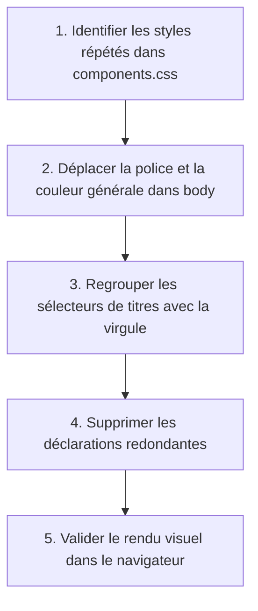

## 1. Contexte & Objectif

Dans les étapes précédentes, votre application affichait les articles extraits de la base de données. Cependant, votre feuille de style contient encore de nombreuses répétitions : la même police de caractères, la même couleur de texte et les mêmes marges sont réécrites pour plusieurs éléments distincts.

Dans ce tutoriel, vous allez apprendre à simplifier et organiser votre code CSS. Vous allez utiliser les **sélecteurs groupés** pour appliquer une règle commune à plusieurs balises en une seule fois. Vous allez également exploiter l'**héritage CSS** en déclarant vos styles typographiques sur le conteneur principal (`body`) pour que tous les éléments enfants en bénéficient automatiquement.

* **Objectif technique :** Factoriser la feuille de style en regroupant les sélecteurs avec la virgule (`,`), transmettre la typographie globale via `body`, et vérifier que la présentation du blog reste parfaitement intacte sans code dupliqué.
* **Prérequis :** Maîtriser les sélecteurs CSS élémentaires (`balise`, `.classe`, `#id`) et les propriétés de texte (`font-family`, `color`, `line-height`).



---

## 2. Théorie Pas-à-Pas

### 2.1. Les sélecteurs groupés avec la virgule

Lorsque plusieurs éléments HTML doivent partager exactement les mêmes propriétés visuelles, il est inutile d'écrire plusieurs blocs CSS séparés.  
En CSS, vous pouvez séparer plusieurs sélecteurs par une **virgule (`,`)**. Le navigateur applique alors les déclarations à tous les éléments listés.

```css
/* Sans groupement : Répétition inutile */
h1 {
    color: #111827;
    margin-top: 0;
}
h2 {
    color: #111827;
    margin-top: 0;
}

/* Avec sélecteur groupé : Code propre et factorisé */
h1, h2, h3 {
    color: #111827;
    margin-top: 0;
}
```

* Chaque sélecteur conserve son rôle, mais la règle n'est déclarée qu'une seule fois.
* Vous pouvez combiner des balises et des classes : `h2, .titre-section, .titre-carte`.

### 2.2. Le mécanisme d'héritage en CSS

En HTML, les éléments sont imbriqués les uns dans les autres selon une relation parent-enfant. L'**héritage** est le mécanisme par lequel certaines propriétés appliquées à un élément parent sont transmises automatiquement à tous ses enfants.

* **Propriétés héritées naturellement :** Toutes les propriétés liées au texte et à la typographie (`font-family`, `color`, `line-height`, `font-size`, `text-align`).
* **Propriétés NON héritées :** Les propriétés du modèle de boîte (`margin`, `padding`, `border`, `background-color`, `width`, `height`).

```css
/* Définir une seule fois les propriétés de texte sur le parent global */
body {
    font-family: Arial, Helvetica, sans-serif;
    color: #1f2937;
    line-height: 1.5;
}

/* Tous les paragraphes <p> et listes <li> héritent automatiquement de cette police et couleur */
```

### 2.3. L'ordre des règles et la cascade

Le terme **Cascading** dans CSS signifie que les règles se combinent ou s'écrasent selon un ordre précis.  
Lorsque deux règles ciblent le même élément avec le même niveau de priorité (spécificité égale), **la dernière règle écrite dans le fichier l'emporte toujours**.

```css
p {
    color: #1f2937; /* Règle générale */
}

.texte-important {
    color: #dc2626; /* Cette règle plus spécifique ou placée après écrase la couleur générale */
}
```

* Organisez toujours vos règles de la plus générale (`body`, balises de base) vers la plus spécifique (classes de composants).

---

## 3. Pratique & Réalisation Guidée

### Étape 1 — Analyser la feuille de style du projet

1. Ouvrez votre éditeur de code et explorez le fichier de style de votre blog :
   ```text
   css/components.css
   ```
2. Observez que la propriété `font-family` ou la couleur `#1f2937` est répétée sur plusieurs classes : `.carte-article`, `.article-contenu`, `p`.
3. Repérez également les titres `.titre-section` et `.titre-carte` qui utilisent la même couleur sombre `#111827` et `margin-top: 0`.

### Étape 2 — Appliquer la typographie générale sur l'élément body

1. Ouvrez le fichier de style de base `css/style.css` (ou `css/components.css`).
2. Ajoutez ou modifiez la règle du sélecteur parent `body` :

```css
/* Typographie et couleurs globales transmises par héritage */
body {
    font-family: Arial, Helvetica, sans-serif;
    color: #1f2937;
    line-height: 1.6;
    margin: 0;
    background-color: #f9fafb;
}
```

3. Supprimez les déclarations `font-family` présentes dans vos paragraphes et vos cartes : ils en héritent désormais naturellement.

### Étape 3 — Regrouper les sélecteurs de titres

1. Dans `css/components.css`, regroupez les sélecteurs de titres avec la virgule :

```css
/* Styles communs pour les titres du blog */
h1, h2, h3, .titre-section, .titre-carte {
    color: #111827;
    margin-top: 0;
    font-weight: 700;
}
```

2. Conservez uniquement les propriétés spécifiques (comme la taille de police `font-size`) dans chaque règle individuelle :

```css
.titre-section {
    font-size: 1.5rem;
    margin-bottom: 1rem;
}

.titre-carte {
    font-size: 1.25rem;
    margin-bottom: 0.5rem;
}
```

### Étape 4 — Tester l'affichage dans le navigateur

1. Lancez votre serveur PHP local si ce n'est pas déjà fait :
   ```bash
   php -S localhost:8000
   ```
2. Ouvrez votre navigateur sur `http://localhost:8000/index.php`.
3. Vérifiez que la typographie de tous les textes et titres reste harmonieuse et parfaitement lisible.

---

## 4. Livrable & Critères de Réussite

### 4.1. Emplacement dans votre dépôt d'autoformation

Dans votre dépôt GitHub annuel d'autoformations, créez l'arborescence suivante :

```text
css/harmoniser-presentation-interface/mutualiser-regles-selecteurs-groupes-heritage/
```

### 4.2. Contenu attendu du livrable

Déposez dans ce dossier votre fichier **`components.css`** (ou `style.css`) factorisé :

```css
/* Livrable : Feuille CSS factorisée avec héritage et sélecteurs groupés */

/* 1. Règle parent globale : Transmission par héritage */
body {
    font-family: Arial, Helvetica, sans-serif;
    color: #1f2937;
    line-height: 1.6;
    margin: 0;
    background-color: #f9fafb;
}

/* 2. Sélecteurs groupés : Mutualisation des règles de titres */
h1, h2, h3, .titre-section, .titre-carte {
    color: #111827;
    margin-top: 0;
    font-weight: 700;
}

/* 3. Règles spécifiques ciblées */
.titre-section {
    font-size: 1.5rem;
    margin-bottom: 1rem;
}

.titre-carte {
    font-size: 1.25rem;
    margin-bottom: 0.5rem;
}
```

### 4.3. Critères de réussite

* [ ] Le fichier commence sans BOM et respecte la syntaxe CSS standard.
* [ ] La règle `body` déclare la police globale (`font-family`) et la couleur principale de texte (`color`).
* [ ] Les sélecteurs de titres sont groupés avec une virgule (`,`).
* [ ] Aucune déclaration typographique redondante n'est présente dans les classes enfants.
* [ ] Le rendu visuel de la page dans le navigateur reste rigoureusement identique sans régression.

---

## 5. Glossaire

* **Sélecteur groupé** : Liste de plusieurs sélecteurs CSS séparés par une virgule pour appliquer un même bloc de déclarations à plusieurs éléments.
* **Héritage CSS** : Mécanisme qui transmet automatiquement certaines propriétés de style d'un élément parent (comme `body`) à ses éléments enfants.
* **Propriété héritée** : Propriété de style (ex. `color`, `font-family`) appliquée automatiquement aux descendants d'un élément.
* **Cascade CSS** : Ensemble de règles déterminant quelle propriété s'applique lorsqu'un élément est ciblé par plusieurs déclarations concurrentes.
* **Spécificité** : Score de priorité attribué à un sélecteur CSS déterminant quelle règle l'emporte en cas de conflit.
