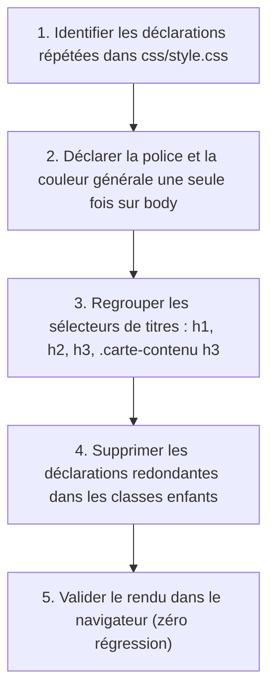

## 1. Contexte & Objectif

Dans les sessions précédentes, vous avez construit l'affichage de votre blog avec une feuille de style unique `css/style.css`. Cependant, au fil des ajouts, ce fichier s'est alourdi de nombreuses règles redondantes : la même police de caractères, la même couleur de texte sombre (`#111827`) et des marges identiques sont répétées sur plusieurs sélecteurs de titres et de paragraphes.

Dans ce premier tutoriel d'harmonisation CSS, vous allez simplifier et assainir votre feuille de style. Vous allez utiliser les **sélecteurs groupés** (séparés par une virgule `,`) pour appliquer une règle commune à plusieurs éléments en une seule déclaration. Vous allez également exploiter l'**héritage CSS** en confiant la typographie générale au conteneur principal (`body`) pour que tous les blocs enfants en bénéficient automatiquement.

* **Objectif technique :** Factoriser `css/style.css` en regroupant les sélecteurs de titres avec la virgule, transmettre la police et la couleur par héritage sur `body`, et vérifier dans le navigateur que le rendu visuel reste rigoureusement intact sans code dupliqué.
* **Prérequis :** Savoir cibler les balises HTML (`h1`, `h2`, `h3`, `body`) et manipuler les classes CSS de base du blog (`.carte-contenu`).



---

## 2. Théorie Pas-à-Pas

### 2.1. Les sélecteurs groupés avec la virgule

Lorsque plusieurs éléments HTML doivent partager les mêmes caractéristiques visuelles, il est inutile d'écrire des blocs CSS séparés.  
En CSS, vous pouvez séparer plusieurs sélecteurs par une **virgule (`,`)**. Le navigateur applique le même bloc de déclarations à chacun d'entre eux.

```css
/* Sans groupement : Répétition inutile de code */
h1 {
    color: #111827;
    margin-top: 0;
}
h2 {
    color: #111827;
    margin-top: 0;
}
.carte-contenu h3 {
    color: #111827;
    margin-top: 0;
}

/* Avec sélecteur groupé : Code propre et factorisé */
h1, h2, h3, .carte-contenu h3 {
    color: #111827;
    margin-top: 0;
}
```

* Chaque élément conserve son identité propre, mais la règle commune n'est écrite qu'une seule fois.
* Vous pouvez mixer balises standard et sélecteurs de classes.

### 2.2. Le mécanisme d'héritage en CSS

En HTML, les balises sont organisées en arborescence parent-enfant. L'**héritage** est le mécanisme par lequel les propriétés appliquées à un élément parent sont transmises naturellement à ses descendants.

* **Propriétés héritées :** Les styles typographiques et textuels (`font-family`, `color`, `line-height`, `font-size`, `text-align`).
* **Propriétés non héritées :** Les propriétés du modèle de boîte (`margin`, `padding`, `border`, `background-color`, `width`, `height`).

```css
/* Définir une seule fois les styles de texte sur body */
body {
    font-family: Arial, Helvetica, sans-serif;
    color: #1f2937;
    line-height: 1.6;
}

/* Tous les paragraphes <p> et éléments du blog héritent de cette police et couleur */
```

### 2.3. L'ordre des règles et la cascade

Le terme **Cascade** signifie que les règles s'appliquent selon un ordre précis.  
Lorsque deux règles ciblent le même élément avec un même niveau de priorité (spécificité égale), **la dernière règle écrite dans la feuille de style l'emporte toujours**.

```css
body {
    color: #1f2937; /* Couleur générale héritée par défaut */
}

h1, h2, h3 {
    color: #111827; /* Cette règle plus précise écrase la couleur pour les titres */
}
```

* Placez toujours les règles globales en tête de fichier, puis les règles spécifiques en dessous.

---

## 3. Pratique & Réalisation Guidée

### Étape 1 — Analyser la feuille de style du blog

1. Ouvrez votre éditeur de code et examinez la feuille de style de votre projet :
   ```text
   css/style.css
   ```
2. Observez la règle `body` au début du fichier : elle déclare déjà la police globale `font-family: Arial, Helvetica, sans-serif;` et la couleur principale de texte `color: #1f2937;`.
3. Repérez les différentes déclarations de titres dans le fichier :
   - Les titres de section `h1` et `h2`.
   - Le titre des cartes d'articles `.carte-contenu h3`.
   - Ils utilisent tous la même couleur foncée `#111827` et une marge supérieure nulle (`margin-top: 0`).

### Étape 2 — Regrouper les sélecteurs de titres

1. Dans `css/style.css`, sous la règle `body`, insérez une règle groupée mutualisant les caractéristiques communes des titres :

```css
/* Mutualisation des styles communs pour l'ensemble des titres du blog */
h1, h2, h3, .carte-contenu h3 {
    color: #111827;
    margin-top: 0;
    font-weight: 700;
}
```

2. Dans la règle `.carte-contenu h3`, conservez uniquement ses propriétés spécifiques (taille et marge inférieure) :

```css
.carte-contenu h3 {
    font-size: 1.2rem;
    margin-bottom: 8px;
}
```

### Étape 3 — Nettoyer les déclarations de police redondantes

1. Parcourez `css/style.css`.
2. Si la propriété `font-family: Arial, ...` est répétée dans les paragraphes ou les blocs de contenu, supprimez-la : ces éléments héritent directement de la règle `body`.
3. Enregistrez le fichier `css/style.css`.

### Étape 4 — Tester le rendu visuel dans le navigateur

1. Lancez votre serveur PHP local si ce n'est pas déjà fait :
   ```bash
   php -S localhost:8000
   ```
2. Ouvrez votre navigateur sur `http://localhost:8000/index.php`.
3. Vérifiez que la page d'accueil conserve rigoureusement son aspect visuel : les titres sont toujours nets et sombres, et les textes restent parfaitement lisibles sans duplication de code.

---

## 4. Livrable & Critères de Réussite

### 4.1. Emplacement dans votre dépôt d'autoformation

Dans votre dépôt GitHub annuel d'autoformations, créez l'arborescence suivante :

```text
css/harmoniser-presentation-interface/mutualiser-regles-selecteurs-groupes-heritage/
```

### 4.2. Contenu attendu du livrable

Déposez dans ce dossier votre fichier **`style.css`** factorisé :

```css
/* Livrable : Feuille CSS factorisée avec héritage et sélecteurs groupés */

/* 1. Base globale transmise par héritage */
body {
    margin: 0;
    color: #1f2937;
    background-color: #f9fafb;
    font-family: Arial, Helvetica, sans-serif;
    line-height: 1.6;
}

/* 2. Règle groupée pour l'ensemble des titres du blog */
h1, h2, h3, .carte-contenu h3 {
    color: #111827;
    margin-top: 0;
    font-weight: 700;
}

/* 3. Règles spécifiques conservant uniquement leurs propriétés propres */
.carte-contenu h3 {
    font-size: 1.2rem;
    margin-bottom: 8px;
}
```

### 4.3. Critères de réussite

* [ ] Le fichier commence sans BOM et respecte la syntaxe CSS standard.
* [ ] La règle `body` transmet la typographie par héritage à l'ensemble du document.
* [ ] Les sélecteurs de titres du blog (`h1, h2, h3, .carte-contenu h3`) sont regroupés avec une virgule.
* [ ] Aucune déclaration redondante de `font-family` ou de `color: #111827` ne subsiste inutilement.
* [ ] La page du blog s'affiche dans le navigateur sans aucune dégradation visuelle.

---

## 5. Glossaire

* **Sélecteur groupé** : Liste de plusieurs sélecteurs CSS séparés par une virgule pour appliquer un même bloc de déclarations à plusieurs éléments.
* **Héritage CSS** : Mécanisme qui transmet automatiquement certaines propriétés de style d'un élément parent (comme `body`) à ses éléments descendants.
* **Propriété héritée** : Propriété de style (ex. `color`, `font-family`) appliquée automatiquement aux enfants d'un élément HTML.
* **Cascade CSS** : Ensemble de règles déterminant quelle déclaration s'applique lorsqu'un élément est ciblé par plusieurs règles concurrentes.
* **Spécificité** : Score de priorité attribué à un sélecteur CSS déterminant quelle règle l'emporte en cas de conflit.
