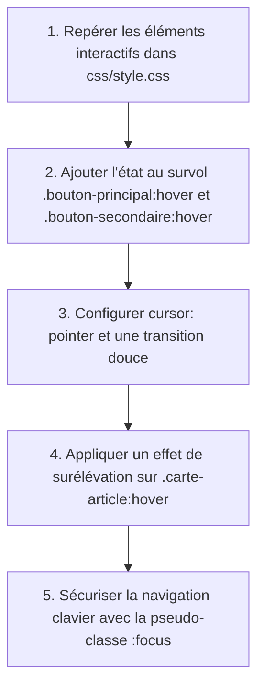

## 1. Contexte & Objectif

Dans le tutoriel précédent, vous avez factorisé votre feuille de style `css/style.css`. Votre code est plus clair et structuré, mais vos composants d'interface (boutons d'action, cartes d'articles, filtres) restent complètement immobiles et inertes lors du passage de la souris.

Sur le Web moderne, un élément cliquable doit fournir un **retour visuel immédiat** pour confirmer à l'utilisateur qu'il peut interagir avec lui. Dans ce tutoriel, vous allez utiliser la pseudo-classe CSS **`:hover`** pour animer les boutons et les cartes au survol (changement de couleur, curseur en forme de main, légère élévation avec ombre), et la pseudo-classe **`:focus`** pour garantir une navigation accessible au clavier.

* **Objectif technique :** Déclarer des états interactifs avec les pseudo-classes `:hover` et `:focus` sur `.bouton-principal`, `.bouton-secondaire` et `.carte-article` dans `css/style.css`, en appliquant `cursor: pointer` et des transitions fluides.
* **Prérequis :** Savoir cibler les classes CSS de composants et manipuler les propriétés de fond, de bordure et de transformation.



---

## 2. Théorie Pas-à-Pas

### 2.1. La pseudo-classe :hover et la détection d'état

Une **pseudo-classe** en CSS permet de cibler un élément HTML selon son **état** dans le navigateur.  
La pseudo-classe **`:hover`** s'active automatiquement dès que le pointeur de la souris survole la zone d'un élément.

```css
/* État initial du bouton */
.bouton-principal {
    background-color: #2673e8;
    color: #ffffff;
}

/* État interactif au passage de la souris */
.bouton-principal:hover {
    background-color: #1c5bba; /* Nuance plus sombre confirmant l'action possible */
}
```

* La syntaxe s'attache directement au sélecteur sans aucun espace : `.bouton-principal:hover`.

### 2.2. Le curseur pointer et la micro-élévation

Pour que l'interaction soit valorisante pour l'utilisateur, on combine deux techniques :

1. **`cursor: pointer;`** : Transforme le curseur flèche standard en curseur main.
2. **`transition` & `transform`** : Anime progressivement le changement d'état et surélève légèrement l'élément :

```css
.carte-article {
    border: 1px solid #e5e7eb;
    transition: transform 0.2s ease, box-shadow 0.2s ease;
}

.carte-article:hover {
    transform: translateY(-4px);
    box-shadow: 0 8px 20px rgba(0, 0, 0, 0.08);
}
```

### 2.3. L'accessibilité avec la pseudo-classe :focus

Certains internautes naviguent sans souris en utilisant la touche `Tab` du clavier.  
La pseudo-classe **`:focus`** s'active lorsqu'un élément interactif (lien ou bouton) est sélectionné.

```css
/* Contour visible lors de la sélection au clavier */
.bouton-principal:focus,
.bouton-secondaire:focus {
    outline: 2px solid #2673e8;
    outline-offset: 2px;
}
```

---

## 3. Pratique & Réalisation Guidée

### Étape 1 — Dynamiser les boutons d'action du blog

1. Ouvrez votre feuille de style :
   ```text
   css/style.css
   ```
2. Repérez la règle `.bouton-principal` et ajoutez `cursor: pointer;` ainsi qu'une transition :

```css
.bouton-principal {
    display: inline-block;
    padding: 10px 20px;
    background-color: #2673e8;
    color: #ffffff;
    border-radius: 8px;
    font-weight: 600;
    cursor: pointer;
    transition: background-color 0.2s ease, transform 0.2s ease;
}

.bouton-principal:hover {
    background-color: #1c5bba;
    transform: translateY(-1px);
}
```

3. Modifiez également `.bouton-secondaire` :

```css
.bouton-secondaire {
    display: inline-block;
    padding: 10px 20px;
    background-color: #ffffff;
    color: #1f2937;
    border: 1px solid #e5e7eb;
    border-radius: 8px;
    font-weight: 600;
    cursor: pointer;
    transition: border-color 0.2s ease, color 0.2s ease;
}

.bouton-secondaire:hover {
    border-color: #2673e8;
    color: #2673e8;
}
```

### Étape 2 — Ajouter l'effet d'élévation sur les cartes d'articles

1. Repérez la règle `.carte-article` dans `css/style.css`.
2. Déclarez la propriété `transition` :

```css
.carte-article {
    background-color: #ffffff;
    border: 1px solid #e5e7eb;
    border-radius: 12px;
    overflow: hidden;
    transition: transform 0.2s ease, box-shadow 0.2s ease;
}
```

3. Ajoutez immédiatement la règle au survol :

```css
.carte-article:hover {
    transform: translateY(-4px);
    box-shadow: 0 8px 20px rgba(0, 0, 0, 0.08);
}
```

### Étape 3 — Ajouter le style de sélection clavier :focus

1. En dessous de vos boutons, ajoutez la règle de focus :

```css
.bouton-principal:focus,
.bouton-secondaire:focus {
    outline: 2px solid #2673e8;
    outline-offset: 2px;
}
```

### Étape 4 — Tester l'interactivité dans le navigateur

1. Actualisez votre page `http://localhost:8000/index.php`.
2. Passez votre curseur sur les boutons *"Lire les articles"* et *"À propos de moi"* : observez le changement de couleur et le curseur main.
3. Survolez les cartes d'articles : chaque carte se soulève doucement avec une ombre portée.
4. Appuyez sur la touche `Tab` pour naviguer au clavier et constater la présence du contour bleu de focus.

---

## 4. Livrable & Critères de Réussite

### 4.1. Emplacement dans votre dépôt d'autoformation

Dans votre dépôt GitHub annuel d'autoformations, créez l'arborescence suivante :

```text
css/harmoniser-presentation-interface/dynamiser-interactions-pseudo-classe-hover/
```

### 4.2. Contenu attendu du livrable

Déposez dans ce dossier votre fichier **`style.css`** enrichi des règles d'interaction :

```css
/* Livrable : Composants interactifs avec :hover et :focus */

/* 1. Bouton principal interactif */
.bouton-principal {
    display: inline-block;
    padding: 10px 20px;
    background-color: #2673e8;
    color: #ffffff;
    border-radius: 8px;
    font-weight: 600;
    cursor: pointer;
    transition: background-color 0.2s ease, transform 0.2s ease;
}

.bouton-principal:hover {
    background-color: #1c5bba;
    transform: translateY(-1px);
}

.bouton-principal:focus {
    outline: 2px solid #2673e8;
    outline-offset: 2px;
}

/* 2. Bouton secondaire */
.bouton-secondaire {
    display: inline-block;
    padding: 10px 20px;
    background-color: #ffffff;
    color: #1f2937;
    border: 1px solid #e5e7eb;
    border-radius: 8px;
    font-weight: 600;
    cursor: pointer;
    transition: border-color 0.2s ease, color 0.2s ease;
}

.bouton-secondaire:hover {
    border-color: #2673e8;
    color: #2673e8;
}

/* 3. Carte avec élévation au survol */
.carte-article {
    background-color: #ffffff;
    border: 1px solid #e5e7eb;
    border-radius: 12px;
    overflow: hidden;
    transition: transform 0.2s ease, box-shadow 0.2s ease;
}

.carte-article:hover {
    transform: translateY(-4px);
    box-shadow: 0 8px 20px rgba(0, 0, 0, 0.08);
}
```

### 4.3. Critères de réussite

* [ ] La pseudo-classe `:hover` est attachée directement au sélecteur sans espace (`.bouton-principal:hover`).
* [ ] La propriété `cursor: pointer;` est déclarée sur les boutons cliquables.
* [ ] Le passage de la souris sur une carte d'article produit une élévation douce via `transition`, `transform` et `box-shadow`.
* [ ] La pseudo-classe `:focus` est présente pour l'accessibilité au clavier.
* [ ] Le fichier est encodé en UTF-8 sans BOM et ne produit aucune erreur CSS.

---

## 5. Glossaire

* **Pseudo-classe** : Mot-clé précédé d'un deux-points (`:`) qui cible un état particulier d'un élément HTML.
* **`:hover`** : Pseudo-classe activée lorsque le pointeur de la souris survole la zone d'un élément.
* **`:focus`** : Pseudo-classe activée lorsqu'un élément reçoit la sélection active du navigateur (clic ou touche Tab).
* **`cursor: pointer`** : Propriété CSS transformant le curseur en forme de main pour signaler un élément cliquable.
* **`box-shadow`** : Propriété permettant d'appliquer une ombre portée autour de la boîte d'un élément.
* **`transition`** : Propriété animant de manière progressive le changement d'une valeur CSS.
