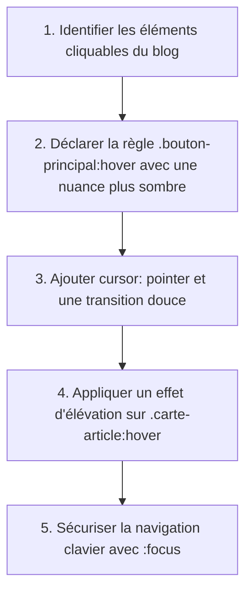

## 1. Contexte & Objectif

Dans le tutoriel précédent, vous avez factorisé votre feuille de style grâce aux sélecteurs groupés et à l'héritage. Votre code est propre, mais vos composants d'interface (boutons, cartes d'articles, badges de catégories) restent complètement inertes au passage de la souris.

Sur le Web moderne, un élément interactif doit fournir un **retour visuel immédiat** pour indiquer à l'utilisateur qu'il peut cliquer dessus. Dans ce tutoriel, vous allez utiliser la pseudo-classe CSS **`:hover`** pour modifier l'apparence des composants au survol (changement de couleur, légère ombre, curseur en forme de main), ainsi que **`:focus`** pour garantir une navigation accessible au clavier.

* **Objectif technique :** Déclarer des états interactifs avec les pseudo-classes `:hover` et `:focus` sur les boutons, liens et cartes du blog, tout en appliquant `cursor: pointer` et des transitions douces.
* **Prérequis :** Savoir cibler des classes CSS (`.bouton-principal`, `.carte-article`) et manipuler les propriétés de fond, de bordure et d'ombrage.



---

## 2. Théorie Pas-à-Pas

### 2.1. La pseudo-classe :hover et la détection d'état

Une **pseudo-classe** en CSS permet de cibler un élément HTML non pas selon sa balise ou sa classe, mais selon son **état** dans le navigateur (au survol, au clic, sélectionné par le clavier).  
La pseudo-classe **`:hover`** s'active automatiquement dès que le pointeur de la souris survole la zone visible de l'élément.

```css
/* État initial par défaut */
.bouton-principal {
    background-color: #2673e8;
    color: #ffffff;
}

/* État interactif au passage de la souris */
.bouton-principal:hover {
    background-color: #1c5bba; /* Nuance légèrement plus foncée pour indiquer le clic possible */
}
```

* La syntaxe s'attache directement au sélecteur sans espace : `.bouton:hover` (un espace comme `.bouton :hover` ciblerait un enfant de l'élément).

### 2.2. Le curseur et les micro-effets de survol

Pour que l'interaction soit naturelle et valorisante pour le visiteur, deux propriétés complètent généralement l'état `:hover` :

1. **`cursor: pointer;`** : Transforme le curseur flèche standard en curseur main, confirmant visuellement l'action de clic.
2. **`box-shadow` & `transform`** : Ajoute une légère ombre portée et un micro-déplacement vers le haut pour donner une sensation de profondeur (effet "carte surélevée").

```css
.carte-article {
    border: 1px solid #e5e7eb;
    transition: transform 0.2s ease, box-shadow 0.2s ease;
}

.carte-article:hover {
    transform: translateY(-2px);
    box-shadow: 0 4px 12px rgba(0, 0, 0, 0.08);
}
```

### 2.3. L'accessibilité avec la pseudo-classe :focus

Tous les internautes n'utilisent pas une souris : certains naviguent au clavier en utilisant la touche `Tab`.  
La pseudo-classe **`:focus`** s'active lorsqu'un élément interactif (lien `<a>`, bouton `<button>`, champ de formulaire `<input>`) reçoit la sélection active.

```css
/* Assurer le retour visuel au clavier identique ou renforcé */
.bouton-principal:focus {
    outline: 2px solid #2673e8;
    outline-offset: 2px;
}
```

* Ne supprimez jamais l'indication de focus sans fournir une alternative visuelle nette.

---

## 3. Pratique & Réalisation Guidée

### Étape 1 — Dynamiser le bouton d'action principal

1. Ouvrez votre fichier de composants :
   ```text
   css/components.css
   ```
2. Repérez la règle `.bouton-principal` et ajoutez-y la propriété `cursor: pointer;` ainsi qu'une transition fluide :

```css
.bouton-principal {
    display: inline-block;
    padding: 0.6rem 1.2rem;
    background-color: #2673e8;
    color: #ffffff;
    text-decoration: none;
    border-radius: 6px;
    font-weight: 600;
    cursor: pointer;
    transition: background-color 0.2s ease;
}
```

3. Ajoutez immédiatement en dessous la règle avec la pseudo-classe `:hover` :

```css
.bouton-principal:hover {
    background-color: #1c5bba;
}
```

### Étape 2 — Ajouter l'effet d'élévation sur les cartes d'articles

1. Repérez la classe `.carte-article` dans `css/components.css`.
2. Déclarez la propriété `transition` sur la carte :

```css
.carte-article {
    background-color: #ffffff;
    border: 1px solid #e5e7eb;
    border-radius: 8px;
    padding: 1.25rem;
    transition: transform 0.2s ease, box-shadow 0.2s ease;
}
```

3. Ajoutez la règle de survol pour surélever la carte :

```css
.carte-article:hover {
    transform: translateY(-3px);
    box-shadow: 0 6px 16px rgba(0, 0, 0, 0.1);
}
```

### Étape 3 — Styliser les badges de catégories et la sélection clavier

1. Ajoutez l'effet au survol sur les badges de catégories :

```css
.badge-categorie {
    display: inline-block;
    padding: 0.25rem 0.6rem;
    border-radius: 9999px;
    font-size: 0.85rem;
    font-weight: 500;
    text-decoration: none;
    transition: opacity 0.2s ease;
}

.badge-categorie:hover {
    opacity: 0.85;
}
```

2. Ajoutez la pseudo-classe `:focus` pour la navigation au clavier :

```css
.bouton-principal:focus,
.badge-categorie:focus {
    outline: 2px solid #2673e8;
    outline-offset: 2px;
}
```

### Étape 4 — Tester l'interactivité dans le navigateur

1. Actualisez votre page `http://localhost:8000/index.php`.
2. Déplacez votre souris au-dessus des boutons et des cartes d'articles : observez l'assombrissement du bouton et la surélévation douce de la carte.
3. Appuyez sur la touche `Tab` du clavier pour vérifier la mise en valeur des liens lors de la sélection.

---

## 4. Livrable & Critères de Réussite

### 4.1. Emplacement dans votre dépôt d'autoformation

Dans votre dépôt GitHub annuel d'autoformations, créez l'arborescence suivante :

```text
css/harmoniser-presentation-interface/dynamiser-interactions-pseudo-classe-hover/
```

### 4.2. Contenu attendu du livrable

Déposez dans ce dossier votre fichier **`components.css`** enrichi des états interactifs :

```css
/* Livrable : Composants interactifs avec :hover et :focus */

/* 1. Bouton d'action avec transition et état au survol */
.bouton-principal {
    display: inline-block;
    padding: 0.6rem 1.2rem;
    background-color: #2673e8;
    color: #ffffff;
    text-decoration: none;
    border-radius: 6px;
    font-weight: 600;
    cursor: pointer;
    transition: background-color 0.2s ease;
}

.bouton-principal:hover {
    background-color: #1c5bba;
}

.bouton-principal:focus {
    outline: 2px solid #2673e8;
    outline-offset: 2px;
}

/* 2. Carte d'article avec micro-élévation au survol */
.carte-article {
    background-color: #ffffff;
    border: 1px solid #e5e7eb;
    border-radius: 8px;
    padding: 1.25rem;
    transition: transform 0.2s ease, box-shadow 0.2s ease;
}

.carte-article:hover {
    transform: translateY(-3px);
    box-shadow: 0 6px 16px rgba(0, 0, 0, 0.1);
}

/* 3. Badge interactif */
.badge-categorie {
    display: inline-block;
    padding: 0.25rem 0.6rem;
    border-radius: 9999px;
    font-size: 0.85rem;
    font-weight: 500;
    text-decoration: none;
    transition: opacity 0.2s ease;
}

.badge-categorie:hover {
    opacity: 0.85;
}
```

### 4.3. Critères de réussite

* [ ] La pseudo-classe `:hover` est attachée directement au sélecteur sans espace intermédiaire.
* [ ] La propriété `cursor: pointer;` est présente sur les éléments cliquables.
* [ ] Le passage de la souris sur une carte d'article applique un ombrage doux sans décalage brusque.
* [ ] L'état `:focus` est défini pour garantir l'accessibilité au clavier.
* [ ] Aucune erreur de syntaxe CSS n'est présente dans le fichier.

---

## 5. Glossaire

* **Pseudo-classe** : Mot-clé précédé d'un deux-points (`:`) qui s'ajoute à un sélecteur pour cibler un état spécifique d'un élément (ex. `:hover`, `:focus`).
* **`:hover`** : Pseudo-classe activée lorsque le pointeur de la souris survole la zone d'un élément.
* **`:focus`** : Pseudo-classe activée lorsqu'un élément reçoit le focus actif (au clic ou lors de la tabulation clavier).
* **`cursor: pointer`** : Propriété CSS indiquant au navigateur d'afficher le curseur de la souris sous la forme d'une main pour désigner un élément cliquable.
* **`box-shadow`** : Propriété permettant d'appliquer une ou plusieurs ombres portées autour du cadre d'un élément.
* **`transition`** : Propriété permettant d'animer de manière progressive le passage d'une valeur CSS à une autre lors d'un changement d'état.
