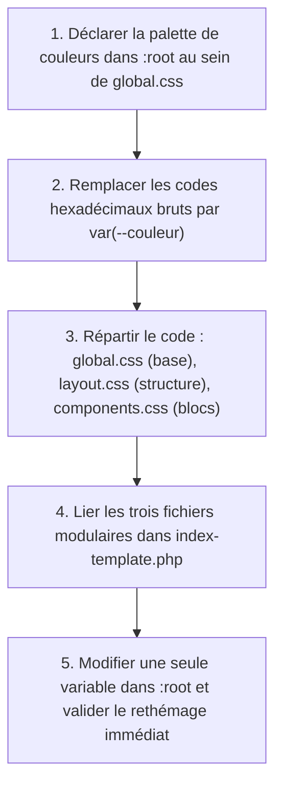

## 1. Contexte & Objectif

Dans les deux tutoriels précédents, vous avez factorisé votre feuille `style.css` et dynamisé vos boutons avec `:hover`. Cependant, votre application s'apprête à devenir un site multi-pages (Accueil, Détail de l'article, Filtrage par catégorie, Page À propos). Si les couleurs principales (`#2673e8`, `#111827`, `#1f2937`, `#e5e7eb`) restent codées en dur à travers des centaines de lignes, changer l'identité visuelle du blog nécessiterait de fastidieuses retouches manuelles.

Dans ce tutoriel, vous allez franchir le cap de la maturité CSS. Vous allez centraliser votre charte graphique grâce aux **variables CSS natives** (propriétés personnalisées) déclarées dans la pseudo-classe globale **`:root`**. Vous allez ensuite décomposer votre fichier monolithique `style.css` en une **architecture modulaire en 3 fichiers** (`global.css`, `layout.css`, `components.css`) partagés par l'ensemble des pages publiques du blog.

* **Objectif technique :** Déclarer la palette de couleurs dans `:root`, remplacer les codes hexadécimaux par la fonction `var()`, réorganiser les styles en 3 fichiers modulaires (`global.css`, `layout.css`, `components.css`), et tester le rethémage instantané du blog.
* **Prérequis :** Maîtriser les déclarations de règles CSS et l'inclusion de plusieurs feuilles de style avec la balise `<link rel="stylesheet">`.



---

## 2. Théorie Pas-à-Pas

### 2.1. Déclaration de variables dans la pseudo-classe :root

Une variable CSS (ou propriété personnalisée) permet de mémoriser une valeur réutilisable (couleur, police, espacement) sous un libellé clair.  
Pour que la variable soit accessible partout, on la déclare au sein de la pseudo-classe **`:root`**, qui représente la racine absolue de l'arbre HTML.

* Le nom d'une variable CSS commence impérativement par deux tirets : **`--`**.
* La déclaration se termine par un point-virgule comme toute règle CSS.

```css
:root {
    --couleur-primaire: #2673e8;
    --couleur-primaire-hover: #1c5bba;
    --couleur-titre: #111827;
    --couleur-texte: #1f2937;
    --couleur-secondaire: #6b7280;
    --couleur-fond: #f9fafb;
    --couleur-bordure: #e5e7eb;
}
```

### 2.2. Utilisation des variables avec la fonction var()

Pour injecter la valeur d'une variable dans une propriété, on appelle la fonction native **`var(--nom-de-la-variable)`**.

```css
body {
    background-color: var(--couleur-fond);
    color: var(--couleur-texte);
}

.bouton-principal {
    background-color: var(--couleur-primaire);
    color: #ffffff;
}

.bouton-principal:hover {
    background-color: var(--couleur-primaire-hover);
}
```

* **Puissance du rethémage :** Changer la couleur dominante de tout le site se fait désormais en une seconde en modifiant simplement la valeur de `--couleur-primaire` dans `:root`.

### 2.3. L'architecture CSS modulaire en 3 fichiers

Plutôt que d'accumuler des centaines de lignes dans un seul fichier confus, un projet Web professionnel sépare nettement les responsabilités :

1. **`global.css`** : Les variables de charte (`:root`), le reset de base et la typographie par héritage (`body`, `img`, `a`).
2. **`layout.css`** : La structure des pages, les conteneurs (`.container`), l'en-tête (`.en-tete-site`), la navigation (`.barre-navigation`), la bannière (`.banniere-accueil`), la grille d'articles et le pied de page (`.pied-de-page`).
3. **`components.css`** : Les blocs autonomes réutilisables (boutons `.bouton-principal`, cartes `.carte-article`, badges `.etiquette-categorie`, pilules de filtre).

Chaque page charge ces feuilles dans l'ordre logique :

```html
<link rel="stylesheet" href="css/global.css">
<link rel="stylesheet" href="css/layout.css">
<link rel="stylesheet" href="css/components.css">
```

---

## 3. Pratique & Réalisation Guidée

### Étape 1 — Créer css/global.css avec la charte graphique

1. Dans le dossier `css/` de votre projet de blog, créez un nouveau fichier nommé **`global.css`**.
2. Déclarez la pseudo-classe `:root` avec l'ensemble des variables de couleurs et la typographie de base :

```css
/* css/global.css : Variables de thème et typographie globale */
:root {
    --couleur-primaire: #2673e8;
    --couleur-primaire-hover: #1c5bba;
    --couleur-titre: #111827;
    --couleur-texte: #1f2937;
    --couleur-secondaire: #6b7280;
    --couleur-fond: #f9fafb;
    --couleur-bordure: #e5e7eb;
}

body {
    margin: 0;
    color: var(--couleur-texte);
    background-color: var(--couleur-fond);
    font-family: Arial, Helvetica, sans-serif;
    line-height: 1.6;
}

img {
    display: block;
    max-width: 100%;
}

a {
    color: inherit;
    text-decoration: none;
}
```

### Étape 2 — Structurer css/layout.css et css/components.css

1. Créez `css/layout.css` pour accueillir la structure globale (`.container`, `.en-tete-site`, `.banniere-accueil`, `.pied-de-page`).
2. Créez `css/components.css` pour accueillir les composants utilisant les variables :

```css
/* Extrait de css/components.css avec variables */
.bouton-principal {
    display: inline-block;
    padding: 10px 20px;
    background-color: var(--couleur-primaire);
    color: #ffffff;
    border-radius: 8px;
    font-weight: 600;
    cursor: pointer;
    transition: background-color 0.2s ease;
}

.bouton-principal:hover {
    background-color: var(--couleur-primaire-hover);
}

.carte-article {
    background-color: #ffffff;
    border: 1px solid var(--couleur-bordure);
    border-radius: 12px;
    overflow: hidden;
    transition: transform 0.2s ease, box-shadow 0.2s ease;
}

.carte-article:hover {
    transform: translateY(-4px);
    box-shadow: 0 8px 20px rgba(0, 0, 0, 0.08);
}
```

### Étape 3 — Lier les feuilles modulaires dans index-template.php

1. Ouvrez `index-template.php`.
2. Remplacez l'ancien lien vers `style.css` par les trois balises modulaires :

```html
<head>
    <meta charset="UTF-8">
    <meta name="viewport" content="width=device-width, initial-scale=1.0">
    <title>Mon Blog Personnel - Accueil</title>
    <!-- Architecture CSS modulaire N1 -->
    <link rel="stylesheet" href="css/global.css">
    <link rel="stylesheet" href="css/layout.css">
    <link rel="stylesheet" href="css/components.css">
</head>
```

### Étape 4 — Tester le rethémage instantané du blog

1. Ouvrez votre navigateur sur `http://localhost:8000/index.php`.
2. Pour tester la puissance des variables CSS, modifiez temporairement `--couleur-primaire` dans `css/global.css` :
   ```css
   --couleur-primaire: #10b981; /* Vert émeraude */
   --couleur-primaire-hover: #059669;
   ```
3. Actualisez la page : tous les boutons et éléments primaires passent instantanément au vert.
4. Rétablissez la couleur bleue d'origine (`#2673e8`) et enregistrez le fichier.

---

## 4. Livrable & Critères de Réussite

### 4.1. Emplacement dans votre dépôt d'autoformation

Dans votre dépôt GitHub annuel d'autoformations, créez l'arborescence suivante :

```text
css/harmoniser-presentation-interface/centraliser-charte-graphique-variables-css/
```

### 4.2. Contenu attendu du livrable

Déposez dans ce dossier votre fichier **`global.css`** déclarant les variables du thème :

```css
/* Livrable : global.css avec variables de thème et typographie par héritage */

:root {
    --couleur-primaire: #2673e8;
    --couleur-primaire-hover: #1c5bba;
    --couleur-titre: #111827;
    --couleur-texte: #1f2937;
    --couleur-secondaire: #6b7280;
    --couleur-fond: #f9fafb;
    --couleur-bordure: #e5e7eb;
}

body {
    margin: 0;
    color: var(--couleur-texte);
    background-color: var(--couleur-fond);
    font-family: Arial, Helvetica, sans-serif;
    line-height: 1.6;
}

img {
    display: block;
    max-width: 100%;
}

a {
    color: inherit;
    text-decoration: none;
}
```

### 4.3. Critères de réussite

* [ ] Le fichier `global.css` déclare la pseudo-classe `:root` en début de document.
* [ ] Toutes les variables débutent par le préfixe obligatoire `--`.
* [ ] Les composants de `components.css` consomment les variables via la fonction `var()`.
* [ ] L'architecture CSS est découpée en 3 fichiers spécialisés (`global.css`, `layout.css`, `components.css`).
* [ ] La modification de `--couleur-primaire` répercute instantanément le changement de couleur sur l'ensemble de l'interface.

---

## 5. Glossaire

* **Pseudo-classe `:root`** : Pseudo-classe CSS ciblant la racine du document HTML, utilisée pour stocker les variables globales accessibles par toutes les règles.
* **Variable CSS (Propriété personnalisée)** : Valeur réutilisable déclarée avec deux tirets (`--`) pouvant être rappelée dans n'importe quelle feuille de style.
* **Fonction `var()`** : Fonction native CSS extrayant la valeur d'une variable pour l'appliquer à une propriété.
* **Architecture CSS modulaire** : Organisation des styles en plusieurs fichiers spécialisés (`global`, `layout`, `components`) pour améliorer la lisibilité et la maintenance.
* **Rethémage** : Changement rapide et centralisé de la charte graphique d'un site Web par modification de quelques variables maîtresses.
