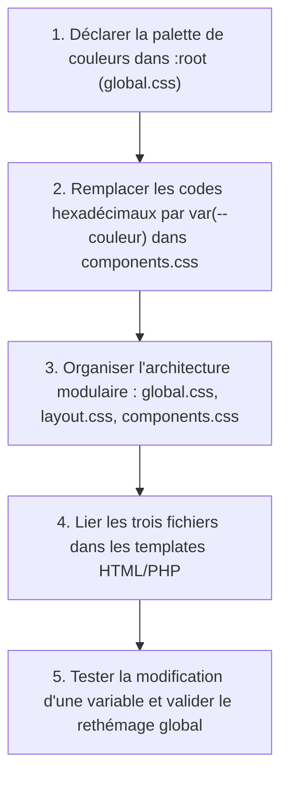

## 1. Contexte & Objectif

Dans les étapes précédentes, vous avez factorisé vos règles et dynamisé vos boutons avec `:hover`. Cependant, votre application s'apprête à devenir un site multi-pages (Accueil, Détail de l'article, Filtrage par catégorie, Page À propos). Si chaque page utilise des fichiers séparés ou si les couleurs primaires (`#2673e8`, `#1c5bba`, `#1f2937`) sont recopiées en dur dans chaque règle, changer la couleur principale du site obligerait à modifier des dizaines de lignes de code éparpillées.

Dans ce tutoriel, vous allez centraliser l'ensemble de votre charte graphique grâce aux **variables CSS natives** (propriétés personnalisées) déclarées dans la pseudo-classe globale **`:root`**. Vous allez également structurer vos styles selon une architecture modulaire propre en 3 fichiers (`global.css`, `layout.css`, `components.css`) partagés par toutes les pages publiques du blog.

* **Objectif technique :** Déclarer les variables de couleurs dans `:root`, les consommer via la fonction `var()`, réorganiser l'architecture CSS modulaire, et vérifier le rethémage instantané du blog en modifiant une seule ligne.
* **Prérequis :** Maîtriser les déclarations de propriétés CSS et l'inclusion de feuilles de style externes avec `<link rel="stylesheet">`.



---

## 2. Théorie Pas-à-Pas

### 2.1. Déclaration d'une variable CSS dans la pseudo-classe :root

Une variable CSS (ou propriété personnalisée) permet de stocker une valeur réutilisable (couleur, taille, marge) sous un nom explicite.  
Pour que la variable soit accessible partout dans l'application, on la déclare au sein de la pseudo-classe **`:root`**, qui représente la racine absolue du document HTML.

* Le nom d'une variable CSS commence obligatoirement par deux tirets : **`--`**.
* La déclaration se termine par un point-virgule comme toute propriété CSS standard.

```css
:root {
    --couleur-primaire: #2673e8;
    --couleur-primaire-hover: #1c5bba;
    --couleur-texte: #1f2937;
    --couleur-fond: #f9fafb;
    --couleur-carte: #ffffff;
    --couleur-bordure: #e5e7eb;
}
```

### 2.2. Consommation des variables avec la fonction var()

Pour utiliser la valeur stockée dans une variable, on fait appel à la fonction native **`var(--nom-de-la-variable)`**.

```css
body {
    background-color: var(--couleur-fond);
    color: var(--couleur-texte);
}

.bouton-principal {
    background-color: var(--couleur-primaire);
    color: #ffffff;
}

.bouton-principal:hover {
    background-color: var(--couleur-primaire-hover);
}
```

* **Avantage majeur :** Pour modifier la couleur dominante de tout le site, il suffit de changer la valeur de `--couleur-primaire` dans `:root`. Toutes les règles qui l'appellent sont mises à jour instantanément.

### 2.3. L'architecture CSS modulaire en 3 fichiers

Plutôt que d'empiler des centaines de lignes de style dans un fichier unique, un projet Web professionnel sépare les responsabilités :

1. **`global.css`** : Les variables de charte graphique (`:root`), le reset de base et la typographie générale (`body`).
2. **`layout.css`** : La structure des pages, les conteneurs (`.container`), l'en-tête (`header`), le pied de page (`footer`) et les grilles d'alignement.
3. **`components.css`** : Les blocs autonomes réutilisables (cartes d'articles, boutons, badges, messages d'alerte).

Chaque page charge ces fichiers dans l'ordre logique via l'en-tête HTML `<head>` :

```html
<link rel="stylesheet" href="css/global.css">
<link rel="stylesheet" href="css/layout.css">
<link rel="stylesheet" href="css/components.css">
```

---

## 3. Pratique & Réalisation Guidée

### Étape 1 — Créer le fichier global.css et définir :root

1. Dans le dossier `css/` de votre projet de blog, créez un nouveau fichier nommé **`global.css`**.
2. Déclarez la pseudo-classe `:root` avec les variables de votre charte graphique :

```css
/* css/global.css : Charte graphique globale et variables CSS */
:root {
    /* Palette de couleurs */
    --couleur-primaire: #2673e8;
    --couleur-primaire-hover: #1c5bba;
    --couleur-texte: #1f2937;
    --couleur-texte-secondaire: #6b7280;
    --couleur-fond: #f9fafb;
    --couleur-surface: #ffffff;
    --couleur-bordure: #e5e7eb;

    /* Typographie et espacements */
    --police-principale: Arial, Helvetica, sans-serif;
    --rayon-bordure: 8px;
}

/* Base typographique globale */
body {
    font-family: var(--police-principale);
    background-color: var(--couleur-fond);
    color: var(--couleur-texte);
    line-height: 1.6;
    margin: 0;
}
```

### Étape 2 — Adapter components.css avec les variables

1. Ouvrez `css/components.css`.
2. Remplacez les codes de couleurs codés en dur par leurs variables correspondantes :

```css
/* css/components.css adapté avec variables */
.carte-article {
    background-color: var(--couleur-surface);
    border: 1px solid var(--couleur-bordure);
    border-radius: var(--rayon-bordure);
    padding: 1.25rem;
    transition: transform 0.2s ease, box-shadow 0.2s ease;
}

.carte-article:hover {
    transform: translateY(-3px);
    box-shadow: 0 6px 16px rgba(0, 0, 0, 0.08);
}

.bouton-principal {
    display: inline-block;
    padding: 0.6rem 1.2rem;
    background-color: var(--couleur-primaire);
    color: #ffffff;
    text-decoration: none;
    border-radius: var(--rayon-bordure);
    font-weight: 600;
    cursor: pointer;
    transition: background-color 0.2s ease;
}

.bouton-principal:hover {
    background-color: var(--couleur-primaire-hover);
}
```

### Étape 3 — Lier les feuilles de style dans index-template.php

1. Ouvrez votre template d'accueil `index-template.php`.
2. Dans la balise `<head>`, vérifiez ou complétez le chargement des fichiers modulaires :

```html
<head>
    <meta charset="UTF-8">
    <meta name="viewport" content="width=device-width, initial-scale=1.0">
    <title>Mon Blog - Accueil</title>
    <link rel="stylesheet" href="css/global.css">
    <link rel="stylesheet" href="css/layout.css">
    <link rel="stylesheet" href="css/components.css">
</head>
```

### Étape 4 — Tester le rethémage instantané du blog

1. Ouvrez la page `http://localhost:8000/index.php` dans votre navigateur.
2. Pour tester la puissance des variables CSS, modifiez temporairement `--couleur-primaire` dans `css/global.css` :
   ```css
   --couleur-primaire: #10b981; /* Vert émeraude */
   --couleur-primaire-hover: #059669;
   ```
3. Actualisez la page dans le navigateur : tous les boutons et éléments primaires changent de couleur instantanément.
4. Rétablissez la couleur bleue d'origine (`#2673e8`) et enregistrez le fichier.

---

## 4. Livrable & Critères de Réussite

### 4.1. Emplacement dans votre dépôt d'autoformation

Dans votre dépôt GitHub annuel d'autoformations, créez l'arborescence suivante :

```text
css/harmoniser-presentation-interface/centraliser-charte-graphique-variables-css/
```

### 4.2. Contenu attendu du livrable

Déposez dans ce dossier votre fichier **`global.css`** déclarant la charte graphique :

```css
/* Livrable : Fichier global.css avec déclaration centralisée des variables CSS */

:root {
    /* Charte graphique principale */
    --couleur-primaire: #2673e8;
    --couleur-primaire-hover: #1c5bba;
    --couleur-texte: #1f2937;
    --couleur-texte-secondaire: #6b7280;
    --couleur-fond: #f9fafb;
    --couleur-surface: #ffffff;
    --couleur-bordure: #e5e7eb;

    /* Paramètres de mise en page */
    --police-principale: Arial, Helvetica, sans-serif;
    --rayon-bordure: 8px;
}

/* Réinitialisation et base typographique */
body {
    font-family: var(--police-principale);
    background-color: var(--couleur-fond);
    color: var(--couleur-texte);
    line-height: 1.6;
    margin: 0;
}
```

### 4.3. Critères de réussite

* [ ] Le fichier `global.css` contient la pseudo-classe `:root` en tête de document.
* [ ] Les noms de variables commencent tous par le préfixe double tiret `--`.
* [ ] Les variables de couleur couvrent au minimum le texte, le fond, la bordure et la couleur primaire.
* [ ] Les composants de `components.css` utilisent la fonction `var()` sans couleur brute codée en dur.
* [ ] La modification de `--couleur-primaire` dans `:root` répercute immédiatement le changement sur l'ensemble de l'interface.

---

## 5. Glossaire

* **Pseudo-classe `:root`** : Pseudo-classe CSS ciblant la racine du document (équivalent à `<html>` avec une spécificité plus élevée), idéale pour stocker des variables globales.
* **Variable CSS (Propriété personnalisée)** : Valeur réutilisable déclarée avec un nom débutant par `--` utilisable n'importe où dans la feuille de style.
* **Fonction `var()`** : Fonction native CSS permettant d'extraire et d'appliquer la valeur d'une propriété personnalisée.
* **Architecture CSS modulaire** : Pratique consistant à séparer les styles d'un projet en fichiers distincts spécialisés (`global`, `layout`, `components`) pour améliorer la maintenance.
* **Rethémage** : Capacité d'une interface à changer d'aspect visuel (couleurs, polices, mode sombre) en modifiant un nombre minimal de variables.
