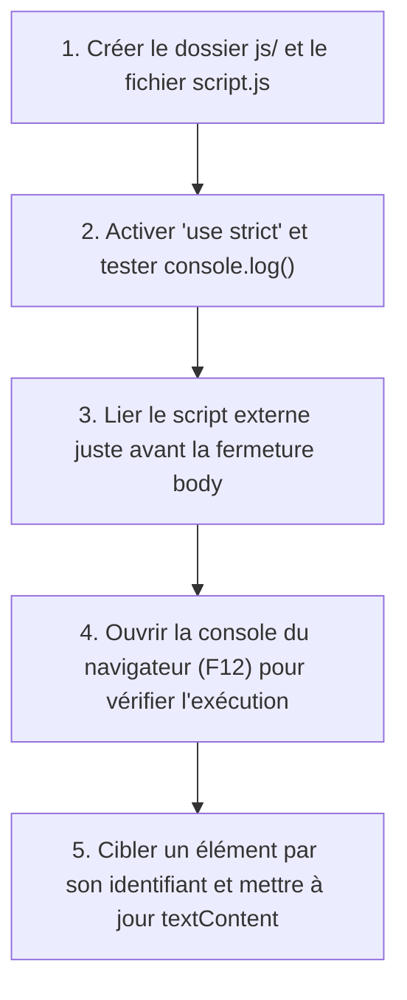

## 1. Contexte & Objectif

Jusqu'à présent, tout le code dynamique de votre blog s'exécutait exclusivement côté serveur avec PHP, produisant des pages HTML envoyées au navigateur. Une fois reçue par le client, la page reste statique, sans traitement local interactif.

Dans ce tutoriel, vous allez franchir une nouvelle étape en introduisant le langage **JavaScript** exécuté directement côté client, dans le navigateur de l'utilisateur. Vous allez créer votre premier script externe `js/script.js`, le lier à votre template HTML, activer le mode strict, afficher des messages de contrôle dans la console des outils de développement et modifier le texte d'un élément HTML en direct avec `document.getElementById()` et `textContent`.

* **Objectif technique :** Créer le fichier `js/script.js`, lier le script avec la balise `<script src="...">` avant la balise fermante `</body>`, ouvrir la console DevTools (F12) pour valider `console.log()`, et modifier dynamiquement un élément HTML par son identifiant.
* **Prérequis :** Connaître la structure d'une page HTML et l'attribut `id` sur un élément.



---

## 2. Théorie Pas-à-Pas

### 2.1. Le rôle de JavaScript côté client et la balise `<script>`

Alors que PHP s'exécute sur le serveur pour préparer le code HTML, **JavaScript** s'exécute directement sur l'ordinateur ou le smartphone de l'internaute au sein du navigateur Web.  
Pour charger un script externe, on utilise la balise **`<script src="chemin/vers/fichier.js"></script>`**.

* **Emplacement recommandé :** On place la balise `<script>` tout en bas du document HTML, immédiatement **avant la fermeture de la balise `</body>`**.  
* **Pourquoi ?** Cela garantit que tous les éléments HTML de la page sont déjà analysés et affichés par le navigateur avant que le script ne s'exécute, évitant ainsi de ralentir le chargement initial de la page.

```html
    <!-- Contenu visible de la page -->
    <main>...</main>

    <!-- Chargement du script JavaScript client en fin de document -->
    <script src="js/script.js"></script>
</body>
</html>
```

### 2.2. Le mode strict et la console du navigateur

Au sommet de tout fichier JavaScript moderne, on déclare la directive **`'use strict';`**.  
Ce mode strict empêche l'utilisation de mauvaises pratiques (comme l'utilisation de variables non déclarées) et déclenche des alertes immédiates en cas d'erreur.

Pour observer ce qui se passe pendant l'exécution d'un script sans perturber l'affichage de la page, on utilise l'objet **`console`** et sa méthode **`console.log()`** :

```javascript
'use strict';

const message = "Bienvenue sur le Blog - Script client actif.";
console.log(message);
```

* Dans le navigateur, appuyez sur la touche **F12** (ou `Clic droit → Inspecter`) puis cliquez sur l'onglet **Console** pour lire les messages émis par vos scripts.

### 2.3. Cibler un élément HTML et modifier son texte

JavaScript peut lire et modifier le contenu de n'importe quel élément de la page grâce au **DOM** (*Document Object Model*) :

1. **`document.getElementById('mon-id')`** : Trouve et sélectionne l'élément HTML portant l'attribut `id="mon-id"`.
2. **`.textContent`** : Permet de lire ou de remplacer le texte brut contenu à l'intérieur de cet élément.

```javascript
'use strict';

// 1. Sélectionner l'élément HTML par son identifiant unique
const elementStatut = document.getElementById('statut-chargement');

// 2. Vérifier que l'élément existe bien dans la page
if (elementStatut) {
    // 3. Modifier dynamiquement son texte
    elementStatut.textContent = "Application prête et interactive.";
    console.log("Statut mis à jour avec succès.");
}
```

---

## 3. Pratique & Réalisation Guidée

### Étape 1 — Créer le dossier et le fichier de script JavaScript

1. Dans le dossier racine de votre projet de blog, créez un nouveau répertoire nommé **`js/`**.
2. À l'intérieur de ce dossier, créez un fichier nommé **`script.js`**.
3. Saisissez les lignes suivantes pour activer le mode strict et émettre un message de bienvenue :

```javascript
'use strict';

// js/script.js : Script d'interaction client pour le Blog
console.log("Initialisation du script client du Blog Solicode...");

// Récupérer l'élément de statut dans le pied de page
const zoneStatut = document.getElementById('statut-client');

if (zoneStatut) {
    zoneStatut.textContent = "Blog connecté et interactif (JS actif)";
    console.log("Zone de statut mise à jour avec succès dans le DOM.");
}
```

### Étape 2 — Préparer l'élément récepteur dans index-template.php

1. Ouvrez votre fichier de template `index-template.php`.
2. Repérez la section du pied de page `<footer>`.
3. Ajoutez une petite balise `<p>` munie de l'identifiant `statut-client` pour accueillir le message dynamique :

```html
<footer class="pied-page">
    <div class="container">
        <p>&copy; 2026 - Mon Blog Personnel</p>
        <p id="statut-client" class="texte-discret">Chargement du script...</p>
    </div>
</footer>
```

### Étape 3 — Lier le fichier script.js dans le template

1. Dans `index-template.php`, faites défiler jusqu'à la fin du document.
2. Insérez la balise `<script>` juste avant `</body>` :

```html
    <!-- Script d'interaction client -->
    <script src="js/script.js"></script>
</body>
</html>
```

3. Enregistrez les modifications du template.

### Étape 4 — Tester l'exécution dans la console du navigateur

1. Démarrez votre serveur PHP local (`php -S localhost:8000`) si nécessaire.
2. Ouvrez votre navigateur sur `http://localhost:8000/index.php`.
3. Appuyez sur la touche **F12** de votre clavier pour ouvrir les Outils de développement (*DevTools*).
4. Cliquez sur l'onglet **Console** :
   - Vérifiez la présence du message :  
     `Initialisation du script client du Blog Solicode...`
   - Vérifiez la présence du message de confirmation :  
     `Zone de statut mise à jour avec succès dans le DOM.`
5. Observez le pied de page dans la page Web : le texte initial *"Chargement du script..."* a été instantanément remplacé par *"Blog connecté et interactif (JS actif)"*.

---

## 4. Livrable & Critères de Réussite

### 4.1. Emplacement dans votre dépôt d'autoformation

Dans votre dépôt GitHub annuel d'autoformations, créez l'arborescence suivante :

```text
javascript/ecrire-script-javascript-simple/ecrire-executer-script-javascript-client/
```

### 4.2. Contenu attendu du livrable

Déposez dans ce dossier votre fichier **`script.js`** opérationnel :

```javascript
'use strict';

// Livrable : Premier script client JavaScript
console.log("Initialisation du script client du Blog Solicode...");

// Sélection de l'élément HTML par son identifiant unique
const zoneStatut = document.getElementById('statut-client');

if (zoneStatut) {
    zoneStatut.textContent = "Blog connecté et interactif (JS actif)";
    console.log("Zone de statut mise à jour avec succès dans le DOM.");
}
```

### 4.3. Critères de réussite

* [ ] Le fichier commence obligatoirement par la directive `'use strict';`.
* [ ] Le script est chargé via la balise `<script src="js/script.js"></script>` placée immédiatement avant `</body>`.
* [ ] La console du navigateur (F12) affiche les messages émis par `console.log()` sans aucune erreur rouge.
* [ ] L'élément HTML portant l'attribut `id="statut-client"` voit son texte modifié dynamiquement lors du chargement de la page.
* [ ] La sélection est sécurisée par une condition (`if (zoneStatut)`) pour éviter toute erreur si l'élément n'est pas présent.

---

## 5. Glossaire

* **JavaScript client** : Langage de script interprété directement par le navigateur de l'utilisateur pour animer une page et réagir aux actions.
* **Balise `<script>`** : Balise HTML permettant d'insérer ou de lier un fichier de code JavaScript externe via son attribut `src`.
* **Mode strict (`'use strict'`)** : Directive imposant des règles de programmation plus rigoureuses et bloquant les comportements dangereux en JavaScript.
* **Console DevTools** : Outil intégré aux navigateurs Web permettant aux développeurs de lire les messages de débogage et de diagnostiquer les erreurs de code.
* **`console.log()`** : Méthode JavaScript standard permettant d'écrire un message ou d'afficher la valeur d'une variable dans la console du navigateur.
* **`document.getElementById()`** : Méthode permettant de retrouver un élément HTML dans le document à partir de sa valeur d'attribut `id`.
* **`textContent`** : Propriété représentant le contenu textuel brut d'un élément HTML sans interpréter de balises.
