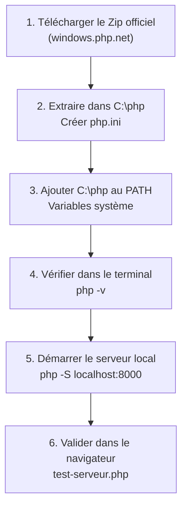

## 1. Contexte & Objectif

Dans cette session, vous commencez la programmation côté serveur avec PHP.  
Pour exécuter vos scripts, vous allez installer **le binaire officiel de PHP** directement sur votre ordinateur (sans suite lourde comme XAMPP) et configurer votre système pour pouvoir lancer PHP depuis n'importe quel terminal.

* **Objectif technique :** Télécharger et extraire le binaire officiel de PHP dans `C:\php`, configurer la variable d'environnement `PATH`, démarrer le serveur Web intégré et valider un premier script dans votre navigateur.
* **Prérequis :** Savoir ouvrir l'explorateur de fichiers de Windows et manipuler un terminal.



---

## 2. Théorie Pas-à-Pas

### 2.1. Qu'est-ce que PHP et comment fonctionne-t-il ?

**PHP** (*Hypertext Preprocessor*) est un langage de programmation informatique exécuté **côté serveur**, spécialement conçu pour créer des pages et applications Web dynamiques.

Pour comprendre le rôle de PHP, il faut distinguer deux environnements :
- **Côté client (HTML, CSS, JavaScript) :** Le code est envoyé directement au navigateur Web (Chrome, Firefox, Edge). Le navigateur lit et affiche le résultat sur l'écran de l'utilisateur.
- **Côté serveur (PHP) :** Le code PHP ne s'exécute jamais dans le navigateur. Il s'exécute sur le serveur grâce à un programme spécial appelé **l'interpréteur PHP**.

Le cycle d'exécution d'une page PHP fonctionne en 3 étapes simples :
1. Le navigateur demande une page Web (exemple : `http://localhost:8000/index.php`).
2. Le serveur lance l'interpréteur PHP pour lire et exécuter les instructions du fichier.
3. Le serveur renvoie au navigateur uniquement le résultat produit (du texte ou du code HTML). L'utilisateur ne voit jamais le code PHP source.

> **Glossaire :**
> * **PHP :** Langage de programmation open source exécuté côté serveur pour le Web.
> * **Interpréteur :** Programme qui lit et exécute les instructions du code source.
> * **Côté serveur :** Traitement réalisé sur la machine hébergeant le site avant l'envoi de la page au client.

### 2.2. Qu'est-ce que le binaire officiel de PHP ?

Un **binaire officiel** est la version compilée d'origine fournie directement par les développeurs de PHP.  
Contrairement à des logiciels tiers comme XAMPP ou WampServer qui installent de multiples programmes superflus (serveur Apache lourd, base de données MySQL non utilisée pour le moment), le binaire officiel :
- Est ultra-léger (quelques mégaoctets).
- Ne nécessite aucune installation cachée dans le registre Windows.
- Vous donne le contrôle direct sur l'interpréteur en ligne de commande.

### 2.3. Le rôle de la variable d'environnement `PATH`

Sous Windows, lorsque vous tapez `php` dans le terminal, le système parcourt la liste des dossiers déclarés dans sa variable système **`PATH`** pour trouver le programme `php.exe`.  
En ajoutant le dossier `C:\php` à votre `PATH`, la commande `php` devient accessible immédiatement depuis n'importe quel terminal et n'importe quel dossier de travail.

### 2.4. Le serveur Web intégré de PHP (`php -S`)

PHP dispose nativement d'un serveur Web de développement local.  
Une commande unique permet de transformer n'importe quel dossier en serveur local accessible depuis votre navigateur :

```bash
php -S localhost:8000
```

* `localhost` : Votre propre machine (adresse IP `127.0.0.1`).
* `8000` : Le port de communication local.

---

## 3. Pratique & Réalisation Guidée

### Étape 1 — Télécharger le binaire officiel pour Windows

1. Rendez-vous sur le site officiel de distribution de PHP pour Windows :  
   [windows.php.net/download](https://windows.php.net/download/)
2. Repérez la dernière version stable de **PHP 8.x** (par exemple PHP 8.2 ou PHP 8.3).
3. Dans la colonne **VS16 x64 Thread Safe**, cliquez sur le lien **Zip** pour télécharger l'archive.

### Étape 2 — Extraire PHP dans `C:\php`

1. Ouvrez l'explorateur de fichiers de Windows et rendez-vous à la racine de votre disque principal `C:\`.
2. Créez un nouveau dossier nommé exactement `php` (chemin : `C:\php`).
3. Ouvrez le fichier Zip téléchargé, sélectionnez tous les fichiers qu'il contient et décompressez-les directement dans `C:\php`.
4. Dans `C:\php`, repérez le fichier `php.ini-development`, faites-en une copie et renommez cette copie en `php.ini`.

```text
C:\
└── php\
    ├── php.exe
    ├── php.ini
    └── ...
```

### Étape 3 — Ajouter `C:\php` à la variable `PATH` de Windows

1. Appuyez sur la touche **Windows** de votre clavier, tapez `variables d'environnement` et sélectionnez **Modifier les variables d'environnement système**.
2. Dans la fenêtre qui s'ouvre, cliquez sur le bouton **Variables d'environnement...** situé en bas à droite.
3. Dans la partie inférieure intitulée **Variables système**, sélectionnez la ligne **Path** et cliquez sur le bouton **Modifier...**.
4. Dans la nouvelle fenêtre, cliquez sur **Nouveau** et tapez le chemin du dossier :
   ```text
   C:\php
   ```
5. Cliquez sur **OK**, puis à nouveau sur **OK** pour enregistrer et fermer toutes les fenêtres.

### Étape 4 — Vérifier l'installation dans le terminal

1. Fermez tous les terminaux actuellement ouverts.
2. Ouvrez un **nouveau terminal** (PowerShell ou Invite de commandes).
3. Exécutez la commande suivante :

```bash
php -v
```

4. **Résultat attendu :**  
   Le terminal affiche les informations de version officielle :
   ```text
   PHP 8.3.x (cli) (built: ...) ( NTS / TS )
   Copyright (c) The PHP Group
   Zend Engine v4.x, Copyright (c) Zend Technologies
   ```

### Étape 5 — Créer le script de validation locale

1. Créez un dossier nommé `exercice-php` sur votre ordinateur et ouvrez-le dans VS Code.
2. Créez un nouveau fichier nommé `test-serveur.php`.
3. Écrivez le code PHP suivant :

```php
<?php
echo "Environnement local PHP opérationnel";
```

4. Enregistrez le fichier (`Ctrl + S`).

### Étape 6 — Démarrer le serveur local et tester dans le navigateur

1. Dans le terminal intégré de VS Code, assurez-vous d'être dans le dossier contenant `test-serveur.php`.
2. Démarrez le serveur local :

```bash
php -S localhost:8000
```

3. Ouvrez votre navigateur Web et visitez l'adresse suivante :

```text
http://localhost:8000/test-serveur.php
```

4. **Résultat attendu :**  
   Le message `Environnement local PHP opérationnel` s'affiche sur la page.
5. Pour arrêter le serveur dans le terminal, appuyez sur `Ctrl + C`.

---

## 4. Livrable & Critères de Réussite

### 4.1. Emplacement dans votre dépôt d'autoformation

Créez le dossier suivant dans votre dépôt GitHub annuel d'autoformations :

```text
php/bien-demarrer-php/installer-php-preparer-environnement-local/
```

### 4.2. Contenu attendu du livrable

Déposez dans ce dossier :
1. **`commandes.md`** : Fichier consignant les commandes exécutées dans le terminal (`php -v`, `php -S localhost:8000`).
2. **`test-serveur.php`** : Le script de test écrit lors de l'exercice.

### 4.3. Critères de réussite

* [ ] Le binaire officiel est extrait dans `C:\php` et configuré dans la variable `PATH`.
* [ ] La commande `php -v` exécutée dans un nouveau terminal affiche la version de PHP sans erreur.
* [ ] Le fichier `test-serveur.php` contient les balises PHP valides et l'instruction d'affichage.
* [ ] Le serveur local démarré avec `php -S localhost:8000` transmet avec succès le message au navigateur.
* [ ] Le livrable est constitué exclusivement de code source et de fichiers Markdown, sans aucune capture d'écran.

---

## 5. Glossaire

* **Binaire officiel** : Version précompilée d'un langage distribuée directement par son éditeur officiel.
* **Variable d'environnement (PATH)** : Liste de répertoires enregistrée dans le système d'exploitation indiquant où trouver les commandes exécutables.
* **Interpréteur PHP** : Programme (`php.exe`) qui analyse et exécute les instructions du code PHP.
* **Serveur local** : Serveur Web tournant sur votre ordinateur pour tester votre code sans connexion distante.
* **CLI (Command Line Interface)** : Interface textuelle permettant de lancer des commandes sur l'ordinateur.
* **localhost** : Nom d'hôte réseau désignant votre propre machine locale (`127.0.0.1`).
* **echo** : Instruction de base en PHP permettant d'afficher du texte dans la sortie serveur.
