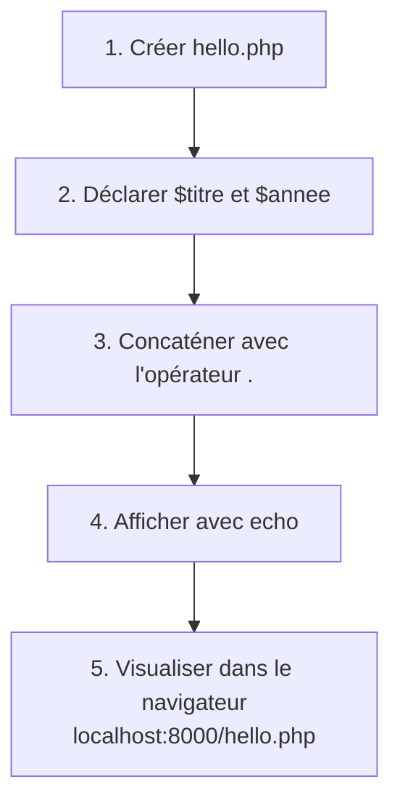

## 1. Contexte & Objectif

Dans le tutoriel précédent, vous avez installé l'interpréteur PHP officiel et validé le fonctionnement de votre serveur local.  
Vous allez maintenant apprendre les bases de la syntaxe PHP : ouvrir une balise de script, stocker des valeurs dans des variables et afficher un message à l'écran avec l'instruction `echo`.

* **Objectif technique :** Créer un script `hello.php`, déclarer une variable texte et une variable numérique, puis afficher une phrase dynamique en assemblant ces variables avec l'opérateur de concaténation `.`.
* **Prérequis :** Avoir PHP configuré dans votre terminal et savoir exécuter `php -S localhost:8000`.



---

## 2. Théorie Pas-à-Pas

### 2.1. Les balises PHP (`<?php`)

Pour indiquer au serveur que du code PHP doit être exécuté, vous devez placer vos instructions entre les balises de script PHP :

```php
<?php
echo "PHP est prêt à exécuter vos instructions.";
```

* `<?php` est la balise d'ouverture obligatoire.
* Dans un fichier contenant exclusivement du code PHP, la bonne pratique recommandée est de **ne pas fermer la balise `?>`** pour éviter d'envoyer des espaces vides invisibles au navigateur.
* Chaque instruction PHP doit impérativement se terminer par un **point-virgule (`;`)**.

### 2.2. Les variables en PHP (`$`)

Une variable est une boîte en mémoire qui stocke une information.  
En PHP, les variables suivent trois règles simples :
1. Elles commencent toujours par le signe dollar **`$`**.
2. Leur nom est sensible à la casse (`$titre` et `$Titre` sont deux variables distinctes).
3. On leur attribue une valeur à l'aide du signe égal **`=`** (opérateur d'assignation).

```php
<?php
$titre = "Mon Blog"; // Chaîne de caractères (texte entre guillemets)
$annee = 2026;       // Nombre entier (sans guillemets)

echo $titre;
```

### 2.3. L'instruction `echo` et l'opérateur de concaténation (`.`)

* **`echo`** est l'instruction native qui demande à PHP d'écrire du texte dans la réponse envoyée au navigateur.
* **Le point (`.`)** est l'opérateur de **concaténation**. Il permet de coller ensemble plusieurs morceaux de texte et des variables pour former une seule phrase.

```php
<?php
$titre = "Mon Blog";
$annee = 2026;

echo "Bienvenue sur " . $titre . " (" . $annee . ")";
```

---

## 3. Pratique & Réalisation Guidée

### Étape 1 — Créer le fichier et déclarer les variables

1. Ouvrez votre dossier de travail dans VS Code.
2. Créez un nouveau fichier nommé `hello.php`.
3. Écrivez la balise d'ouverture `<?php` puis déclarez la variable texte `$titre` et la variable numérique `$annee` :

```php
<?php
$titre = "Mon Blog";
$annee = 2026;
```

> **Attention :** N'oubliez pas le point-virgule `;` à la fin de chaque ligne.

### Étape 2 — Afficher la phrase avec `echo` et la concaténation

1. À la suite des variables, ajoutez l'instruction `echo` qui assemble le message d'accueil :

```php
<?php
$titre = "Mon Blog";
$annee = 2026;
echo "Bienvenue sur " . $titre . " (" . $annee . ")";
```

2. Enregistrez le fichier avec le raccourci `Ctrl + S`.

### Étape 3 — Tester le script dans le navigateur

1. Ouvrez le terminal de VS Code dans le dossier de votre fichier.
2. Démarrez le serveur local intégré de PHP :

```bash
php -S localhost:8000
```

3. Ouvrez votre navigateur Web à l'adresse suivante :

```text
http://localhost:8000/hello.php
```

4. **Résultat attendu :**  
   Le navigateur affiche la phrase complète :
   ```text
   Bienvenue sur Mon Blog (2026)
   ```

---

## 4. Livrable & Critères de Réussite

### 4.1. Emplacement dans votre dépôt d'autoformation

Dans votre dépôt GitHub annuel d'autoformations, créez l'arborescence suivante :

```text
php/bien-demarrer-php/ecrire-premier-script-echo/
```

### 4.2. Contenu attendu du livrable

Déposez dans ce dossier :
* **`hello.php`** : Le fichier source PHP complet écrit pendant ce tutoriel.

```php
<?php
$titre = "Mon Blog";
$annee = 2026;
echo "Bienvenue sur " . $titre . " (" . $annee . ")";
```

### 4.3. Critères de réussite

* [ ] Le fichier commence par la balise d'ouverture `<?php`.
* [ ] Deux variables `$titre` et `$annee` sont correctement déclarées avec le préfixe `$`.
* [ ] Chaque ligne d'instruction se termine par un point-virgule `;`.
* [ ] L'opérateur de concaténation `.` est utilisé pour combiner les textes et les variables.
* [ ] L'instruction `echo` produit l'affichage attendu sur `http://localhost:8000/hello.php`.
* [ ] Le livrable est constitué exclusivement du fichier de code source, sans aucune capture d'écran.

---

## 5. Glossaire

* **Balise PHP (`<?php`)** : Marqueur signalant à l'interpréteur le début d'un bloc de code PHP.
* **Variable** : Espace mémoire identifié par un nom précédé de `$`, servant à conserver une donnée.
* **Assignation (`=`)** : Opération qui affecte une valeur à une variable.
* **echo** : Instruction de sortie de PHP qui envoie du texte au navigateur.
* **Concaténation (`.`)** : Opération qui assemble deux ou plusieurs chaînes de caractères en une seule.
* **Point-virgule (`;`)** : Caractère obligatoire marquant la fin d'une instruction en PHP.
