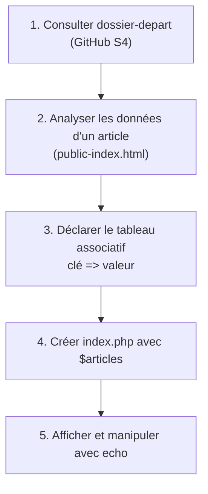

## 1. Contexte & Objectif

Vous commencez le développement de la page d'accueil dynamique du **Blog**.  
Consultez le dossier de départ sur le dépôt GitHub :  
[dossiers-depart-n1/S4/dossier-depart](https://github.com/solicode-web-mobile/dossiers-depart-n1/tree/master/S4/dossier-depart)

En examinant la maquette statique `public-index.html`, vous constatez que chaque carte d'article regroupe plusieurs informations : un titre, un extrait de contenu, une image, une date et une catégorie.  
Avant de générer une page Web complète, vous devez d'abord savoir représenter ces données côté serveur en mémoire PHP grâce aux **tableaux associatifs**.

* **Objectif technique :** Déclarer un tableau associatif représentant un article, accéder à ses valeurs par leurs clés, puis créer le fichier `index.php` contenant une collection `$articles` de deux articles affichés avec `echo`.
* **Prérequis :** Savoir exécuter un script PHP et utiliser l'instruction `echo`.



---

## 2. Théorie Pas-à-Pas

### 2.1. Qu'est-ce qu'un tableau associatif ?

Un **tableau associatif** est une variable capable de stocker plusieurs valeurs repérées par des noms textuels appelés des **clés**.  
Chaque élément est une paire **`clé => valeur`** :

```php
<?php
$article = [
    'titre' => 'Introduction à PHP',
    'auteur' => 'Admin'
];

echo $article['titre'];
```

* La **clé** (`'titre'`, `'auteur'`) est une chaîne de caractères qui décrit le rôle de la donnée.
* La **valeur** (`'Introduction à PHP'`, `'Admin'`) est la donnée stockée.

### 2.2. Accéder aux données avec les crochets `[...]`

On déclare un tableau avec des crochets `[...]`.  
Pour lire une information précise, on place le nom de la clé entre crochets à la suite de la variable : `$article['cle']`.

```php
<?php
$article = [
    'titre' => 'Comment débuter en PHP',
    'annee' => 2026
];

echo "Titre : " . $article['titre'] . " | Année : " . $article['annee'];
```

### 2.3. Les collections de données (tableau multidimensionnel)

Dans le blog, nous devons gérer plusieurs articles.  
On regroupe donc plusieurs tableaux associatifs dans un tableau principal : c'est un tableau de tableaux (ou collection).

```php
<?php
$articles = [
    [
        'id' => 1,
        'titre' => 'Premier article'
    ],
    [
        'id' => 2,
        'titre' => 'Deuxième article'
    ]
];

echo $articles[0]['titre'] . " et " . $articles[1]['titre'];
```

* `$articles[0]` désigne le premier article de la liste.
* `$articles[0]['titre']` accède au titre du premier article.

---

## 3. Pratique & Réalisation Guidée

### Étape 1 — Consulter le dossier de départ sur GitHub

1. Ouvrez dans votre navigateur le dossier de départ du sprint S4 :  
   [https://github.com/solicode-web-mobile/dossiers-depart-n1/tree/master/S4/dossier-depart](https://github.com/solicode-web-mobile/dossiers-depart-n1/tree/master/S4/dossier-depart)
2. Téléchargez ou clonez ce dossier sur votre ordinateur et ouvrez-le dans VS Code.
3. Ouvrez le fichier `public-index.html`.  
   Dans la section `<div class="grille-articles">`, repérez les informations d'un article :
   - Le titre de l'article
   - Le texte du paragraphe
   - Le nom du fichier image
   - La date
   - Le libellé et la couleur de la catégorie

### Étape 2 — Créer le fichier `index.php` et modéliser les articles

1. À la racine de votre dossier de travail, créez un nouveau fichier nommé :
   ```text
   index.php
   ```
2. Écrivez la balise `<?php` puis déclarez le tableau `$articles` contenant 2 articles complets :

```php
<?php
$articles = [
    [
        'id' => 1,
        'titre' => 'Comment structurer ses composants UI avec Atomic Design ?',
        'contenu' => 'Découvrez les concepts fondamentaux de la méthode Atomic Design...',
        'image' => 'article-example.png',
        'date_creation' => '2026-02-14',
        'categorie_libelle' => 'Développement',
        'categorie_couleur' => 'bleu'
    ],
    [
        'id' => 2,
        'titre' => 'Maîtriser les micro-interactions UX',
        'contenu' => 'Une interface belle n\'est pas suffisante...',
        'image' => 'article-example.png',
        'date_creation' => '2026-02-10',
        'categorie_libelle' => 'Design UI/UX',
        'categorie_couleur' => 'rose'
    ]
];
```

### Étape 3 — Manipuler et afficher les données avec `echo`

1. À la suite du tableau dans `index.php`, ajoutez les instructions `echo` pour afficher le titre et la catégorie de chaque article :

```php
<?php
$articles = [
    [
        'id' => 1,
        'titre' => 'Comment structurer ses composants UI avec Atomic Design ?',
        'contenu' => 'Découvrez les concepts fondamentaux de la méthode Atomic Design...',
        'image' => 'article-example.png',
        'date_creation' => '2026-02-14',
        'categorie_libelle' => 'Développement',
        'categorie_couleur' => 'bleu'
    ],
    [
        'id' => 2,
        'titre' => 'Maîtriser les micro-interactions UX',
        'contenu' => 'Une interface belle n\'est pas suffisante...',
        'image' => 'article-example.png',
        'date_creation' => '2026-02-10',
        'categorie_libelle' => 'Design UI/UX',
        'categorie_couleur' => 'rose'
    ]
];

echo "Article 1 : " . $articles[0]['titre'] . " (" . $articles[0]['categorie_libelle'] . ")<br>";
echo "Article 2 : " . $articles[1]['titre'] . " (" . $articles[1]['categorie_libelle'] . ")";
```

2. Enregistrez le fichier avec le raccourci `Ctrl + S`.
3. Dans le terminal, lancez votre serveur local :
   ```bash
   php -S localhost:8000
   ```
4. Ouvrez `http://localhost:8000/index.php` dans votre navigateur Web.
5. **Résultat attendu :**  
   Les données extraites du tableau en mémoire s'affichent correctement à l'écran :
   ```text
   Article 1 : Comment structurer ses composants UI avec Atomic Design ? (Développement)
   Article 2 : Maîtriser les micro-interactions UX (Design UI/UX)
   ```

---

## 4. Livrable & Critères de Réussite

### 4.1. Emplacement dans votre dépôt d'autoformation

Dans votre dépôt GitHub annuel d'autoformations, créez l'arborescence suivante :

```text
php/page-dynamique/declarer-manipuler-tableau-associatif/
```

### 4.2. Contenu attendu du livrable

Déposez dans ce dossier :
* **`index.php`** : Le fichier source PHP déclarant le tableau `$articles` et affichant ses données avec `echo`.

### 4.3. Critères de réussite

* [ ] Le fichier commence par `<?php`.
* [ ] Le tableau `$articles` est déclaré avec la syntaxe courte des crochets `[...]`.
* [ ] Chaque article comporte les 7 clés demandées : `id`, `titre`, `contenu`, `image`, `date_creation`, `categorie_libelle`, `categorie_couleur`.
* [ ] L'opérateur d'association `=>` est utilisé pour chaque couple clé / valeur.
* [ ] L'accès aux éléments est testé avec succès via `$articles[0]['titre']` et `$articles[1]['titre']`.
* [ ] L'affichage sur `http://localhost:8000/index.php` fonctionne sans aucune erreur PHP.
* [ ] Le livrable est constitué exclusivement de code source, sans aucune capture d'écran.

---

## 5. Glossaire

* **Tableau associatif** : Structure de données associant des clés textuelles à des valeurs.
* **Clé (Key)** : Identifiant textuel unique servant à retrouver une valeur dans un tableau associatif.
* **Valeur (Value)** : Donnée concrète associée à une clé.
* **Opérateur d'association (`=>`)** : Symbole qui relie une clé à sa valeur.
* **Collection (Tableau multidimensionnel)** : Tableau contenant d'autres tableaux pour stocker une liste d'éléments.
