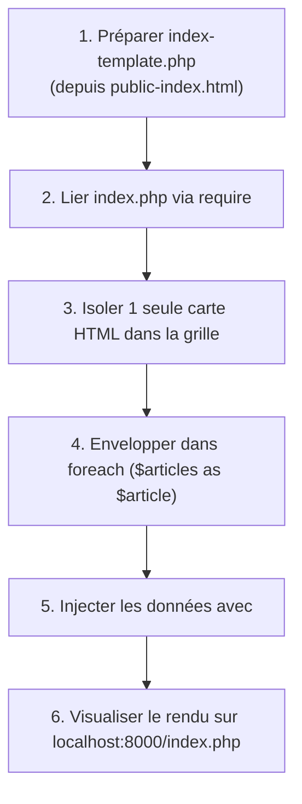

## 1. Contexte & Objectif

Dans le tutoriel précédent, vous avez modélisé les données de vos articles dans un tableau PHP `$articles` dans `index.php`.  
Actuellement, la maquette statique `public-index.html` contient du code HTML dupliqué pour chaque carte d'article. Vous allez maintenant dynamiser l'affichage : créer la vue `index-template.php`, remplacer les doublons HTML par une seule carte modèle et répéter son affichage automatiquement grâce à la boucle **`foreach`**, tout en sécurisant chaque donnée affichée contre les failles XSS.

* **Objectif technique :** Utiliser la boucle `foreach` avec la syntaxe alternative (`: ... endforeach;`) pour parcourir le tableau `$articles`, échapper les données avec `htmlspecialchars()` et générer dynamiquement la grille des cartes du Blog.
* **Prérequis :** Avoir réalisé `T.123.121` (tableau associatif `$articles` en mémoire).



---

## 2. Théorie Pas-à-Pas

### 2.1. Qu'est-ce que la boucle `foreach` ?

La boucle **`foreach`** est l'outil privilégié en PHP pour parcourir tous les éléments d'une collection sans avoir besoin de gérer un compteur manuel.  
À chaque tour de boucle, PHP extrait l'élément courant et le place dans une variable temporaire :

```php
<?php
$categories = ["Développement", "Design", "DevOps"];

foreach ($categories as $cat) {
    echo $cat . " | ";
}
```

### 2.2. La syntaxe alternative pour les vues HTML (`: ... endforeach;`)

Lorsque l'on injecte du code PHP au milieu de balises HTML, les accolades `{ ... }` réduisent la lisibilité.  
En développement professionnel, on utilise la **syntaxe alternative** : on remplace `{` par deux-points **`:`**, et `}` par **`endforeach;`** :

```php
<?php
$articles = [
    ['titre' => 'Premier article'],
    ['titre' => 'Deuxième article']
];
?>
<ul>
<?php foreach ($articles as $article): ?>
    <li><?= $article['titre'] ?></li>
<?php endforeach; ?>
</ul>
```

> **Note :** La balise `<?= $variable ?>` est un raccourci officiel équivalent à `<?php echo $variable; ?>`.

### 2.3. Sécurité vitale : La protection contre les failles XSS

Une faille **XSS** (*Cross-Site Scripting*) survient lorsqu'un texte injecté dans la page contient du code HTML ou JavaScript malveillant interprété par le navigateur.  
Pour s'en prémunir, la règle d'or est de **toujours neutraliser les caractères spéciaux** avant l'affichage avec la fonction native **`htmlspecialchars()`** :

```php
<?php
$texte = "Découvrir <strong>HTML & PHP</strong>";

echo htmlspecialchars($texte, ENT_QUOTES, 'UTF-8');
```

* `htmlspecialchars()` convertit les caractères sensibles (`<`, `>`, `&`, `"`) en entités HTML inoffensives (ex: `&lt;`, `&gt;`).

### 2.4. Troncature et formatage de dates

Pour que les cartes du blog restent homogènes :
* **`mb_substr($texte, 0, 100)`** coupe le contenu à 100 caractères pour ne pas casser la hauteur des cartes.
* **`date('d M Y', strtotime($date))`** convertit une date brute (`2026-02-14`) en date lisible (`14 Feb 2026`).

```php
<?php
$texte = "Voici un texte très long qui doit être raccourci pour l'affichage dans une carte.";
$date = "2026-02-14";

echo mb_substr($texte, 0, 30) . "... le " . date('d M Y', strtotime($date));
```

---

## 3. Pratique & Réalisation Guidée

### Étape 1 — Préparer la vue `index-template.php` et la lier dans `index.php`

1. Dans votre dossier de projet, copiez le fichier statique `public-index.html` (issu du dossier de départ) et renommez cette copie :
   ```text
   index-template.php
   ```
2. Ouvrez le fichier `index.php`. Supprimez les lignes temporaires de test avec `echo` écrites au tutoriel précédent, et ajoutez à la fin l'instruction `require` pour appeler le template :

```php
<?php
$articles = [
    [
        'id' => 1,
        'titre' => 'Comment structurer ses composants UI avec Atomic Design ?',
        'contenu' => 'Découvrez les concepts fondamentaux de la méthode Atomic Design...',
        'image' => 'article-example.png',
        'date_creation' => '2026-02-14',
        'categorie_libelle' => 'Développement',
        'categorie_couleur' => 'bleu'
    ],
    [
        'id' => 2,
        'titre' => 'Maîtriser les micro-interactions UX',
        'contenu' => 'Une interface belle n\'est pas suffisante...',
        'image' => 'article-example.png',
        'date_creation' => '2026-02-10',
        'categorie_libelle' => 'Design UI/UX',
        'categorie_couleur' => 'rose'
    ]
];

require 'index-template.php';
```

3. Enregistrez `index.php` (`Ctrl + S`).

### Étape 2 — Isoler une seule carte modèle dans `index-template.php`

1. Ouvrez `index-template.php` dans VS Code.
2. Localisez la division de la grille d'articles :
   ```html
   <div class="grille-articles">
   ```
3. Cette division contient plusieurs blocs `<div class="carte-article">` codés en dur.
4. **Supprimez tous les blocs de cartes en doublon** pour n'en conserver **qu'un seul**.

### Étape 3 — Rendre la carte dynamique avec `foreach` et `htmlspecialchars()`

1. Enveloppez la carte unique restante dans la boucle `foreach ($articles as $article)` et remplacez les textes statiques par les données du tableau échappées :

```html
<div class="grille-articles">
    <?php foreach ($articles as $article): ?>
        <div class="carte-article">
            <a href="article.php?id=<?= $article['id'] ?>" class="carte-image">
                " alt="Illustration">
            </a>
            <span class="etiquette-categorie"><?= htmlspecialchars($article['categorie_libelle']) ?></span>
            <div class="carte-contenu">
                <h3><a href="article.php?id=<?= $article['id'] ?>"><?= htmlspecialchars($article['titre']) ?></a></h3>
                <p><?= htmlspecialchars(mb_substr($article['contenu'], 0, 100)) ?>...</p>
                <div class="carte-meta">
                    <span><?= date('d M Y', strtotime($article['date_creation'])) ?></span>
                    <span>5 min</span>
                </div>
            </div>
        </div>
    <?php endforeach; ?>
</div>
```

2. Enregistrez `index-template.php` (`Ctrl + S`).

### Étape 4 — Tester l'affichage dynamique

1. Lancez votre serveur Web local dans le terminal :
   ```bash
   php -S localhost:8000
   ```
2. Ouvrez votre navigateur Web à l'adresse suivante :
   ```text
   http://localhost:8000/index.php
   ```
3. **Résultat attendu :**  
   La page d'accueil affiche automatiquement **2 cartes distinctes**, correspondant exactement aux 2 articles déclarés dans `$articles` dans `index.php`, avec leurs titres, catégories, images et dates respectifs.

---

## 4. Livrable & Critères de Réussite

### 4.1. Emplacement dans votre dépôt d'autoformation

Dans votre dépôt GitHub annuel d'autoformations, créez l'arborescence suivante :

```text
php/page-dynamique/parcourir-collection-boucle-foreach/
```

### 4.2. Contenu attendu du livrable

Déposez dans ce dossier :
* **`index.php`** : Le fichier contrôleur déclarant `$articles` et incluant `index-template.php`.
* **`index-template.php`** : La vue contenant la boucle dynamique `foreach`.

### 4.3. Critères de réussite

* [ ] Le fichier `index.php` charge `index-template.php` avec l'instruction `require`.
* [ ] La division `.grille-articles` ne contient plus aucune carte codée en dur en double.
* [ ] La boucle `<?php foreach ($articles as $article): ?>` enveloppe la carte modèle.
* [ ] La boucle se ferme avec `<?php endforeach; ?>`.
* [ ] Toutes les sorties texte sont protégées par `htmlspecialchars()`.
* [ ] Le navigateur affiche 2 cartes dynamiques fonctionnelles sur `http://localhost:8000/index.php`.
* [ ] Le livrable est constitué exclusivement de code source, sans aucune capture d'écran.

---

## 5. Glossaire

* **foreach** : Structure de contrôle PHP conçue pour parcourir séquentiellement chaque élément d'un tableau.
* **Syntaxe alternative (`: ... endforeach;`)** : Notation de boucle adaptée à l'intégration propre de PHP au sein du HTML.
* **htmlspecialchars()** : Fonction native PHP convertissant les caractères réservés en entités HTML pour prévenir les failles XSS.
* **Faille XSS (Cross-Site Scripting)** : Vulnérabilité de sécurité consistant à injecter du code malveillant dans une page Web affichée à d'autres utilisateurs.
* **mb_substr()** : Fonction tronquant une chaîne de caractères à une longueur donnée tout en gérant les caractères accentués.
* **Balise courte (`<?= ... ?>`)** : Raccourci syntaxique de PHP servant à afficher directement le résultat d'une expression.
