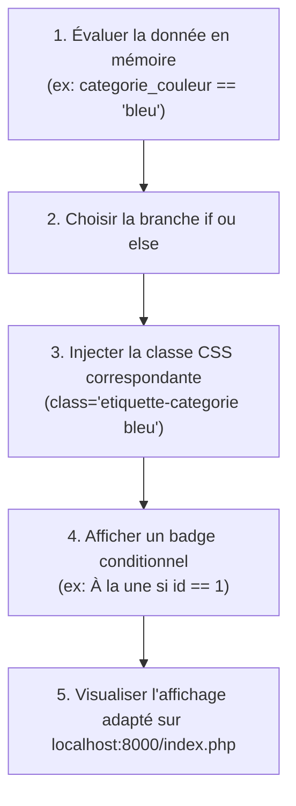

## 1. Contexte & Objectif

Dans le tutoriel précédent, vous avez généré automatiquement les cartes du Blog avec la boucle `foreach`.  
Cependant, tous les articles ne se ressemblent pas : certains appartiennent à des thèmes différents nécessitant une couleur d'étiquette spécifique (`bleu` pour le développement, `rose` pour le design), et d'autres méritent une mise en avant particulière (par exemple un badge *"À la une"*). Pour prendre des décisions d'affichage en fonction des données, PHP utilise les **structures conditionnelles `if / else`**.

* **Objectif technique :** Utiliser la structure conditionnelle `if / else` en syntaxe alternative (`: ... else: ... endif;`) dans `index-template.php` pour adapter la classe CSS des étiquettes et afficher un badge conditionnel selon la valeur des données.
* **Prérequis :** Avoir réalisé `T.123.122` (boucle `foreach` et template `index-template.php`).



---

## 2. Théorie Pas-à-Pas

### 2.1. Les conditions en PHP (`if / else`)

Une condition permet à l'interpréteur d'exécuter un bloc de code **seulement si une affirmation est vraie** :

```php
<?php
$role = "admin";

if ($role == "admin") {
    echo "Accès autorisé au panneau d'administration";
} else {
    echo "Accès public standard";
}
```

* L'opérateur **`==`** compare l'égalité entre deux valeurs.
* Si le test est vrai, le premier bloc s'exécute.
* Sinon, c'est le bloc `else` qui prend le relais.

### 2.2. La syntaxe alternative pour le HTML (`if (...): ... else: ... endif;`)

Dans un fichier de vue qui mélange HTML et PHP, les accolades `{ ... }` alourdissent la lecture.  
On privilégie la **syntaxe alternative** :
* On remplace `{` par **`:`**
* On termine obligatoirement la condition par **`endif;`**

```php
<?php
$estEnLigne = true;
?>
<?php if ($estEnLigne): ?>
    <span class="badge vert">Article publié</span>
<?php else: ?>
    <span class="badge gris">Brouillon</span>
<?php endif; ?>
```

### 2.3. Adapter dynamiquement une classe CSS

Pour changer l'apparence visuelle d'un élément selon sa catégorie, on insère la condition directement à l'intérieur de l'attribut `class` :

```php
<?php
$couleur = "bleu";
?>
<span class="badge <?php if ($couleur == 'bleu'): ?>badge-bleu<?php else: ?>badge-rose<?php endif; ?>">
    Thème <?= htmlspecialchars($couleur) ?>
</span>
```

---

## 3. Pratique & Réalisation Guidée

### Étape 1 — Localiser l'étiquette de catégorie dans `index-template.php`

1. Ouvrez `index-template.php` dans VS Code.
2. À l'intérieur de la boucle `foreach ($articles as $article):`, repérez la balise de l'étiquette de catégorie :

```html
<span class="etiquette-categorie"><?= htmlspecialchars($article['categorie_libelle']) ?></span>
```

Actuellement, l'étiquette s'affiche sans classe de couleur dédiée.

### Étape 2 — Appliquer la couleur conditionnelle

1. Dans votre feuille de style `css/components.css`, les classes `.etiquette-categorie.bleu` et `.etiquette-categorie.rose` sont déjà configurées.
2. Modifiez la balise `<span>` dans `index-template.php` pour injecter la classe de couleur appropriée selon la donnée `$article['categorie_couleur']` :

```html
<span class="etiquette-categorie <?php if ($article['categorie_couleur'] == 'bleu'): ?>bleu<?php else: ?>rose<?php endif; ?>">
    <?= htmlspecialchars($article['categorie_libelle']) ?>
</span>
```

### Étape 3 — Afficher un badge conditionnel « À la une »

1. Pour mettre en valeur le tout premier article de la page, ajoutez un test conditionnel vérifiant si l'identifiant est égal à `1`.
2. Insérez cette condition juste au-dessus du titre dans `.carte-contenu` :

```html
<div class="carte-contenu">
    <?php if ($article['id'] == 1): ?>
        <small class="badge-special">⭐ À la une</small>
    <?php endif; ?>
    <h3><a href="article.php?id=<?= $article['id'] ?>"><?= htmlspecialchars($article['titre']) ?></a></h3>
    <p><?= htmlspecialchars(mb_substr($article['contenu'], 0, 100)) ?>...</p>
    <div class="carte-meta">
        <span><?= date('d M Y', strtotime($article['date_creation'])) ?></span>
        <span>5 min</span>
    </div>
</div>
```

3. Enregistrez le fichier `index-template.php` (`Ctrl + S`).

### Étape 4 — Vérifier le résultat dans le navigateur

1. Assurez-vous que votre serveur local est actif (`php -S localhost:8000`).
2. Actualisez la page dans votre navigateur :  
   ```text
   http://localhost:8000/index.php
   ```
3. **Résultat attendu :**  
   * La première carte (*Développement*) porte l'étiquette bleue et affiche la mention *"⭐ À la une"*.
   * La deuxième carte (*Design UI/UX*) porte l'étiquette rose sans la mention *"⭐ À la une"*.

---

## 4. Livrable & Critères de Réussite

### 4.1. Emplacement dans votre dépôt d'autoformation

Dans votre dépôt GitHub annuel d'autoformations, créez l'arborescence suivante :

```text
php/page-dynamique/adapter-affichage-condition-if-else/
```

### 4.2. Contenu attendu du livrable

Déposez dans ce dossier :
* **`index-template.php`** : La vue intégrant l'affichage conditionnel des classes et badges.
* **`index.php`** : Le contrôleur inchangé fournissant les données.

### 4.3. Critères de réussite

* [ ] La syntaxe alternative `if (...): ... else: ... endif;` est utilisée dans le template HTML.
* [ ] L'étiquette de catégorie adopte dynamiquement la classe CSS `bleu` ou `rose`.
* [ ] Le badge conditionnel ne s'affiche que pour l'article ciblé (`$article['id'] == 1`).
* [ ] La page s'affiche sans erreur sur `http://localhost:8000/index.php`.
* [ ] Le livrable est constitué exclusivement de code source, sans aucune capture d'écran.

---

## 5. Glossaire

* **Structure conditionnelle (`if / else`)** : Instruction permettant d'exécuter différents blocs de code selon la véracité d'une condition.
* **Syntaxe alternative (`if (...): ... endif;`)** : Écriture épurée de PHP adaptée aux fichiers de template sans accolades.
* **Opérateur d'égalité (`==`)** : Opérateur comparant la valeur de deux expressions.
* **Affichage conditionnel** : Technique consistant à rendre visible ou masquer des fragments de HTML en fonction des données serveur.
