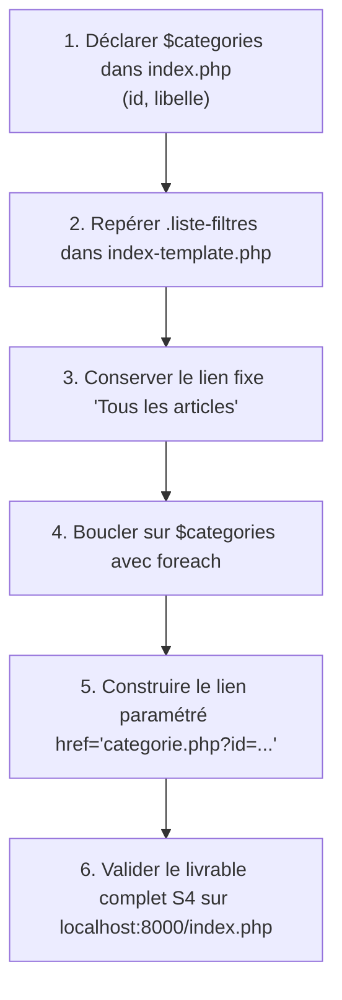

## 1. Contexte & Objectif

Dans les tutoriels précédents, vous avez dynamisé les cartes d'articles et leurs étiquettes avec des conditions.  
Il reste une dernière section statique sur la page d'accueil du Blog : la barre de filtres par thèmes (*Explorer par thème*). Actuellement, ces boutons sont écrits en dur dans le fichier HTML. Pour finaliser la page d'accueil, vous allez réinvestir la boucle `foreach` sur une seconde collection de données (`$categories`) et générer automatiquement des liens de navigation enrichis de paramètres d'URL.

* **Objectif technique :** Déclarer le tableau `$categories` dans `index.php` et utiliser une boucle `foreach` dans `index-template.php` pour générer dynamiquement la liste des pilules de navigation avec des paramètres d'URL (`categorie.php?id=<?= $cat['id'] ?>`), complétant ainsi le livrable final de la session S4.
* **Prérequis :** Avoir réalisé `T.123.123` (boucle `foreach` et conditions `if / else`).



---

## 2. Théorie Pas-à-Pas

### 2.1. Qu'est-ce qu'un lien paramétré en Web ?

En programmation Web, une URL peut transmettre des informations au serveur grâce à un point d'interrogation **`?`** suivi de paramètres sous la forme **`clé=valeur`** :

```text
categorie.php?id=1
```

* `categorie.php` : Le fichier cible chargé de traiter la demande.
* `?id=1` : Le paramètre envoyé au serveur, lui indiquant d'afficher les articles de la catégorie n°1.

### 2.2. Construire un lien dynamique dans une boucle `foreach`

Dans un template, on utilise la balise courte d'affichage `<?= $valeur ?>` directement à l'intérieur de l'attribut `href` pour créer des liens uniques pour chaque élément :

```php
<?php
$categories = [
    ['id' => 1, 'nom' => 'Développement'],
    ['id' => 2, 'nom' => 'Design']
];
?>
<nav>
<?php foreach ($categories as $cat): ?>
    <a href="categorie.php?id=<?= $cat['id'] ?>">
        <?= htmlspecialchars($cat['nom']) ?>
    </a>
<?php endforeach; ?>
</nav>
```

### 2.3. Coexistence d'un élément fixe et d'éléments dynamiques

Dans une barre de filtres, le premier bouton renvoie généralement vers la vue d'ensemble sans filtre (*« Tous les articles »*).  
On conserve ce premier bouton en dur avec sa classe active, et on applique la boucle `foreach` uniquement sur les catégories spécifiques :

```php
<?php
$themes = [
    ['id' => 10, 'nom' => 'Front-end'],
    ['id' => 20, 'nom' => 'Back-end']
];
?>
<div class="liste-filtres">
    <a href="index.php" class="pilule-filtre actif">Tous</a>
    <?php foreach ($themes as $theme): ?>
        <a href="theme.php?id=<?= $theme['id'] ?>" class="pilule-filtre">
            <?= htmlspecialchars($theme['nom']) ?>
        </a>
    <?php endforeach; ?>
</div>
```

---

## 3. Pratique & Réalisation Guidée

### Étape 1 — Déclarer le tableau `$categories` dans `index.php`

1. Ouvrez `index.php` dans VS Code.
2. Juste sous la déclaration du tableau `$articles` (et avant l'instruction `require`), déclarez le tableau `$categories` contenant 2 thèmes :

```php
<?php
$articles = [
    [
        'id' => 1,
        'titre' => 'Comment structurer ses composants UI avec Atomic Design ?',
        'contenu' => 'Découvrez les concepts fondamentaux de la méthode Atomic Design...',
        'image' => 'article-example.png',
        'date_creation' => '2026-02-14',
        'categorie_libelle' => 'Développement',
        'categorie_couleur' => 'bleu'
    ],
    [
        'id' => 2,
        'titre' => 'Maîtriser les micro-interactions UX',
        'contenu' => 'Une interface belle n\'est pas suffisante...',
        'image' => 'article-example.png',
        'date_creation' => '2026-02-10',
        'categorie_libelle' => 'Design UI/UX',
        'categorie_couleur' => 'rose'
    ]
];

$categories = [
    ['id' => 1, 'libelle' => 'Développement'],
    ['id' => 2, 'libelle' => 'Design UI/UX']
];

require 'index-template.php';
```

3. Enregistrez `index.php` (`Ctrl + S`).

### Étape 2 — Repérer la section des filtres dans `index-template.php`

1. Ouvrez `index-template.php` dans VS Code.
2. Localisez la section des thèmes :

```html
<section class="filtre-categories">
    <h2>Explorer par thème</h2>
    <div class="liste-filtres">
        <a href="index.php" class="pilule-filtre actif">Tous les articles</a>
        <a href="public-categorie.html" class="pilule-filtre">Développement</a>
        <a href="public-categorie.html" class="pilule-filtre">Design UI/UX</a>
    </div>
</section>
```

### Étape 3 — Remplacer les filtres statiques par la boucle `foreach`

1. Conservez le lien fixe `Tous les articles`.
2. Supprimez les deux autres liens statiques et remplacez-les par la boucle `foreach ($categories as $cat)` :

```html
<section class="filtre-categories">
    <h2>Explorer par thème</h2>
    <div class="liste-filtres">
        <a href="index.php" class="pilule-filtre actif">Tous les articles</a>
        <?php foreach ($categories as $cat): ?>
            <a href="categorie.php?id=<?= $cat['id'] ?>" class="pilule-filtre">
                <?= htmlspecialchars($cat['libelle']) ?>
            </a>
        <?php endforeach; ?>
    </div>
</section>
```

3. Enregistrez `index-template.php` (`Ctrl + S`).

### Étape 4 — Tester le rendu final du Blog

1. Assurez-vous que votre serveur local fonctionne toujours (`php -S localhost:8000`).
2. Ouvrez votre navigateur Web à l'adresse suivante :  
   ```text
   http://localhost:8000/index.php
   ```
3. **Résultat attendu :**  
   * La barre des filtres affiche le bouton actif *« Tous les articles »*, suivi des deux pilules générées dynamiquement : *« Développement »* et *« Design UI/UX »*.
   * En survolant les pilules, l'URL de destination affiche bien `categorie.php?id=1` et `categorie.php?id=2`.
   * L'intégralité de la page d'accueil est désormais pilotée par les données du contrôleur `index.php` et rendue par la vue `index-template.php`.

---

## 4. Livrable & Critères de Réussite

### 4.1. Emplacement dans votre dépôt d'autoformation

Dans votre dépôt GitHub annuel d'autoformations, créez l'arborescence suivante :

```text
php/page-dynamique/generer-liens-dynamiques-boucle-foreach/
```

### 4.2. Contenu attendu du livrable

Déposez dans ce dossier les deux fichiers finaux formant le livrable complet de la session S4 :
* **`index.php`** : Le contrôleur déclarant les collections `$articles` et `$categories` et incluant la vue.
* **`index-template.php`** : La vue complète du Blog avec ses boucles dynamiques et ses conditions d'affichage.

### 4.3. Critères de réussite

* [ ] Le tableau `$categories` est déclaré dans `index.php` avec les clés `id` et `libelle`.
* [ ] Le lien fixe *Tous les articles* est préservé avec sa classe `actif`.
* [ ] La boucle `<?php foreach ($categories as $cat): ?>` génère dynamiquement chaque bouton de filtre.
* [ ] L'attribut `href` contient l'URL paramétrée `categorie.php?id=<?= $cat['id'] ?>`.
* [ ] Le libellé est protégé par `htmlspecialchars()`.
* [ ] La page d'accueil complète s'exécute sans erreur sur `http://localhost:8000/index.php`.
* [ ] Le livrable est constitué exclusivement de code source, sans aucune capture d'écran.

---

## 5. Glossaire

* **Paramètre d'URL (Query String)** : Données transmises à une page Web à la suite du symbole `?` sous forme de paires `clé=valeur`.
* **Lien paramétré** : Balise `<a>` dont l'attribut `href` contient des valeurs issues de variables dynamiques pour transmettre un identifiant.
* **Collection secondaire** : Liste de données auxiliaires (ici les catégories) venant enrichir la page principale.
* **Pilule de filtre** : Composant graphique d'interface utilisateur sous forme de bouton arrondi permettant de filtrer un contenu.
