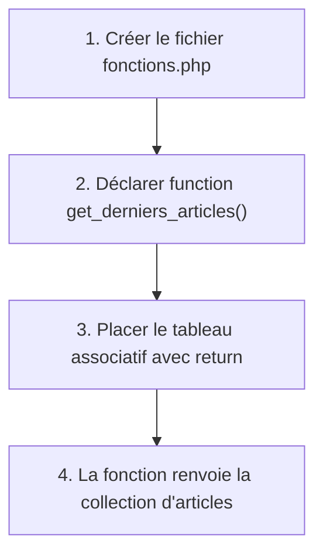
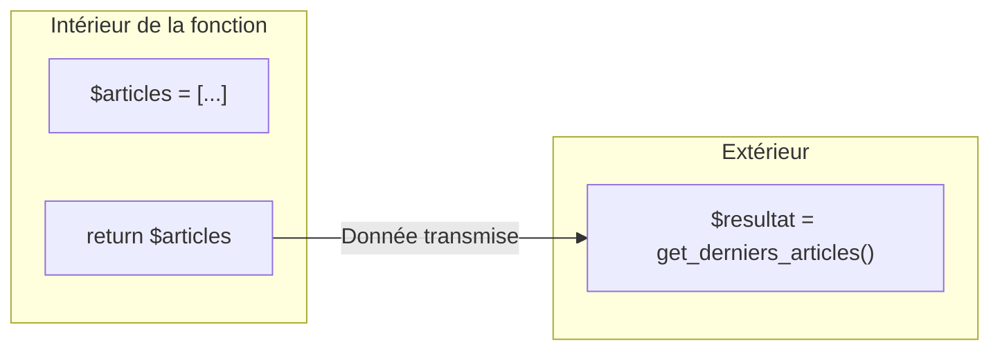

## 1. Contexte & Objectif

Dans la session précédente (S4), vous avez affiché des articles et des filtres de catégories sur la page d'accueil de votre blog. Toutes les données étaient écrites directement dans le fichier `index.php`.  
Lorsque le code d'une application grandit, mélanger la définition des données et leur affichage rend le code difficile à lire et impossible à réutiliser.

Dans ce tutoriel, vous allez apprendre à déclarer votre première fonction en PHP dans un fichier séparé nommé `fonctions.php`. Cette fonction préparera et renverra le tableau des articles grâce au mot-clé `return`.

* **Objectif technique :** Créer le fichier `fonctions.php`, déclarer la fonction `get_derniers_articles()` et renvoyer la collection des articles avec l'instruction `return`.
* **Prérequis :** Savoir déclarer un tableau associatif en PHP et exécuter un script avec `php -S localhost:8000`.



---

## 2. Théorie Pas-à-Pas

### 2.1. Qu'est-ce qu'une fonction en PHP ?

Une fonction est un bloc d'instructions qui porte un nom et accomplit une tâche précise. On peut l'exécuter plusieurs fois sans réécrire son code.

Pour déclarer une fonction en PHP, on utilise le mot-clé `function` suivi du nom de la fonction et de parenthèses `()` :

```php
<?php
function saluer() {
    echo "Bonjour et bienvenue sur le Blog !";
}

saluer();
```

* Le mot-clé **`function`** indique à PHP que l'on crée une nouvelle fonction.
* Par convention en PHP moderne, le nom s'écrit en minuscules avec des tirets bas (**`snake_case`**).
* On choisit un nom explicite qui commence par un verbe d'action (exemple : `get_...`, `calculer_...`, `afficher_...`).

### 2.2. Renvoyer une valeur avec l'instruction `return`

Une fonction peut afficher directement du texte, mais sa mission principale en développement Web est souvent de **calculer ou préparer une donnée**, puis de la **renvoyer** au programme.

Pour renvoyer une valeur, on utilise l'instruction **`return`** :

```php
<?php
function get_annee_en_cours() {
    $annee = 2026;
    return $annee;
}

$date = get_annee_en_cours();
echo "Année : " . $date;
```

* Dès que PHP rencontre l'instruction `return`, la fonction s'arrête et transmet le résultat à l'endroit où la fonction a été appelée.
* Une fonction peut renvoyer n'importe quel type de donnée : une chaîne de caractères, un nombre, ou un tableau complet.

### 2.3. Portée des variables et encapsulation

Les variables déclarées à l'intérieur d'une fonction n'existent que pendant l'exécution de cette fonction. C'est ce qu'on appelle la **portée locale**.



Cette isolation protège votre code : deux fonctions peuvent utiliser une variable portant le même nom sans créer de conflit.

---

## 3. Pratique & Réalisation Guidée

### Étape 1 — Créer le fichier `fonctions.php`

1. Ouvrez votre projet de blog dans VS Code.
2. Créez un nouveau fichier nommé `fonctions.php` à la racine de votre dossier de travail.
3. Ouvrez la balise PHP au tout début du fichier :

```php
<?php
```

### Étape 2 — Déclarer la fonction `get_derniers_articles()`

1. Écrivez la déclaration de la fonction `get_derniers_articles()`.
2. Placez l'instruction `return` suivie du tableau associatif contenant vos deux articles de blog :

```php
<?php
function get_derniers_articles() {
    return [
        [
            'id' => 1,
            'titre' => 'Comment structurer ses composants UI avec Atomic Design ?',
            'contenu' => 'Découvrez les concepts fondamentaux pour concevoir des composants modulaires.',
            'image' => 'article-example.png',
            'date_creation' => '2026-02-14',
            'categorie_libelle' => 'Développement',
            'categorie_couleur' => 'bleu'
        ],
        [
            'id' => 2,
            'titre' => 'Maîtriser les micro-interactions UX',
            'contenu' => 'Une interface belle n\'est pas suffisante : découvrez comment améliorer l\'expérience.',
            'image' => 'article-example.png',
            'date_creation' => '2026-02-10',
            'categorie_libelle' => 'Design UI/UX',
            'categorie_couleur' => 'rose'
        ]
    ];
}
```

3. Enregistrez le fichier avec le raccourci `Ctrl + S`.

### Étape 3 — Vérifier la syntaxe du fichier

1. Ouvrez le terminal intégré de VS Code (`Ctrl + ù` ou `Terminal > Nouveau terminal`).
2. Lancez la vérification de syntaxe PHP :

```bash
php -l fonctions.php
```

3. **Résultat attendu :**
```text
No syntax errors detected in fonctions.php
```

Le module `fonctions.php` est prêt. La responsabilité de produire la liste des articles est désormais isolée dans une fonction réutilisable.

---

## 4. Livrable & Critères de Réussite

### 4.1. Emplacement dans votre dépôt d'autoformation

Dans votre dépôt GitHub annuel d'autoformations, déposez votre fichier dans le dossier suivant :

```text
php/organiser-avec-fonctions/declarer-fonction-instruction-return/
```

### 4.2. Contenu attendu du livrable

Votre dossier de livrable doit contenir :
* **`fonctions.php`** : Le fichier source PHP déclarant la fonction `get_derniers_articles()`.

```php
<?php
function get_derniers_articles() {
    return [
        [
            'id' => 1,
            'titre' => 'Comment structurer ses composants UI avec Atomic Design ?',
            'contenu' => 'Découvrez les concepts fondamentaux pour concevoir des composants modulaires.',
            'image' => 'article-example.png',
            'date_creation' => '2026-02-14',
            'categorie_libelle' => 'Développement',
            'categorie_couleur' => 'bleu'
        ],
        [
            'id' => 2,
            'titre' => 'Maîtriser les micro-interactions UX',
            'contenu' => 'Une interface belle n\'est pas suffisante : découvrez comment améliorer l\'expérience.',
            'image' => 'article-example.png',
            'date_creation' => '2026-02-10',
            'categorie_libelle' => 'Design UI/UX',
            'categorie_couleur' => 'rose'
        ]
    ];
}
```

### 4.3. Critères de réussite

* [ ] Le fichier `fonctions.php` commence par la balise d'ouverture `<?php`.
* [ ] La fonction est correctement nommée `get_derniers_articles()` en syntaxe `snake_case`.
* [ ] L'instruction `return` renvoie le tableau complet des deux articles.
* [ ] La commande `php -l fonctions.php` valide la syntaxe sans erreur.
* [ ] Le livrable est constitué exclusivement de code source commité sur GitHub, sans capture d'écran.

---

## 5. Glossaire

* **Fonction** : Bloc de code réutilisable effectuant une tâche précise et identifié par un nom unique.
* **`function`** : Mot-clé PHP servant à déclarer une nouvelle fonction.
* **`return`** : Instruction qui arrête l'exécution d'une fonction et renvoie sa valeur au programme appelant.
* **Encapsulation** : Principe consistant à regrouper et isoler une logique technique au sein d'une unité autonome.
* **`snake_case`** : Convention d'écriture où les mots sont tous en minuscules et séparés par un tiret bas (`_`).
