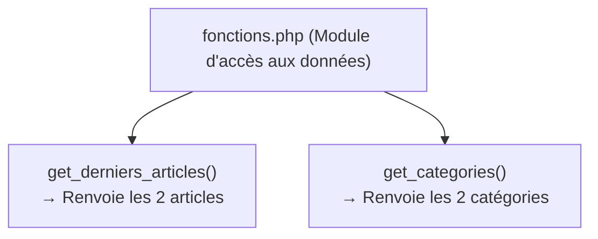

## 1. Contexte & Objectif

Dans le tutoriel précédent (T.123.151), vous avez créé le fichier `fonctions.php` et encapsulé les articles du blog dans la fonction `get_derniers_articles()`.  
Sur notre page d'accueil, nous avons une seconde source d'information : **la liste des catégories** qui sert à filtrer les articles.

Dans ce tutoriel, vous allez enrichir le fichier `fonctions.php` en y ajoutant la fonction `get_categories()`. Vous allez comprendre comment organiser et documenter plusieurs fonctions indépendantes au sein d'un même module PHP.

* **Objectif technique :** Déclarer la fonction `get_categories()` dans `fonctions.php`, renvoyer la collection des catégories avec `return`, et documenter chaque fonction avec un bloc de commentaire.
* **Prérequis :** Avoir terminé le tutoriel `T.123.151` et disposer du fichier `fonctions.php`.



---

## 2. Théorie Pas-à-Pas

### 2.1. Qu'est-ce qu'un module en PHP ?

En PHP procédural, un **module** est un fichier qui regroupe un ensemble de fonctions traitant d'un même domaine de responsabilité.  
Notre fichier `fonctions.php` joue le rôle de module de préparation des données pour le blog.

Plutôt que d'éparpiller des fonctions dans des dizaines de fichiers, les regrouper dans un module présente trois avantages majeurs :
1. **Centralisation :** On sait exactement dans quel fichier retrouver la logique de données.
2. **Maintenance simplifiée :** Modifier une donnée se fait à un seul endroit.
3. **Réutilisation :** N'importe quelle page du site pourra faire appel à ces fonctions.

### 2.2. Cohabitation de plusieurs fonctions dans un fichier

Dans un fichier PHP, vous pouvez déclarer autant de fonctions que nécessaire les unes après les autres.  
Chaque fonction possède son propre bloc délimité par des accolades `{ ... }` et son propre nom unique.

```php
<?php
function get_nom_site() {
    return "Mon Super Blog";
}

function get_version() {
    return "1.0.0";
}

echo get_nom_site() . " (version " . get_version() . ")";
```

* L'ordre des fonctions dans le fichier n'a pas d'importance pour l'interpréteur PHP.
* Cependant, pour le développeur humain, on sépare chaque fonction par **une ligne vide** afin de garder un code aéré et lisible.

### 2.3. Documenter ses fonctions avec les blocs de commentaires

Pour faciliter la lecture du code par votre équipe ou par vous-même dans quelques mois, on place un bloc de documentation au-dessus de chaque fonction.  
En PHP, ce standard s'appelle la syntaxe **PHPDoc** :

```php
<?php
/**
 * Calcule le montant total avec la TVA
 * @param float $prix_ht Prix hors taxes
 * @return float Montant total TTC
 */
function calculer_ttc($prix_ht) {
    return $prix_ht * 1.20;
}

echo "Total TTC : " . calculer_ttc(100) . " DH";
```

* `/**` ouvre le bloc de documentation.
* Chaque ligne commence par une étoile `*`.
* `@return` décrit le type et la nature de la valeur renvoyée.

---

## 3. Pratique & Réalisation Guidée

### Étape 1 — Ouvrir `fonctions.php`

1. Ouvrez votre projet dans VS Code.
2. Ouvrez le fichier `fonctions.php` que vous avez créé à l'étape précédente.  
Il contient actuellement la fonction `get_derniers_articles()`.

### Étape 2 — Ajouter la fonction `get_categories()`

1. Placez votre curseur après la fermeture de `get_derniers_articles()`.
2. Sautez une ligne, puis écrivez la fonction `get_categories()` avec son bloc de commentaire :

```php
/**
 * Renvoie la liste des catégories disponibles pour le filtrage
 * @return array Collection des catégories
 */
function get_categories() {
    return [
        ['id' => 1, 'libelle' => 'Développement'],
        ['id' => 2, 'libelle' => 'Design UI/UX']
    ];
}
```

3. Enregistrez les modifications avec `Ctrl + S`.

### Étape 3 — Tester l'exécution des deux fonctions

1. Pour vous assurer que les deux fonctions fonctionnent correctement, créez temporairement un petit fichier de test `test.php` à la racine :

```php
<?php
require_once 'fonctions.php';

$articles = get_derniers_articles();
$categories = get_categories();

echo "Articles trouvés : " . count($articles) . "\n";
echo "Catégories trouvées : " . count($categories) . "\n";
```

2. Exécutez ce script dans votre terminal :

```bash
php test.php
```

3. **Résultat attendu :**
```text
Articles trouvés : 2
Catégories trouvées : 2
```

4. Supprimez le fichier temporaire `test.php` une fois le test validé.

Votre fichier `fonctions.php` centralise désormais l'intégralité des données nécessaires à la page d'accueil du blog.

---

## 4. Livrable & Critères de Réussite

### 4.1. Emplacement dans votre dépôt d'autoformation

Dans votre dépôt GitHub annuel d'autoformations, déposez votre fichier dans le dossier suivant :

```text
php/organiser-avec-fonctions/regrouper-plusieurs-fonctions-module/
```

### 4.2. Contenu attendu du livrable

Votre dossier de livrable doit contenir :
* **`fonctions.php`** : Le module enrichi contenant les deux fonctions documentées.

```php
<?php
// fonctions.php — Module de gestion des données du Blog

/**
 * Renvoie la liste des derniers articles publiés
 * @return array Collection d'articles
 */
function get_derniers_articles() {
    return [
        [
            'id' => 1,
            'titre' => 'Comment structurer ses composants UI avec Atomic Design ?',
            'contenu' => 'Découvrez les concepts fondamentaux pour concevoir des composants modulaires.',
            'image' => 'article-example.png',
            'date_creation' => '2026-02-14',
            'categorie_libelle' => 'Développement',
            'categorie_couleur' => 'bleu'
        ],
        [
            'id' => 2,
            'titre' => 'Maîtriser les micro-interactions UX',
            'contenu' => 'Une interface belle n\'est pas suffisante : découvrez comment améliorer l\'expérience.',
            'image' => 'article-example.png',
            'date_creation' => '2026-02-10',
            'categorie_libelle' => 'Design UI/UX',
            'categorie_couleur' => 'rose'
        ]
    ];
}

/**
 * Renvoie la liste des catégories disponibles pour le filtrage
 * @return array Collection des catégories
 */
function get_categories() {
    return [
        ['id' => 1, 'libelle' => 'Développement'],
        ['id' => 2, 'libelle' => 'Design UI/UX']
    ];
}
```

### 4.3. Critères de réussite

* [ ] Le fichier `fonctions.php` contient les deux fonctions `get_derniers_articles()` et `get_categories()`.
* [ ] Chaque fonction porte un commentaire explicatif sur son rôle.
* [ ] La fonction `get_categories()` renvoie un tableau contenant les deux catégories.
* [ ] La commande `php -l fonctions.php` valide la syntaxe sans erreur.
* [ ] Le livrable est constitué exclusivement de code source commité sur GitHub, sans capture d'écran.

---

## 5. Glossaire

* **Module** : Fichier regroupant plusieurs fonctions spécialisées dans un domaine technique précis.
* **Modularité** : Pratique consistant à découper une application en composants indépendants et réutilisables.
* **PHPDoc** : Standard de commentaires structurés permettant de documenter le rôle, les paramètres et la valeur de retour d'une fonction.
* **`count()`** : Fonction native PHP qui retourne le nombre d'éléments contenus dans un tableau.
