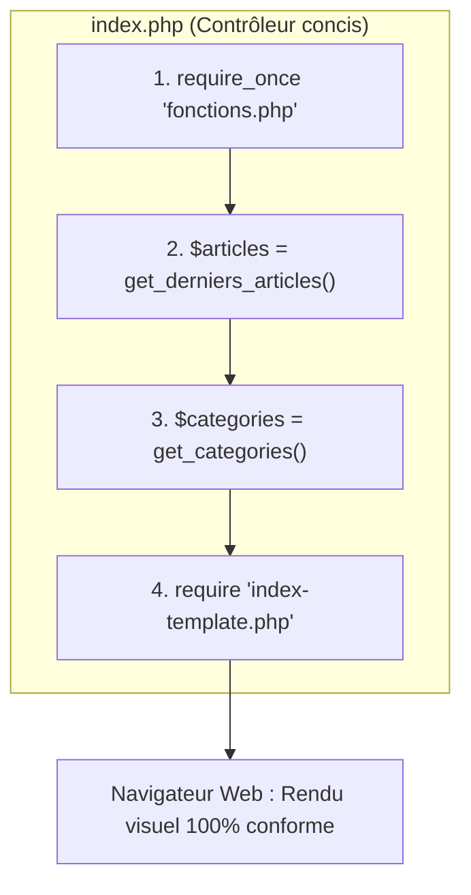

## 1. Contexte & Objectif

Dans les deux tutoriels précédents, vous avez regroupé les fonctions de production de données au sein du module `fonctions.php`.  
Pourtant, votre fichier principal `index.php` contient toujours les gros tableaux de données codés en dur depuis la session S4.

Dans ce tutoriel, vous allez nettoyer et réusiner `index.php`. Vous allez apprendre à importer le module externe avec l'instruction sécurisée `require_once`, appeler vos fonctions pour alimenter les variables `$articles` et `$categories`, puis passer le relais au template `index-template.php`.  
À la fin de ce tutoriel, votre fichier `index.php` fera moins de 10 lignes et la page d'accueil s'affichera à l'identique dans le navigateur.

* **Objectif technique :** Remplacer les tableaux en dur de `index.php` par l'inclusion `require_once 'fonctions.php'` et l'appel des fonctions `get_derniers_articles()` et `get_categories()`.
* **Prérequis :** Avoir terminé les tutoriels `T.123.151` et `T.123.152` avec le fichier `fonctions.php` opérationnel.



---

## 2. Théorie Pas-à-Pas

### 2.1. L'instruction `require_once`

En PHP, pour charger le contenu d'un fichier externe, on utilise l'instruction `require` ou `require_once` :

* **`require`** : Charge et exécute le fichier cible. Si le fichier est manquant, PHP bloque l'exécution avec une erreur fatale (*Fatal Error*).
* **`require_once`** : Fait exactement la même chose, mais vérifie au préalable si le fichier a déjà été inclus plus tôt dans l'exécution. Si c'est le cas, il ne le recharge pas une seconde fois.

```php
<?php
// Utilisation recommandée pour les modules de fonctions et classes
require_once 'fonctions.php';
```

> **Pourquoi utiliser `require_once` pour les fonctions ?**  
> Si vous incluez deux fois un même fichier contenant une déclaration de fonction, PHP génère une erreur fatale bloquante : *Fatal error: Cannot redeclare nom_fonction()*. L'utilisation systématique de `require_once` pour vos modules élimine totalement ce risque.

### 2.2. Appeler une fonction et récupérer son résultat

Lorsqu'une fonction utilise l'instruction `return`, appeler cette fonction produit une valeur. Pour utiliser cette valeur plus tard dans la page, on l'affecte directement à une variable avec le signe égal `=` :

```php
<?php
// Exemple autonome
function get_message() {
    return "Bienvenue sur le Blog";
}

// Appel de la fonction et stockage du résultat
$texte = get_message();

echo $texte;
```

Dans notre contrôleur, `$articles = get_derniers_articles();` stocke le tableau renvoyé dans la variable `$articles`, qui sera ensuite parcourue par la boucle `foreach` du template d'affichage.

### 2.3. Le rôle d'un contrôleur d'orchestration

En architecture Web, le fichier `index.php` joue le rôle de **contrôleur** :
1. Il importe les outils nécessaires (`require_once 'fonctions.php'`).
2. Il récupère les données via les fonctions.
3. Il délègue l'affichage à la vue (`require 'index-template.php'`).

Le contrôleur ne doit pas contenir de code HTML, ni de données en dur. Il se contente d'orchestrer la page.

---

## 3. Pratique & Réalisation Guidée

### Étape 1 — Observer le fichier `index.php` de départ

1. Ouvrez `index.php` dans votre éditeur VS Code.
2. Observez que le fichier comporte une trentaine de lignes dominées par de gros tableaux statiques :

```php
<?php
// État hérité de S4 : données mélangées au contrôleur
$articles = [
    [ 'id' => 1, 'titre' => 'Comment structurer ses composants UI...', ... ],
    [ 'id' => 2, 'titre' => 'Maîtriser les micro-interactions UX...', ... ]
];

$categories = [
    ['id' => 1, 'libelle' => 'Développement'],
    ['id' => 2, 'libelle' => 'Design UI/UX']
];

require 'index-template.php';
```

### Étape 2 — Réusiner `index.php` avec `require_once` et les appels de fonctions

1. Supprimez l'intégralité des tableaux `$articles = [...]` et `$categories = [...]`.
2. Remplacez-les par l'inclusion du module et les deux appels de fonctions :

```php
<?php
// 1. Inclusion sécurisée du module de données
require_once 'fonctions.php';

// 2. Récupération des données via les fonctions
$articles = get_derniers_articles();
$categories = get_categories();

// 3. Délégation de l'affichage au template HTML
require 'index-template.php';
```

3. Enregistrez le fichier avec `Ctrl + S`.  
Votre contrôleur fait désormais moins de 10 lignes utiles.

### Étape 3 — Tester la page d'accueil dans le navigateur

1. Démarrez votre serveur local si ce n'est pas déjà fait :

```bash
php -S localhost:8000
```

2. Ouvrez votre navigateur Web à l'adresse suivante :

```text
http://localhost:8000/index.php
```

3. **Vérification du résultat :**
   - La bannière du blog et le titre s'affichent correctement.
   - Les deux cartes d'articles sont présentes avec leurs badges de catégorie respectifs.
   - Les boutons de filtre des catégories s'affichent au-dessus des articles.
   - Aucune erreur ou avertissement PHP n'apparaît.

Le résultat visuel est 100% identique à la session S4, mais le code applicatif est désormais modulaire, propre et maintenable.

---

## 4. Livrable & Critères de Réussite

### 4.1. Emplacement dans votre dépôt d'autoformation

Dans votre dépôt GitHub annuel d'autoformations, déposez votre fichier dans le dossier suivant :

```text
php/organiser-avec-fonctions/inclure-module-externe-require-once/
```

### 4.2. Contenu attendu du livrable

Votre dossier de livrable doit contenir :
* **`index.php`** : Le fichier contrôleur réusiné et allégé.

```php
<?php
// index.php — Contrôleur de la page d'accueil du Blog

// 1. Charger le module de fonctions
require_once 'fonctions.php';

// 2. Préparer les données pour la vue
$articles = get_derniers_articles();
$categories = get_categories();

// 3. Charger le template d'affichage
require 'index-template.php';
```

### 4.3. Critères de réussite

* [ ] Le fichier `index.php` ne contient plus aucun tableau associatif codé en dur.
* [ ] L'instruction `require_once 'fonctions.php'` est présente en début de fichier.
* [ ] Les variables `$articles` et `$categories` reçoivent le résultat des fonctions correspondantes.
* [ ] La ligne `require 'index-template.php'` est conservée à la fin du fichier.
* [ ] La page s'affiche sans aucune rupture visuelle sur `http://localhost:8000/index.php`.
* [ ] Le livrable est constitué exclusivement de code source commité sur GitHub, sans capture d'écran.

---

## 5. Glossaire

* **`require_once`** : Instruction PHP qui inclut et exécute un fichier externe une seule fois au maximum par requête.
* **Contrôleur** : Fichier principal qui reçoit la demande de l'utilisateur, prépare les données et charge le template de rendu.
* **Appel de fonction** : Déclenchement de l'exécution d'une fonction en écrivant son nom suivi de parenthèses `()`.
* **Réusinage (Refactoring)** : Amélioration de la structure interne d'un code existant sans changer son comportement extérieur.
