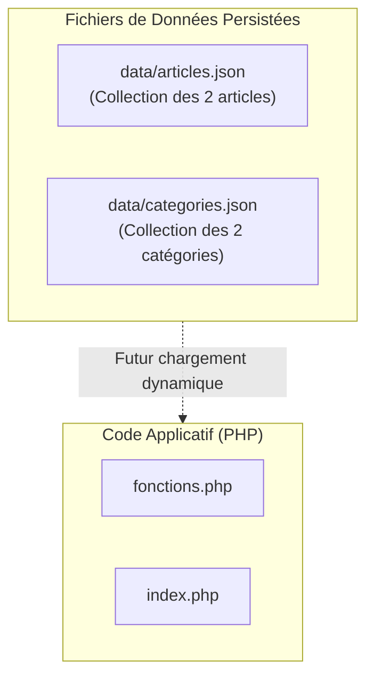

## 1. Contexte & Objectif

Dans les tutoriels précédents (série UA.123.15), vous avez modularisé votre code en créant des fonctions. Cependant, les données des articles et des catégories sont toujours écrites en dur dans le fichier `fonctions.php`.  
Si un rédacteur souhaite ajouter un nouvel article de blog ou corriger une faute de frappe, il doit modifier un fichier de code PHP, ce qui représente un risque élevé d'erreur syntaxique.

Dans ce tutoriel, vous allez franchir une étape clé : **séparer physiquement les données du code source**. Vous allez découvrir le format universel **JSON** et créer deux fichiers de données autonomes : `data/articles.json` et `data/categories.json`.

* **Objectif technique :** Créer le sous-dossier `data/`, modéliser la collection des articles dans `data/articles.json` et celle des catégories dans `data/categories.json` au format JSON valide.
* **Prérequis :** Comprendre la structure des tableaux associatifs PHP (clés et valeurs).



---

## 2. Théorie Pas-à-Pas

### 2.1. Qu'est-ce que le format JSON ?

**JSON** (*JavaScript Object Notation*) est un format texte standardisé et universel utilisé pour stocker et échanger des données entre différentes applications ou langages de programmation.

Pourquoi utiliser JSON plutôt que du PHP pour stocker des données ?
* **Indépendant du langage :** Un fichier JSON peut être lu par PHP, JavaScript, Python ou une base de données.
* **Lisible par l'humain :** Sa structure en paires clé/valeur est facile à comprendre et à modifier.
* **Sécurisé :** Un fichier JSON ne contient que des données brutes, aucun code exécutable ne peut s'y cacher.

### 2.2. La syntaxe stricte du format JSON

Le format JSON repose sur deux structures fondamentales :
1. **Le tableau (`[]`)** : Une liste ordonnée d'éléments séparés par des virgules.
2. **L'objet (`{}`)** : Un ensemble de paires `"clé": valeur`.

```json
[
  {
    "id": 1,
    "titre": "Découvrir JSON",
    "est_publie": true
  }
]
```

### 2.3. Les 3 règles d'or à respecter en JSON

La syntaxe JSON est beaucoup plus stricte que celle de PHP ou JavaScript. Vous devez impérativement respecter trois règles :

1. **Guillemets doubles obligatoires (`""`) :** Les noms de clés et les textes doivent être entourés de guillemets doubles. Les guillemets simples (`'...'`) sont formellement interdits en JSON.
2. **Types primitifs autorisés :**
   - Chaînes de caractères : `"texte"`
   - Nombres : `42` ou `19.99` (sans guillemets)
   - Booléens : `true` ou `false` (sans guillemets, en minuscules)
   - Valeur nulle : `null`
3. **Interdiction de la virgule finale (virgule orpheline) :** Il ne faut **jamais** placer de virgule après le dernier élément d'un tableau ou après la dernière clé d'un objet. Une virgule finale provoque une erreur de syntaxe JSON.

---

## 3. Pratique & Réalisation Guidée

### Étape 1 — Créer le dossier `data/`

1. Ouvrez votre projet dans VS Code.
2. À la racine de votre projet, créez un nouveau sous-dossier nommé `data`.

### Étape 2 — Créer le fichier `data/articles.json`

1. Dans le dossier `data/`, créez un nouveau fichier nommé `articles.json`.
2. Saisissez la collection des deux articles au format JSON :

```json
[
  {
    "id": 1,
    "titre": "Comment structurer ses composants UI avec Atomic Design ?",
    "contenu": "Découvrez les concepts fondamentaux pour concevoir des composants d'interface modulaires, cohérents et réutilisables dans vos projets web.",
    "image": "article-example.png",
    "date_creation": "2026-02-14",
    "categorie_libelle": "Développement",
    "categorie_couleur": "bleu"
  },
  {
    "id": 2,
    "titre": "Maîtriser les micro-interactions UX",
    "contenu": "Une interface belle n'est pas suffisante : découvrez comment de subtiles animations CSS et retours visuels améliorent l'expérience utilisateur.",
    "image": "article-example.png",
    "date_creation": "2026-02-10",
    "categorie_libelle": "Design UI/UX",
    "categorie_couleur": "rose"
  }
]
```

3. Enregistrez le fichier avec `Ctrl + S`.  
Vérifiez dans VS Code qu'aucune ligne rouge de soulignement n'apparaît.

### Étape 3 — Créer le fichier `data/categories.json`

1. Dans le même dossier `data/`, créez un fichier nommé `categories.json`.
2. Saisissez la liste des catégories au format JSON :

```json
[
  {
    "id": 1,
    "libelle": "Développement"
  },
  {
    "id": 2,
    "libelle": "Design UI/UX"
  }
]
```

3. Enregistrez le fichier avec `Ctrl + S`.

### Étape 4 — Valider la conformité des fichiers JSON

1. Ouvrez votre terminal VS Code.
2. Lancez une commande rapide PHP pour valider le décodage de vos deux fichiers :

```bash
php -r "json_decode(file_get_contents('data/articles.json')) or die('Erreur articles.json'); json_decode(file_get_contents('data/categories.json')) or die('Erreur categories.json'); echo 'Fichiers JSON 100% valides !';"
```

3. **Résultat attendu :**
```text
Fichiers JSON 100% valides !
```

Vos données sont désormais externalisées et prêtes à être chargées dynamiquement par votre application PHP au tutoriel suivant.

---

## 4. Livrable & Critères de Réussite

### 4.1. Emplacement dans votre dépôt d'autoformation

Dans votre dépôt GitHub annuel d'autoformations, déposez vos fichiers dans le dossier suivant :

```text
php/lire-donnees-fichiers/structurer-collection-format-json/
```

### 4.2. Contenu attendu du livrable

Votre dossier de livrable doit contenir :
* **`data/articles.json`** : Le fichier JSON contenant la collection des deux articles du blog.
* **`data/categories.json`** : Le fichier JSON contenant les deux catégories de filtre.

### 4.3. Critères de réussite

* [ ] Le sous-dossier `data/` contient bien les fichiers `articles.json` et `categories.json`.
* [ ] Toutes les clés et chaînes de caractères utilisent des guillemets doubles stricts `""`.
* [ ] Aucune virgule orpheline n'est présente après le dernier élément des objets ou tableaux.
* [ ] Le décodage JSON est validé sans erreur syntaxique.
* [ ] Le livrable est constitué exclusivement de code source commité sur GitHub, sans capture d'écran.

---

## 5. Glossaire

* **JSON** : *JavaScript Object Notation*, format texte léger et universel de représentation de données structurées.
* **Objet JSON (`{}`)** : Structure associant des noms de propriétés (clés) à des valeurs.
* **Tableau JSON (`[]`)** : Liste ordonnée de valeurs ou d'objets indexée numériquement.
* **Persistance** : Capacité à conserver des données de manière durable sur le disque dur ou un système de fichiers.
