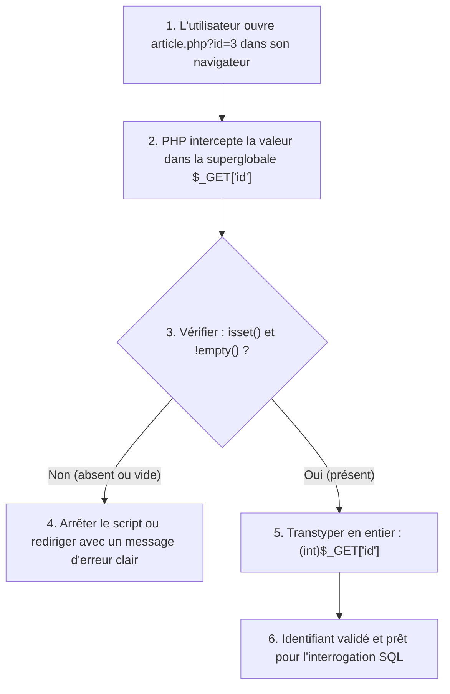

## 1. Contexte & Objectif

Dans une application Web dynamique, toutes les pages ne peuvent pas afficher la même chose pour tout le monde. Lorsqu'un lecteur clique sur un article précis depuis la page d'accueil, le serveur doit savoir **quel article** afficher en détail.

Pour transmettre cette information au serveur lors d'un clic, le protocole HTTP utilise les **paramètres d'URL** (la chaîne de requête ou *query string*, visible sous la forme `article.php?id=3`).  
Côté serveur, PHP intercepte automatiquement ces valeurs dans la variable superglobale **`$_GET`**.

Dans ce tutoriel, vous allez créer le contrôleur **`article.php`**. Vous allez apprendre à intercepter le paramètre transmis dans l'URL, vérifier scrupuleusement qu'il est présent avec `isset()` et `!empty()`, et le convertir en entier sécurisé avec le transtypage `(int)` avant tout traitement.

* **Objectif technique :** Créer le fichier `article.php`, intercepter `$_GET['id']`, vérifier sa validité, transtyper la valeur en entier sécurisé et traiter proprement le cas où aucun paramètre n'est fourni.
* **Prérequis :** Maîtriser les conditions PHP (`if / else`), les fonctions natives de vérification (`isset()`, `empty()`) et l'inclusion de fichiers avec `require_once`.



---

## 2. Théorie Pas-à-Pas

### 2.1. L'anatomie d'une URL et le paramètre de requête (Query String)

Une URL Web peut transporter de petites informations textuelles destinées au serveur grâce à une syntaxe normalisée :

```text
http://localhost:8000/article.php?id=3
                      \_________/ \__/
                           |        |
                      Page cible  Paramètre (?cle=valeur)
```

* **Le point d'interrogation (`?`)** : Marque le début des paramètres transmis dans l'URL.
* **La clé et sa valeur (`cle=valeur`)** : Définit le nom de la variable transmise et sa donnée associée.
* Si l'on souhaite passer plusieurs paramètres, on les sépare par un perluète (`&`) : `page.php?id=3&vue=sommaire`.

### 2.2. La superglobale PHP $_GET

Dès qu'une requête HTTP arrive avec des paramètres d'URL, PHP remplit automatiquement un tableau associatif spécial accessible partout : **`$_GET`**.

* Si l'URL est `article.php?id=3`, la superglobale contient :
  ```php
  <?php
  // $_GET est un tableau associatif natif
  $_GET = [
      'id' => '3' // Attention : La valeur arrive toujours sous forme de texte (string)
  ];
  echo "Paramètre id reçu : " . $_GET['id'];
  ?>
  ```

### 2.3. Vérification d'existence et transtypage sécurisé

**Règle d'or de la sécurité Web :** *« Ne faites jamais confiance aux données envoyées par le client »*.  
Un utilisateur peut modifier l'URL manuellement, supprimer le paramètre ou saisir du texte invalide (`article.php?id=abc` ou `article.php`).

Pour sécuriser l'accès, trois vérifications sont indispensables :

1. **`isset($_GET['id'])`** : Vérifie que la clé `'id'` existe bien dans le tableau.
2. **`!empty($_GET['id'])`** : Vérifie que la valeur n'est pas vide (ni chaîne vide `""`, ni `0`).
3. **Le transtypage entier `(int)`** : Force la conversion de la valeur en nombre entier. Si un utilisateur malveillant injecte du texte, `(int)` le transforme automatiquement en `0`, neutralisant tout risque d'attaque par chaîne parasite.

```php
<?php
// Exemple autonome de validation de paramètre GET
$_GET['id'] = '5'; // Simulation de paramètre reçu

if (!isset($_GET['id']) || empty($_GET['id'])) {
    die("Erreur : Aucun identifiant valide n'a été spécifié.");
}

// Transtypage en entier sécurisé
$articleId = (int)$_GET['id'];

if ($articleId <= 0) {
    die("Erreur : L'identifiant doit être un entier positif supérieur à 0.");
}

echo "Identifiant validé avec succès : " . $articleId;
?>
```

---

## 3. Pratique & Réalisation Guidée

### Étape 1 — Créer le contrôleur article.php

1. À la racine de votre projet de blog, créez un nouveau fichier nommé **`article.php`**.
2. Commencez le fichier par la balise PHP d'ouverture et incluez le module central de connexion à la base de données :

```php
<?php
// article.php : Contrôleur de consultation détaillée d'un article
require_once 'db.php';
```

### Étape 2 — Intercepter et valider l'identifiant d'article

1. Ajoutez la condition de contrôle vérifiant la présence du paramètre `id` dans `$_GET` :

```php
// 1. Vérifier la présence du paramètre d'URL 'id'
if (!isset($_GET['id']) || empty($_GET['id'])) {
    die("Erreur : Aucun article sélectionné. Veuillez choisir un article depuis la page d'accueil.");
}

// 2. Transtyper en entier pour neutraliser les caractères invalides
$articleId = (int)$_GET['id'];

// 3. Valider que l'identifiant est un nombre strictement positif
if ($articleId <= 0) {
    die("Erreur : L'identifiant de l'article est invalide.");
}
```

### Étape 3 — Afficher un message de confirmation temporaire

1. Pour valider que le contrôleur reçoit et traite correctement le paramètre avant de le raccorder à la base de données au tutoriel suivant, ajoutez une ligne d'affichage de contrôle :

```php
// Message de contrôle temporaire
echo "Article n° " . htmlspecialchars($articleId) . " sélectionné avec succès.";
?>
```

### Étape 4 — Tester les différents scénarios d'URL

1. Démarrez votre serveur local si nécessaire :
   ```bash
   php -S localhost:8000
   ```
2. Ouvrez votre navigateur et testez les trois cas d'URL suivants :
   - **Cas 1 (Paramètre valide) :** `http://localhost:8000/article.php?id=2`  
     *Résultat attendu :* Le message affiche *"Article n° 2 sélectionné avec succès."*.
   - **Cas 2 (Paramètre absent) :** `http://localhost:8000/article.php`  
     *Résultat attendu :* Le script s'arrête proprement et affiche *"Erreur : Aucun article sélectionné..."*.
   - **Cas 3 (Valeur invalide) :** `http://localhost:8000/article.php?id=texte`  
     *Résultat attendu :* Le transtypage convertit le texte en `0`, déclenchant *"Erreur : L'identifiant de l'article est invalide."*.

---

## 4. Livrable & Critères de Réussite

### 4.1. Emplacement dans votre dépôt d'autoformation

Dans votre dépôt GitHub annuel d'autoformations, créez l'arborescence suivante :

```text
php/recevoir-donnees-requete-web/recevoir-valider-parametre-url-get/
```

### 4.2. Contenu attendu du livrable

Déposez dans ce dossier votre fichier **`article.php`** validant l'identifiant transmis :

```php
<?php
// Livrable : Contrôleur avec interception et validation sécurisée de $_GET['id']
require_once 'db.php';

// 1. Contrôler l'existence et la non-vacuité du paramètre
if (!isset($_GET['id']) || empty($_GET['id'])) {
    die("Erreur : Aucun article sélectionné. Veuillez choisir un article depuis la page d'accueil.");
}

// 2. Transtypage rigoureux en entier
$articleId = (int)$_GET['id'];

// 3. Vérification de la cohérence de l'entier
if ($articleId <= 0) {
    die("Erreur : L'identifiant de l'article est invalide.");
}

// 4. Affichage de contrôle
echo "Article n° " . htmlspecialchars($articleId) . " sélectionné avec succès.";
?>
```

### 4.3. Critères de réussite

* [ ] Le script vérifie la présence du paramètre avec `isset($_GET['id'])`.
* [ ] Le script vérifie que la valeur n'est pas vide avec `!empty($_GET['id'])`.
* [ ] Le transtypage `(int)` est appliqué systématiquement sur `$_GET['id']`.
* [ ] Un identifiant nul ou négatif est bloqué avec un message d'erreur compréhensible.
* [ ] Une URL sans paramètre (`article.php`) n'affiche aucun avertissement PHP (*Notice* ou *Warning*) et s'interrompt proprement.

---

## 5. Glossaire

* **Query string (Chaîne de requête)** : Partie de l'URL située après le point d'interrogation (`?`) servant à transmettre des paramètres textuels au serveur sous la forme `cle=valeur`.
* **Superglobale `$_GET`** : Tableau associatif prédéfini en PHP contenant automatiquement l'ensemble des données passées dans l'URL d'une requête HTTP GET.
* **`isset()`** : Fonction native PHP déterminant si une variable ou un index de tableau est déclaré et différent de `null`.
* **`empty()`** : Fonction vérifiant si une variable est vide (chaîne vide `""`, `0`, `false` ou non définie).
* **Transtypage (Type casting)** : Opération forçant la conversion explicite d'une variable d'un type vers un autre (ex. `(int)` transforme une chaîne en entier).
* **Méthode HTTP GET** : Méthode de requête Web standard utilisée pour demander une ressource au serveur en transmettant les paramètres dans l'URL.
