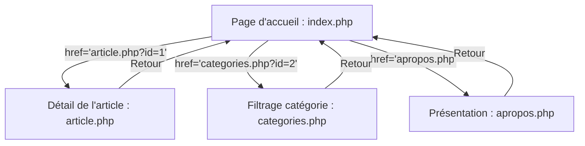

## 1. Contexte & Objectif

Félicitations pour vos avancées : vous disposez maintenant d'un contrôleur d'accueil (`index.php`), d'une page de détail d'un article (`article.php?id=...`) et d'une page de filtrage thématique (`categories.php?id=...`). Cependant, sur votre page d'accueil, cliquer sur les boutons *"Lire l'article"* ou sur les badges de catégories ne fonctionne pas encore, car ils contiennent des liens factices (`href="#"`).

Dans ce dernier tutoriel de la session S7, vous allez finaliser l'ensemble de l'espace public de votre blog. Vous allez apprendre à **construire des liens hypertextes dynamiques** en injectant les identifiants PHP directement dans l'attribut `href` des balises `<a>`. Vous allez également intégrer la page de présentation (`apropos.php` et `apropos-template.php`) et harmoniser la barre de navigation sur tous vos templates pour offrir un parcours utilisateur fluide et sans aucun lien mort.

* **Objectif technique :** Remplacer tous les liens statiques `href="#"` par des URL paramétrées dynamiques (`article.php?id=<?= $article['id'] ?>` et `categories.php?id=<?= $article['categorie_id'] ?>`), créer `apropos.php`, et valider le cycle complet de navigation multi-pages dans le navigateur.
* **Prérequis :** Avoir réalisé les pages `article.php` et `categories.php` opérationnelles avec la base de données MySQL.



---

## 2. Théorie Pas-à-Pas

### 2.1. L'injection d'identifiants dans l'attribut href

En HTML standard, un lien hypertexte est statique : `<a href="contact.html">`.  
Dans une application PHP dynamique, la cible d'un lien est construite au vol à partir des données extraites de la base de données. On utilise la balise courte d'affichage **`<?= ... ?>`** directement dans l'attribut `href` :

```html
<!-- Générer un lien dynamique vers l'article précis en cours d'itération dans la boucle foreach -->
<a href="article.php?id=<?= $article['id'] ?>" class="bouton-principal">
    Lire la suite
</a>
```

* Lorsque PHP génère le code HTML envoyé au navigateur, il remplace `<?= $article['id'] ?>` par le vrai numéro :
  `<a href="article.php?id=3" class="bouton-principal">Lire la suite</a>`.
* Pour l'internaute, il s'agit d'un lien HTML normal et immédiatement cliquable.

### 2.2. Lier les catégories et filtres thématiques

Le même principe s'applique aux badges de catégories. Dans chaque carte d'article, nous injectons la clé étrangère `categorie_id` :

```html
<a href="categories.php?id=<?= $article['categorie_id'] ?>" class="badge-categorie">
    <?= htmlspecialchars($article['categorie_libelle']) ?>
</a>
```

* En cliquant sur le badge, le visiteur est dirigé vers la page filtrée affichant tous les articles de ce même thème.

### 2.3. L'harmonisation du menu de navigation global

Pour qu'un site Web soit agréable à parcourir, l'en-tête `<header>` et la barre de navigation `<nav>` doivent être strictement identiques sur toutes les pages :

```html
<nav class="navigation">
    <a href="index.php">Accueil</a>
    <a href="categories.php">Catégories</a>
    <a href="apropos.php">À propos</a>
</nav>
```

* Chaque page permet de revenir à l'accueil ou d'explorer les autres sections sans utiliser les boutons de retour du navigateur.

---

## 3. Pratique & Réalisation Guidée

### Étape 1 — Dynamiser les liens dans index-template.php

1. Ouvrez votre template d'accueil :
   ```text
   index-template.php
   ```
2. Dans la boucle `foreach ($articles as $article):`, localisez le lien du bouton d'action et remplacez `href="#"` par :

```html
<!-- Lien dynamique vers la page de détail -->
<a href="article.php?id=<?= $article['id'] ?>" class="bouton-principal">
    Lire l'article
</a>
```

3. Localisez le badge de catégorie de l'article et remplacez `href="#"` par le lien vers le filtre :

```html
<!-- Lien dynamique vers la catégorie -->
<a href="categories.php?id=<?= $article['categorie_id'] ?>" class="badge-categorie" style="background-color: <?= htmlspecialchars($article['categorie_couleur']) ?>; color: #fff;">
    <?= htmlspecialchars($article['categorie_libelle']) ?>
</a>
```

### Étape 2 — Créer la page À propos (apropos.php et apropos-template.php)

1. À la racine du projet, créez le contrôleur **`apropos.php`** :

```php
<?php
// apropos.php : Contrôleur de la page de présentation
require_once 'db.php';

// Informations de présentation du blog
$titrePage = "À propos de Mon Blog";

// Chargement de la vue
require 'apropos-template.php';
```

2. Créez ensuite la vue **`apropos-template.php`** à partir de votre maquette `public-apropos.html` :

```html
<!DOCTYPE html>
<html lang="fr">
<head>
    <meta charset="UTF-8">
    <meta name="viewport" content="width=device-width, initial-scale=1.0">
    <title><?= htmlspecialchars($titrePage) ?> - Mon Blog</title>
    <link rel="stylesheet" href="css/global.css">
    <link rel="stylesheet" href="css/layout.css">
    <link rel="stylesheet" href="css/components.css">
</head>
<body>
    <header class="en-tete">
        <div class="container">
            <a href="index.php" class="logo">Mon Blog</a>
            <nav class="navigation">
                <a href="index.php">Accueil</a>
                <a href="categories.php">Catégories</a>
                <a href="apropos.php" class="actif">À propos</a>
            </nav>
        </div>
    </header>

    <main class="container page-apropos">
        <h1><?= htmlspecialchars($titrePage) ?></h1>
        <p class="texte-intro">
            Bienvenue sur mon blog personnel d'autoformation technique Solicode ! Ce projet illustre l'apprentissage progressif du développement Web moderne : structuration HTML5, mise en page CSS factorisée, dynamisme client JavaScript et programmation serveur sécurisée avec PHP et MySQL.
        </p>

        <section class="section-technologies">
            <h2>Technologies Utilisées</h2>
            <ul class="liste-technologies">
                <li><strong>HTML5 & CSS3 :</strong> Feuilles modulaires, variables CSS et interactions fluides.</li>
                <li><strong>JavaScript :</strong> Manipulation du DOM côté client.</li>
                <li><strong>PHP 8 & PDO :</strong> Contrôleurs dynamiques et requêtes préparées anti-injections.</li>
                <li><strong>MySQL :</strong> Modélisation relationnelle avec clés primaires et jointures.</li>
            </ul>
        </section>

        <div class="actions-retour">
            <a href="index.php" class="bouton-principal">← Retour aux publications</a>
        </div>
    </main>

    <footer class="pied-page">
        <div class="container">
            <p>&copy; 2026 - Mon Blog Personnel</p>
            <p id="statut-client" class="texte-discret"></p>
        </div>
    </footer>

    <script src="js/script.js"></script>
</body>
</html>
```

### Étape 3 — Raccorder la barre de navigation sur l'ensemble des templates

Vérifiez que le bloc `<header>` contenant la barre de navigation `<nav>` pointe fidèlement vers les 3 contrôleurs PHP sur chaque vue :
- `index-template.php`
- `article-template.php`
- `categories-template.php`
- `apropos-template.php`

### Étape 4 — Effectuer le test de parcours utilisateur complet

1. Ouvrez votre navigateur sur `http://localhost:8000/index.php`.
2. Cliquez sur le bouton *"Lire l'article"* de la première carte :
   - L'URL passe à `http://localhost:8000/article.php?id=1`.
   - La page de détail complète de l'article s'affiche.
3. Cliquez sur *"← Retour à l'accueil"*.
4. Cliquez sur un badge de catégorie (ex. *PHP & MySQL*) :
   - L'URL passe à `http://localhost:8000/categories.php?id=2`.
   - Seuls les articles de cette catégorie sont listés.
5. Cliquez sur *"À propos"* dans le menu supérieur :
   - La page de présentation s'affiche sans erreur.
6. Félicitations : **Votre espace public de blog est 100% interactif, sécurisé et raccordé !**

---

## 4. Livrable & Critères de Réussite

### 4.1. Emplacement dans votre dépôt d'autoformation

Dans votre dépôt GitHub annuel d'autoformations, créez l'arborescence suivante :

```text
php/recevoir-donnees-requete-web/construire-liens-hypertextes-dynamiques-parametres/
```

### 4.2. Contenu attendu du livrable

Déposez dans ce dossier votre template **`index-template.php`** raccordé dynamiquement :

```html
<!-- Livrable : index-template.php avec liens hypertextes paramétrés dynamiques -->
<!DOCTYPE html>
<html lang="fr">
<head>
    <meta charset="UTF-8">
    <meta name="viewport" content="width=device-width, initial-scale=1.0">
    <title>Mon Blog - Accueil</title>
    <link rel="stylesheet" href="css/global.css">
    <link rel="stylesheet" href="css/layout.css">
    <link rel="stylesheet" href="css/components.css">
</head>
<body>
    <header class="en-tete">
        <div class="container">
            <a href="index.php" class="logo">Mon Blog</a>
            <nav class="navigation">
                <a href="index.php" class="actif">Accueil</a>
                <a href="categories.php">Catégories</a>
                <a href="apropos.php">À propos</a>
            </nav>
        </div>
    </header>

    <main class="container">
        <h1>Articles Récents</h1>

        <div class="grille-articles">
            <?php foreach ($articles as $article): ?>
                <article class="carte-article">
                    <!-- 1. Lien dynamique vers le filtre de catégorie -->
                    <a href="categories.php?id=<?= $article['categorie_id'] ?>" 
                       class="badge-categorie" 
                       style="background-color: <?= htmlspecialchars($article['categorie_couleur']) ?>; color: #fff;">
                        <?= htmlspecialchars($article['categorie_libelle']) ?>
                    </a>

                    <h2 class="titre-carte"><?= htmlspecialchars($article['titre']) ?></h2>
                    <p class="chapeau-carte"><?= htmlspecialchars($article['chapeau']) ?></p>

                    <div class="meta-carte">
                        <span>Publié le <?= date('d/m/Y', strtotime($article['date_creation'])) ?></span>
                    </div>

                    <!-- 2. Lien dynamique vers la vue détaillée de l'article -->
                    <a href="article.php?id=<?= $article['id'] ?>" class="bouton-principal">
                        Lire l'article
                    </a>
                </article>
            <?php endforeach; ?>
        </div>
    </main>

    <footer class="pied-page">
        <div class="container">
            <p>&copy; 2026 - Mon Blog Personnel</p>
            <p id="statut-client" class="texte-discret"></p>
        </div>
    </footer>

    <script src="js/script.js"></script>
</body>
</html>
```

### 4.3. Critères de réussite

* [ ] Aucun lien factice `href="#"` ne subsiste sur les cartes d'articles ou les catégories.
* [ ] L'attribut `href` des boutons pointe vers `article.php?id=<?= $article['id'] ?>`.
* [ ] L'attribut `href` des badges pointe vers `categories.php?id=<?= $article['categorie_id'] ?>`.
* [ ] Le menu de navigation relie parfaitement `index.php`, `categories.php` et `apropos.php`.
* [ ] Le parcours complet de navigation peut être effectué sans aucune erreur 404 ni rupture cognitive.

---

## 5. Glossaire

* **Lien hypertexte dynamique** : Élément de navigation HTML `<a href="...">` dont la destination ou les paramètres sont calculés automatiquement à l'exécution par un script serveur (PHP).
* **Navigation multi-pages** : Architecture d'application Web où chaque vue ou action correspond à une ressource distincte chargée par le navigateur.
* **Paramètre de route (URL paramétrée)** : Valeur d'identifiant injectée dans l'adresse Web pour indiquer au serveur quelle ressource afficher.
* **Parcours utilisateur** : Cheminement fluide suivi par un internaute à travers les différents écrans d'un site Web pour accomplir son objectif de consultation.
* **Lien mort (Broken link)** : Lien hypertexte pointant vers une page inexistante ou générant une erreur (comme une erreur HTTP 404).
