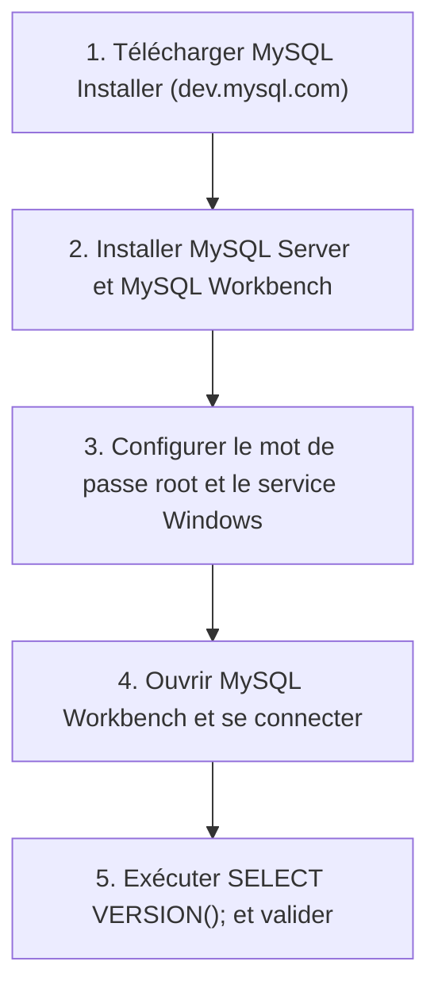

## 1. Contexte & Objectif

Dans les sessions précédentes, vous avez stocké vos données d'abord dans des tableaux PHP, puis dans des fichiers textes JSON.  
Pour construire des applications professionnelles capables de traiter des milliers d'articles, d'utilisateurs et de catégories simultanément, les développeurs utilisent un **SGBDR** (*Système de Gestion de Base de Données Relationnelle*) tel que **MySQL**.

Avant de modifier le code de votre blog, vous devez installer et configurer votre environnement de base de données.  
Plutôt que d'utiliser des logiciels tiers intermédiaires, vous allez installer **MySQL Server** directement comme un **service Windows natif** et l'outil graphique officiel **MySQL Workbench** à l'aide de l'outil officiel **MySQL Installer**.

* **Objectif technique :** Télécharger l'installateur officiel MySQL pour Windows, installer MySQL Server comme service Windows, définir le mot de passe administrateur `root`, configurer MySQL Workbench et exécuter une première requête de diagnostic `SELECT VERSION();`.
* **Prérequis :** Disposer d'un ordinateur sous Windows avec une connexion Internet active.



---

## 2. Théorie Pas-à-Pas

### 2.1. Qu'est-ce que MySQL et son architecture Service Windows ?

Un **SGBDR** est un logiciel spécialisé dans le stockage, l'organisation et la sécurisation de données structurées sous forme de tables reliées entre elles.

* **MySQL Server** fonctionne en arrière-plan comme un **service Windows** (nommé généralement `MySQL80`) :
  - Il écoute en permanence sur un port réseau standard : le **port 3306**.
  - Il démarre automatiquement à l'allumage de votre ordinateur, sans nécessiter de manipulation manuelle.
* **MySQL Workbench** est le client graphique officiel : il se connecte au serveur via ce port 3306 pour envoyer des ordres SQL et afficher les données.


### 2.2. L'outil officiel MySQL Installer pour Windows

Oracle fournit un utilitaire tout-en-un disponible à l'adresse :  
[https://dev.mysql.com/downloads/installer/](https://dev.mysql.com/downloads/installer/)

Cet installateur permet de sélectionner précisément les deux composants officiels indispensables pour notre formation :
1. **MySQL Server** : Le moteur de base de données relationnelle.
2. **MySQL Workbench** : L'environnement graphique d'administration et de requêtage.

### 2.3. Sécurité et compte root : l'importance du mot de passe

Lors de l'installation de MySQL Server, vous configurez obligatoirement le compte super-administrateur nommé **`root`** :
* Ce compte détient tous les privilèges sur le serveur (créer des bases, modifier les tables, gérer les utilisateurs).
* Vous définissez un mot de passe sécurisé pour ce compte (par exemple : **`admin`**).
* **Consigne clé :** Notez soigneusement ce mot de passe. Vous en aurez besoin pour vous connecter dans MySQL Workbench, puis dans votre code PHP (`db.php`).

---

## 3. Pratique & Réalisation Guidée

### Étape 1 — Télécharger MySQL Installer pour Windows

1. Ouvrez votre navigateur Web et rendez-vous sur la page officielle :  
   [https://dev.mysql.com/downloads/installer/](https://dev.mysql.com/downloads/installer/)
2. Repérez la section de téléchargement :
   - Choisissez le fichier complet **Windows (x86, 32-bit), MSI Installer** (d'une taille d'environ 200 à 300 Mo).
   - Cliquez sur le bouton **Download**.
3. Sur la page d'invitation à créer un compte Oracle, cliquez en bas sur le lien :  
   *« No thanks, just start my download »*.
4. Attendez la fin du téléchargement du fichier `.msi`.

### Étape 2 — Sélectionner MySQL Server et MySQL Workbench

1. Double-cliquez sur le fichier `.msi` téléchargé pour lancer l'assistant.
2. Sur l'écran **Choosing a Setup Type**, cochez **Custom** (Personnalisé) puis cliquez sur **Next**.
3. Dans la liste **Available Products** :
   - Déroulez *MySQL Servers* ➔ *MySQL Server* ➔ *MySQL Server 8.0* (ou version la plus récente). Sélectionnez la version et cliquez sur la **flèche verte vers la droite `>`** pour l'ajouter à la liste des produits à installer.
   - Déroulez *Applications* ➔ *MySQL Workbench* ➔ *MySQL Workbench 8.0*. Sélectionnez la version et cliquez également sur la **flèche verte vers la droite `>`**.
4. Cliquez sur **Next**.
5. Sur l'écran **Installation**, cliquez sur **Execute**. L'assistant installe MySQL Server et MySQL Workbench.
6. Une fois les statuts passés à *Complete*, cliquez sur **Next**.

### Étape 3 — Configurer le serveur, le mot de passe root et le service Windows

1. **Type and Networking :**
   - Conservez le profil par défaut : *Development Computer*.
   - Vérifiez que le port TCP/IP indiqué est bien **`3306`**.
   - Cliquez sur **Next**.
2. **Authentication Method :**
   - Laissez cochée l'option recommandée : *Use Strong Password Encryption for Authentication*.
   - Cliquez sur **Next**.
3. **Accounts and Roles (Définition du mot de passe root) :**
   - Dans le champ **MySQL Root Password**, saisissez votre mot de passe (par exemple : `admin`).
   - Dans le champ **Repeat Password**, retapez exactement le même mot de passe (`admin`).
   - *Notez ce mot de passe dans un bloc-notes pour ne pas l'oublier.*
   - Cliquez sur **Next**.
4. **Windows Service :**
   - Laissez le nom par défaut du service : `MySQL80` (ou `MySQL`).
   - Assurez-vous que la case **« Start the MySQL Server at System Startup »** est bien cochée.
   - Cliquez sur **Next**.
5. **Apply Configuration :**
   - Cliquez sur le bouton **Execute**. L'installateur configure le serveur, crée le service Windows et démarre MySQL.
   - Une fois toutes les étapes validées en vert, cliquez sur **Finish**.
6. Cliquez sur **Next** puis sur **Finish** pour clore l'assistant.

Le serveur MySQL fonctionne désormais en permanence comme service Windows sur votre machine.

### Étape 4 — Se connecter dans MySQL Workbench et tester la connexion

1. Ouvrez le menu Démarrer de Windows, tapez **MySQL Workbench** et lancez l'application.
2. Sur la page d'accueil, observez la section **MySQL Connections** :
   - Une connexion locale par défaut est déjà présente (nommée généralement `Local instance MySQL80` ou `localhost:3306`).
   - Cliquez sur cette connexion.
3. Une boîte de dialogue vous invite à saisir votre mot de passe :
   - Saisissez le mot de passe `root` défini lors de l'installation (ex: `admin`).
   - Cochez la case **« Save password in vault »** pour que Workbench mémorise votre mot de passe.
   - Cliquez sur **OK**.
4. L'interface principale s'ouvre avec un onglet d'éditeur SQL (*Query 1*).
5. Saisissez la commande SQL de diagnostic :

```sql
SELECT VERSION();
```

6. Cliquez sur l'icône de l'éclair (**Execute**) dans la barre d'outils (ou utilisez le raccourci `Ctrl + Entrée`).
7. **Résultat attendu dans la grille inférieure (*Result Grid*) :**

| VERSION() |
| :--- |
| 8.0.35 (ou version installée) |

Dans le panneau inférieur *Output*, une ligne avec une coche verte confirme l'exécution sans erreur.

Votre serveur MySQL natif et votre client d'administration Workbench sont opérationnels.

---

## 4. Livrable & Critères de Réussite

### 4.1. Emplacement dans votre dépôt d'autoformation

Dans votre dépôt GitHub annuel d'autoformations, créez l'arborescence suivante :

```text
sql/creation-base-donnees-tables/installer-mysql-preparer-environnement-workbench/
```

### 4.2. Contenu attendu du livrable

Déposez dans ce dossier un fichier **`commandes.md`** consignant les paramètres de votre environnement :

```markdown
# Vérification de l'environnement MySQL & Workbench

## 1. Informations du service Windows MySQL
- **Nom du SGBDR :** MySQL Server (installé via MySQL Installer)
- **Mode d'exécution :** Service Windows natif (démarrage automatique)
- **Hôte :** 127.0.0.1 (localhost)
- **Port d'écoute :** 3306
- **Utilisateur administrateur :** root
- **Mot de passe configuré :** Configuré lors de l'installation
- **Client d'administration :** MySQL Workbench

## 2. Requête de diagnostic exécutée
```sql
SELECT VERSION();
```

## 3. Résultat obtenu
- Connexion établie avec succès depuis MySQL Workbench.
- Le serveur MySQL répond correctement aux requêtes SQL.
```

### 4.3. Critères de réussite

* [ ] MySQL Server est installé via l'utilitaire officiel et configuré comme service Windows.
* [ ] Le service MySQL démarre automatiquement et écoute sur le port `3306`.
* [ ] Le mot de passe administrateur `root` est configuré et noté.
* [ ] MySQL Workbench se connecte à l'instance locale avec l'utilisateur `root`.
* [ ] La requête `SELECT VERSION();` s'exécute sans message d'erreur.
* [ ] Le fichier `commandes.md` est consigné dans le dossier prévu du dépôt annuel sans capture d'écran.

---

## 5. Glossaire

* **MySQL Installer for Windows** : Utilitaire officiel d'Oracle permettant de télécharger, installer et mettre à jour les composants MySQL sous Windows.
* **Service Windows** : Programme fonctionnant en tâche de fond sous Windows sans interface utilisateur, démarré automatiquement par le système.
* **Super-utilisateur `root`** : Compte administrateur suprême disposant de la totalité des droits de gestion sur le serveur MySQL.
* **Port 3306** : Port réseau standard utilisé par le serveur MySQL pour dialoguer avec les clients.
* **MySQL Workbench** : Interface graphique officielle éditée par Oracle pour administrer des bases MySQL et concevoir des requêtes SQL.
* **`SELECT`** : Mot-clé SQL fondamental servant à interroger et extraire des données depuis le serveur.
