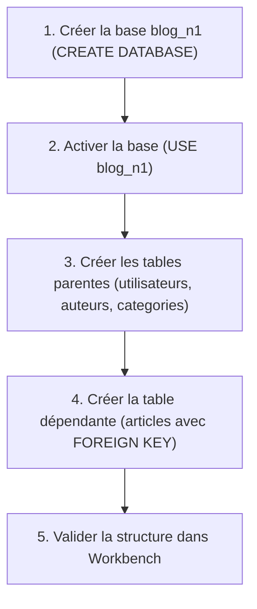
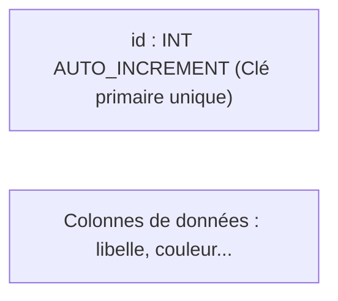

## 1. Contexte & Objectif

Dans le tutoriel précédent, vous avez vérifié que votre serveur MySQL est actif et que l'outil MySQL Workbench est prêt à dialoguer avec lui.  
Votre serveur est maintenant prêt, mais il ne contient encore aucune base de données pour votre application.

Dans ce tutoriel, vous allez écrire votre premier script SQL **DDL** (*Data Definition Language*) pour créer physiquement la base de données **`blog_n1`** et ses quatre tables relationnelles : `utilisateurs`, `auteurs`, `categories` et `articles`.

* **Objectif technique :** Rédiger et exécuter le script SQL créant la base `blog_n1` et ses quatre tables avec clés primaires auto-incrémentées et contraintes de clés étrangères.
* **Prérequis :** Avoir terminé le tutoriel T.124.110 et disposer d'une connexion active à MySQL dans Workbench.



---

## 2. Théorie Pas-à-Pas

### 2.1. Qu'est-ce que le DDL et comment créer une base ?

Le **DDL** (*Data Definition Language*, ou Langage de Définition de Données) rassemble les ordres SQL servant à définir la structure du stockage :
* **`CREATE DATABASE`** : Crée un conteneur indépendant nommé pour vos tables.
* **`USE`** : Indique à MySQL sur quelle base de données vous allez travailler pour les commandes suivantes.

```sql
CREATE DATABASE IF NOT EXISTS blog_n1 DEFAULT CHARACTER SET utf8mb4 COLLATE utf8mb4_general_ci;
USE blog_n1;
```

* **Pourquoi `utf8mb4` ?** Cet encodage universel gère tous les alphabets du monde ainsi que les caractères spéciaux et les emojis sans aucune perte d'information.

### 2.2. Colonnes, types de données et clé primaire

Chaque table stocke des enregistrements sous forme de lignes composées de colonnes typées :
* **`INT`** : Nombre entier (ex: identifiants).
* **`VARCHAR(taille)`** : Texte court de longueur maximale définie (ex: nom, email, titre).
* **`TEXT`** : Texte long sans limite stricte (ex: contenu d'un article).
* **`DATETIME`** : Date et heure précises (`AAAA-MM-JJ HH:MM:SS`).

Toute table relationnelle doit posséder une **clé primaire** (`PRIMARY KEY`), souvent nommée `id`.  
Avec l'option **`AUTO_INCREMENT`**, le serveur MySQL calcule automatiquement le prochain identifiant (1, 2, 3...) à chaque nouvel enregistrement.



### 2.3. Les clés étrangères et l'intégrité référentielle

Un article appartient toujours à une catégorie et a été rédigé par un auteur.  
Pour relier la table `articles` aux tables parentes `categories` et `auteurs`, nous utilisons des **clés étrangères** (`FOREIGN KEY`) :

* La colonne `categorie_id` dans `articles` pointe vers la colonne `id` de `categories`.
* La colonne `auteur_id` dans `articles` pointe vers la colonne `id` de `auteurs`.
* L'option **`ON DELETE CASCADE`** garantit que si une catégorie parente est supprimée, tous ses articles associés sont automatiquement effacés pour éviter les données orphelines.

> **Règle absolue d'ordre de création :**  
> Vous devez impérativement créer les tables parentes (`categories`, `auteurs`) **avant** la table dépendante (`articles`). Dans le cas contraire, MySQL déclenche une erreur car la table référencée n'existe pas encore.

---

## 3. Pratique & Réalisation Guidée

### Étape 1 — Créer et sélectionner la base de données

1. Ouvrez **MySQL Workbench** et connectez-vous sur votre instance locale (`localhost:3306`).
2. Ouvrez un nouvel onglet d'éditeur SQL (*Query Tab*).
3. Saisissez la commande suivante :

```sql
CREATE DATABASE IF NOT EXISTS blog_n1 DEFAULT CHARACTER SET utf8mb4 COLLATE utf8mb4_general_ci;
USE blog_n1;
```

### Étape 2 — Créer les tables parentes

Sous les commandes précédentes, ajoutez la création des tables qui ne dépendent d'aucune autre table :

```sql
-- Table des administrateurs du blog
CREATE TABLE IF NOT EXISTS utilisateurs (
  id INT AUTO_INCREMENT PRIMARY KEY,
  nom VARCHAR(50) NOT NULL,
  prenom VARCHAR(50) NOT NULL,
  email VARCHAR(100) NOT NULL UNIQUE,
  mot_de_passe VARCHAR(255) NOT NULL
);

-- Table des auteurs d'articles
CREATE TABLE IF NOT EXISTS auteurs (
  id INT AUTO_INCREMENT PRIMARY KEY,
  nom VARCHAR(50) NOT NULL,
  prenom VARCHAR(50) NOT NULL,
  image_profil VARCHAR(255) DEFAULT NULL
);

-- Table des catégories d'articles
CREATE TABLE IF NOT EXISTS categories (
  id INT AUTO_INCREMENT PRIMARY KEY,
  libelle VARCHAR(50) NOT NULL,
  couleur VARCHAR(20) NOT NULL DEFAULT 'bleu'
);
```

### Étape 3 — Créer la table dépendante avec ses relations

Ajoutez enfin la définition de la table `articles` avec ses deux contraintes d'intégrité référentielle :

```sql
-- Table des articles reliée aux catégories et aux auteurs
CREATE TABLE IF NOT EXISTS articles (
  id INT AUTO_INCREMENT PRIMARY KEY,
  titre VARCHAR(255) NOT NULL,
  contenu TEXT NOT NULL,
  image VARCHAR(255) DEFAULT NULL,
  date_creation DATETIME NOT NULL DEFAULT CURRENT_TIMESTAMP,
  categorie_id INT NOT NULL,
  auteur_id INT NOT NULL,
  CONSTRAINT fk_article_categorie FOREIGN KEY (categorie_id) REFERENCES categories(id) ON DELETE CASCADE,
  CONSTRAINT fk_article_auteur FOREIGN KEY (auteur_id) REFERENCES auteurs(id) ON DELETE CASCADE
);
```

### Étape 4 — Exécuter le script et vérifier le résultat

1. Cliquez sur l'icône de l'éclair (**Execute**) dans MySQL Workbench pour exécuter tout le script.
2. Dans le panneau de gauche (*Navigator*), sous l'onglet **Schemas**, faites un clic droit puis sélectionnez **Refresh All**.
3. Dépliez la base `blog_n1` puis le dossier **Tables** :
   - Vérifiez la présence des 4 tables : `articles`, `auteurs`, `categories`, `utilisateurs`.
4. Dans le panneau inférieur *Output*, vérifiez que 5 lignes vertes s'affichent sans message d'erreur rouge.

---

## 4. Livrable & Critères de Réussite

### 4.1. Emplacement dans votre dépôt d'autoformation

Dans votre dépôt GitHub annuel d'autoformations, créez l'arborescence suivante :

```text
sql/creation-base-donnees-tables/creer-base-donnees-tables-relationnelles/
```

### 4.2. Contenu attendu du livrable

Déposez dans ce dossier le fichier **`database.sql`** contenant l'intégralité du script DDL exécuté :

```sql
-- Script DDL : Création de la base de données blog_n1 et de ses tables
CREATE DATABASE IF NOT EXISTS blog_n1 DEFAULT CHARACTER SET utf8mb4 COLLATE utf8mb4_general_ci;
USE blog_n1;

CREATE TABLE IF NOT EXISTS utilisateurs (
  id INT AUTO_INCREMENT PRIMARY KEY,
  nom VARCHAR(50) NOT NULL,
  prenom VARCHAR(50) NOT NULL,
  email VARCHAR(100) NOT NULL UNIQUE,
  mot_de_passe VARCHAR(255) NOT NULL
);

CREATE TABLE IF NOT EXISTS auteurs (
  id INT AUTO_INCREMENT PRIMARY KEY,
  nom VARCHAR(50) NOT NULL,
  prenom VARCHAR(50) NOT NULL,
  image_profil VARCHAR(255) DEFAULT NULL
);

CREATE TABLE IF NOT EXISTS categories (
  id INT AUTO_INCREMENT PRIMARY KEY,
  libelle VARCHAR(50) NOT NULL,
  couleur VARCHAR(20) NOT NULL DEFAULT 'bleu'
);

CREATE TABLE IF NOT EXISTS articles (
  id INT AUTO_INCREMENT PRIMARY KEY,
  titre VARCHAR(255) NOT NULL,
  contenu TEXT NOT NULL,
  image VARCHAR(255) DEFAULT NULL,
  date_creation DATETIME NOT NULL DEFAULT CURRENT_TIMESTAMP,
  categorie_id INT NOT NULL,
  auteur_id INT NOT NULL,
  CONSTRAINT fk_article_categorie FOREIGN KEY (categorie_id) REFERENCES categories(id) ON DELETE CASCADE,
  CONSTRAINT fk_article_auteur FOREIGN KEY (auteur_id) REFERENCES auteurs(id) ON DELETE CASCADE
);
```

### 4.3. Critères de réussite

* [ ] La commande `CREATE DATABASE` crée la base `blog_n1` avec le jeu de caractères `utf8mb4`.
* [ ] Les 4 tables (`utilisateurs`, `auteurs`, `categories`, `articles`) sont visibles dans le panneau *Schemas* de Workbench.
* [ ] Chaque table possède une clé primaire numérique auto-incrémentée (`INT AUTO_INCREMENT PRIMARY KEY`).
* [ ] La table `articles` référence correctement `categories(id)` et `auteurs(id)` avec la clause `ON DELETE CASCADE`.
* [ ] Le script complet est enregistré dans le fichier `database.sql` à l'emplacement indiqué.

---

## 5. Glossaire

* **DDL** (*Data Definition Language*) : Sous-ensemble du langage SQL servant à créer, modifier ou supprimer des structures de données (`CREATE`, `ALTER`, `DROP`).
* **`CREATE DATABASE`** : Ordre SQL créant un nouvel espace logique de stockage de tables.
* **`USE`** : Commande SQL sélectionnant la base de données active sur laquelle exécuter les requêtes suivantes.
* **`CREATE TABLE`** : Ordre SQL définissant le nom d'une table et la liste de ses colonnes avec leurs types et contraintes.
* **Clé primaire (`PRIMARY KEY`)** : Colonne ou groupe de colonnes garantissant l'unicité stricte de chaque ligne d'une table.
* **`AUTO_INCREMENT`** : Propriété MySQL attribuant automatiquement un identifiant numérique croissant à chaque nouvel enregistrement.
* **Clé étrangère (`FOREIGN KEY`)** : Colonne contenant l'identifiant d'une ligne appartenant à une autre table, établissant un lien relationnel.
* **`ON DELETE CASCADE`** : Règle d'intégrité supprimant automatiquement les lignes enfants si la ligne parente correspondante est supprimée.
