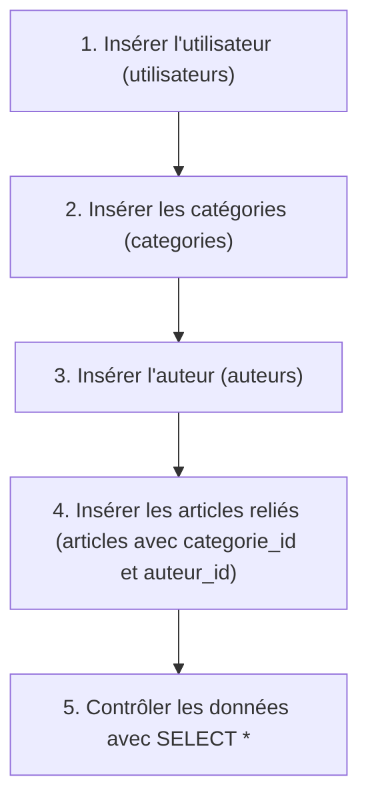

## 1. Contexte & Objectif

Dans le tutoriel précédent, vous avez créé la structure de la base `blog_n1` et ses quatre tables.  
Cependant, ces tables sont actuellement vides. Une base de données vide ne permet ni de tester des requêtes, ni d'afficher une interface dynamique dans votre blog.

Dans ce tutoriel, vous allez découvrir le sous-ensemble **DML** (*Data Manipulation Language*) de SQL. Vous allez rédiger des ordres **`INSERT INTO`** pour peupler votre base avec un jeu de données d'essai : un administrateur, trois catégories, un auteur et deux articles.

* **Objectif technique :** Rédiger et exécuter les instructions `INSERT INTO` en respectant l'ordre imposé par les contraintes d'intégrité référentielle, puis vérifier la présence des données avec `SELECT *`.
* **Prérequis :** Avoir terminé le tutoriel T.124.111 (avoir créé la base `blog_n1` et ses quatre tables).



---

## 2. Théorie Pas-à-Pas

### 2.1. Qu'est-ce que le DML et l'instruction INSERT INTO ?

Le **DML** (*Data Manipulation Language*) regroupe les commandes SQL permettant d'ajouter, modifier ou supprimer des lignes de données dans des tables existantes.  
Pour créer un nouvel enregistrement, on utilise l'ordre **`INSERT INTO`** :

```sql
INSERT INTO categories (libelle, couleur) VALUES ('Développement', 'bleu');
```

* Le premier bloc entre parenthèses liste le nom des colonnes cibles.
* Le mot-clé **`VALUES`** introduit les valeurs exactes correspondantes, dans le même ordre.
* Vous pouvez insérer plusieurs lignes en une seule instruction en séparant les tuples par une virgule.

### 2.2. Gestion des types et de la clé auto-incrémentée

Lors de l'insertion de valeurs, vous devez respecter les types SQL :
* **Textes (`VARCHAR`, `TEXT`) :** Doivent impérativement être entourés d'apostrophes simples (`'...'`).
* **Nombres (`INT`) :** S'écrivent sans apostrophes (ex: `1`, `42`).
* **Dates (`DATETIME`) :** S'écrivent sous la forme d'une chaîne normée `'AAAA-MM-JJ HH:MM:SS'`.
* **Clé primaire (`id`) :** Étant configurée avec `AUTO_INCREMENT`, **vous ne devez pas mentionner la colonne `id`** dans l'ordre d'insertion. MySQL lui attribue automatiquement la prochaine valeur disponible (1, puis 2, etc.).

### 2.3. L'ordre des insertions imposé par les relations

Dans la table `articles`, les colonnes `categorie_id` et `auteur_id` sont des clés étrangères :
* Si vous tentez d'insérer un article avec `categorie_id = 1` alors que la table `categories` est encore vide, MySQL refuse l'opération avec une erreur de contrainte d'intégrité (*Foreign key constraint fails*).
* **Règle absolue :** Insérez toujours les données des tables parentes (`categories`, `auteurs`, `utilisateurs`) **avant** d'insérer les lignes de la table dépendante (`articles`).

---

## 3. Pratique & Réalisation Guidée

### Étape 1 — Insérer l'administrateur

1. Dans **MySQL Workbench**, ouvrez un onglet de requête sur la base `blog_n1`.
2. Saisissez et exécutez l'insertion du compte administrateur :

```sql
USE blog_n1;

INSERT INTO utilisateurs (nom, prenom, email, mot_de_passe) VALUES
('Admin', 'Super', 'admin@blog.local', '$2y$10$e3MG7k/3i2t6YK2qj0Q4rOQcwwcBQVzOkWnE9CA/4O..p4P8656/W');
```

### Étape 2 — Insérer les catégories et l'auteur

1. Insérez les trois catégories du blog avec leurs couleurs respectives :

```sql
INSERT INTO categories (libelle, couleur) VALUES
('Développement', 'bleu'),
('UI / UX', 'rose'),
('Management', 'vert');
```

2. Insérez le premier auteur :

```sql
INSERT INTO auteurs (nom, prenom, image_profil) VALUES
('Ali', 'Madani', 'author.jpg');
```

### Étape 3 — Insérer les deux articles reliés

Maintenant que la catégorie `1` et l'auteur `1` existent en base, insérez les deux premiers articles du blog en précisant `categorie_id` et `auteur_id` :

```sql
INSERT INTO articles (titre, contenu, image, date_creation, categorie_id, auteur_id) VALUES
('Le métier de développeur et ses principales missions', 'Le développeur crée des applications...', 'article-example.png', '2026-02-14 10:00:00', 1, 1),
('Design UI/UX : Les bases pour commencer', 'L’expérience utilisateur est primordiale...', 'article-example.png', '2026-02-15 14:30:00', 2, 1);
```

### Étape 4 — Vérifier la présence des données insérées

1. Exécutez une requête de sélection sur la table `categories` :

```sql
SELECT * FROM categories;
```

**Résultat attendu dans la grille de résultats :**

| id | libelle | couleur |
| :---: | :--- | :--- |
| 1 | Développement | bleu |
| 2 | UI / UX | rose |
| 3 | Management | vert |

2. Exécutez une requête de sélection sur la table `articles` :

```sql
SELECT id, titre, date_creation, categorie_id, auteur_id FROM articles;
```

**Résultat attendu dans la grille de résultats :**

| id | titre | date_creation | categorie_id | auteur_id |
| :---: | :--- | :--- | :---: | :---: |
| 1 | Le métier de développeur et ses principales missions | 2026-02-14 10:00:00 | 1 | 1 |
| 2 | Design UI/UX : Les bases pour commencer | 2026-02-15 14:30:00 | 2 | 1 |

Les données de test sont correctement enregistrées dans votre base de données relationnelle.

---

## 4. Livrable & Critères de Réussite

### 4.1. Emplacement dans votre dépôt d'autoformation

Dans votre dépôt GitHub annuel d'autoformations, créez l'arborescence suivante :

```text
sql/creation-base-donnees-tables/inserer-donnees-test-instruction-insert/
```

### 4.2. Contenu attendu du livrable

Déposez dans ce dossier le fichier **`database.sql`** consolidé rassemblant à la fois la structure DDL et les données DML :

```sql
-- Script complet : Base de données blog_n1 (Structure et Données)

CREATE DATABASE IF NOT EXISTS blog_n1 DEFAULT CHARACTER SET utf8mb4 COLLATE utf8mb4_general_ci;
USE blog_n1;

-- 1. Structure des tables
CREATE TABLE IF NOT EXISTS utilisateurs (
  id INT AUTO_INCREMENT PRIMARY KEY,
  nom VARCHAR(50) NOT NULL,
  prenom VARCHAR(50) NOT NULL,
  email VARCHAR(100) NOT NULL UNIQUE,
  mot_de_passe VARCHAR(255) NOT NULL
);

CREATE TABLE IF NOT EXISTS auteurs (
  id INT AUTO_INCREMENT PRIMARY KEY,
  nom VARCHAR(50) NOT NULL,
  prenom VARCHAR(50) NOT NULL,
  image_profil VARCHAR(255) DEFAULT NULL
);

CREATE TABLE IF NOT EXISTS categories (
  id INT AUTO_INCREMENT PRIMARY KEY,
  libelle VARCHAR(50) NOT NULL,
  couleur VARCHAR(20) NOT NULL DEFAULT 'bleu'
);

CREATE TABLE IF NOT EXISTS articles (
  id INT AUTO_INCREMENT PRIMARY KEY,
  titre VARCHAR(255) NOT NULL,
  contenu TEXT NOT NULL,
  image VARCHAR(255) DEFAULT NULL,
  date_creation DATETIME NOT NULL DEFAULT CURRENT_TIMESTAMP,
  categorie_id INT NOT NULL,
  auteur_id INT NOT NULL,
  CONSTRAINT fk_article_categorie FOREIGN KEY (categorie_id) REFERENCES categories(id) ON DELETE CASCADE,
  CONSTRAINT fk_article_auteur FOREIGN KEY (auteur_id) REFERENCES auteurs(id) ON DELETE CASCADE
);

-- 2. Données de test
INSERT INTO utilisateurs (nom, prenom, email, mot_de_passe) VALUES
('Admin', 'Super', 'admin@blog.local', '$2y$10$e3MG7k/3i2t6YK2qj0Q4rOQcwwcBQVzOkWnE9CA/4O..p4P8656/W');

INSERT INTO categories (libelle, couleur) VALUES
('Développement', 'bleu'),
('UI / UX', 'rose'),
('Management', 'vert');

INSERT INTO auteurs (nom, prenom, image_profil) VALUES
('Ali', 'Madani', 'author.jpg');

INSERT INTO articles (titre, contenu, image, date_creation, categorie_id, auteur_id) VALUES
('Le métier de développeur et ses principales missions', 'Le développeur crée des applications...', 'article-example.png', '2026-02-14 10:00:00', 1, 1),
('Design UI/UX : Les bases pour commencer', 'L’expérience utilisateur est primordiale...', 'article-example.png', '2026-02-15 14:30:00', 2, 1);
```

### 4.3. Critères de réussite

* [ ] La commande `INSERT INTO` est utilisée avec la syntaxe normalisée en majuscules.
* [ ] Les tables parentes (`categories`, `auteurs`, `utilisateurs`) sont peuplées avant la table `articles`.
* [ ] La requête `SELECT * FROM categories;` retourne les 3 enregistrements attendus.
* [ ] La requête `SELECT * FROM articles;` retourne les 2 articles avec leurs clés étrangères valides.
* [ ] Le fichier `database.sql` est complet et consigné dans le dossier prévu du dépôt annuel.

---

## 5. Glossaire

* **DML** (*Data Manipulation Language*) : Sous-ensemble du langage SQL servant à manipuler les données enregistrées dans les tables (`INSERT`, `UPDATE`, `DELETE`).
* **`INSERT INTO`** : Ordre SQL ajoutant une ou plusieurs nouvelles lignes dans une table existante.
* **`VALUES`** : Mot-clé SQL introduisant la liste ordonnée des valeurs à insérer dans chaque colonne.
* **Tuple (ou ligne)** : Ensemble indivisible de valeurs représentant une entité concrète dans une table.
* **Intégrité référentielle** : Règle garantissant qu'une clé étrangère pointe toujours vers une clé primaire réelle et existante.
