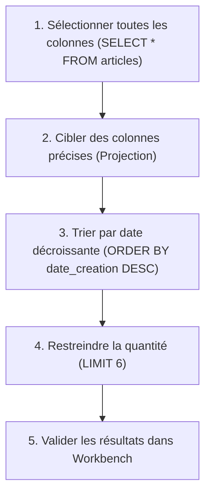

## 1. Contexte & Objectif

Dans le tutoriel T.124.112, vous avez inséré vos premiers enregistrements de test dans la base `blog_n1`.  
Pour exploiter ces informations dans une application, vous devez apprendre à interroger la base à l'aide de l'instruction fondamentale du langage SQL : **`SELECT`**.

Avant d'apprendre à relier plusieurs tables entre elles, vous allez maîtriser la sélection sur une table unique. Vous apprendrez à extraire l'ensemble des colonnes, à cibler uniquement les champs utiles (*projection*), à trier les lignes chronologiquement avec **`ORDER BY`** et à restreindre le nombre de résultats avec **`LIMIT`**.

* **Objectif technique :** Rédiger et exécuter dans MySQL Workbench des requêtes `SELECT` sur la table `articles` avec projection de colonnes, tri décroissant et limitation de volume.
* **Prérequis :** Avoir terminé le tutoriel T.124.112 (base `blog_n1` créée et peuplée de données de test).



---

## 2. Théorie Pas-à-Pas

### 2.1. L'instruction SELECT et la clause FROM

L'instruction **`SELECT`** indique au serveur MySQL quelles colonnes vous souhaitez lire, tandis que la clause **`FROM`** précise dans quelle table chercher :

```sql
SELECT * FROM articles;
```

* L'astérisque **`*`** est un caractère générique qui signifie : *« retourne toutes les colonnes existantes de la table »*.
* Cette commande est très utile lors du développement pour vérifier rapidement l'état d'une table.

### 2.2. La projection de colonnes : pourquoi cibler ses champs ?

Dans une application en production, utiliser `SELECT *` consomme inutilement de la bande passante et de la mémoire serveur, en particulier si la table contient des textes très longs ou des images.  
La bonne pratique consiste à lister explicitement les noms des colonnes souhaitées, séparées par des virgules :

```sql
SELECT id, titre, date_creation FROM articles;
```

* On appelle cette sélection ciblée une **projection**.

### 2.3. Trier et limiter les résultats

Les lignes d'une base de données relationnelle ne sont pas stockées dans un ordre garanti.  
Pour contrôler la présentation des résultats, nous utilisons deux clauses complémentaires :

1. **`ORDER BY nom_colonne [ASC|DESC]`** :
   - `ASC` : Tri croissant (par défaut, du plus ancien au plus récent, ou de A à Z).
   - `DESC` : Tri décroissant (du plus récent au plus ancien, ou de Z à A).
2. **`LIMIT nombre`** :
   - Restreint le résultat au nombre maximal de lignes spécifié (ex: afficher les 6 derniers articles sur la page d'accueil).

```sql
SELECT id, titre, date_creation
FROM articles
ORDER BY date_creation DESC
LIMIT 6;
```

---

## 3. Pratique & Réalisation Guidée

### Étape 1 — Sélectionner l'ensemble des données de la table articles

1. Lancez **MySQL Workbench** et ouvrez votre connexion locale.
2. Ouvrez un onglet d'éditeur SQL sur la base `blog_n1`.
3. Saisissez la requête de sélection globale :

```sql
USE blog_n1;

SELECT * FROM articles;
```

4. Exécutez la requête (`Ctrl + Entrée`).
5. **Résultat :** La grille inférieure affiche les 2 articles avec l'intégralité de leurs colonnes (`id`, `titre`, `contenu`, `image`, `date_creation`, `categorie_id`, `auteur_id`).

### Étape 2 — Pratiquer la projection de colonnes

Pour alléger la réponse et n'extraire que les champs nécessaires à l'affichage des cartes du blog, remplacez `*` par la liste des colonnes utiles :

```sql
SELECT id, titre, date_creation, image, categorie_id
FROM articles;
```

Exécutez la requête. Constatez que la colonne volumineuse `contenu` n'est plus transférée.

### Étape 3 — Trier les articles par date décroissante

Dans un blog, nous souhaitons que les articles les plus récents s'affichent en premier :

```sql
SELECT id, titre, date_creation
FROM articles
ORDER BY date_creation DESC;
```

**Résultat attendu dans la grille de résultats :**

| id | titre | date_creation |
| :---: | :--- | :--- |
| 2 | Design UI/UX : Les bases pour commencer | 2026-02-15 14:30:00 |
| 1 | Le métier de développeur et ses principales missions | 2026-02-14 10:00:00 |

* L'article n°2 (publié le 15 février) apparaît bien avant l'article n°1 (publié le 14 février).

### Étape 4 — Restreindre le nombre de résultats avec LIMIT

Ajoutez la clause `LIMIT 6` à la fin de votre requête pour brider l'affichage aux 6 publications les plus récentes :

```sql
SELECT id, titre, date_creation
FROM articles
ORDER BY date_creation DESC
LIMIT 6;
```

Cette requête forme le squelette de base de notre extraction d'articles.

---

## 4. Livrable & Critères de Réussite

### 4.1. Emplacement dans votre dépôt d'autoformation

Dans votre dépôt GitHub annuel d'autoformations, créez l'arborescence suivante :

```text
sql/construire-requete-select-simple/selectionner-trier-donnees-select-order-by/
```

### 4.2. Contenu attendu du livrable

Déposez dans ce dossier un fichier **`requetes.sql`** consignant vos requêtes d'entraînement testées et commentées :

```sql
-- Requêtes SQL : Sélection simple, projection, tri et limitation
-- Projet : Blog Personnel N1

USE blog_n1;

-- 1. Sélection de toutes les colonnes
SELECT * FROM articles;

-- 2. Projection de colonnes ciblées
SELECT id, titre, date_creation, image, categorie_id FROM articles;

-- 3. Sélection avec tri chronologique décroissant et limite
SELECT id, titre, date_creation, image, categorie_id
FROM articles
ORDER BY date_creation DESC
LIMIT 6;
```

### 4.3. Critères de réussite

* [ ] Les mots-clés SQL (`SELECT`, `FROM`, `ORDER BY`, `DESC`, `LIMIT`) sont tous en **MAJUSCULES**.
* [ ] La commande `SELECT *` retourne les 2 articles de la base.
* [ ] La projection restreint l'affichage aux colonnes demandées.
* [ ] La clause `ORDER BY date_creation DESC` classe l'article le plus récent en premier.
* [ ] Le fichier `requetes.sql` est enregistré dans le dossier du dépôt annuel sans capture d'écran.

---

## 5. Glossaire

* **`SELECT`** : Ordre SQL de base servant à interroger et extraire des enregistrements d'une base de données.
* **`FROM`** : Clause SQL désignant la table source interrogée.
* **Projection** : Action de sélectionner un sous-ensemble précis de colonnes plutôt que la totalité (`*`).
* **`ORDER BY`** : Clause organisant le classement des résultats selon une ou plusieurs colonnes.
* **`DESC`** : Modificateur de tri décroissant (du plus grand au plus petit, ou du plus récent au plus ancien).
* **`LIMIT`** : Clause limitant le nombre maximal d'enregistrements retournés par le SGBD.
