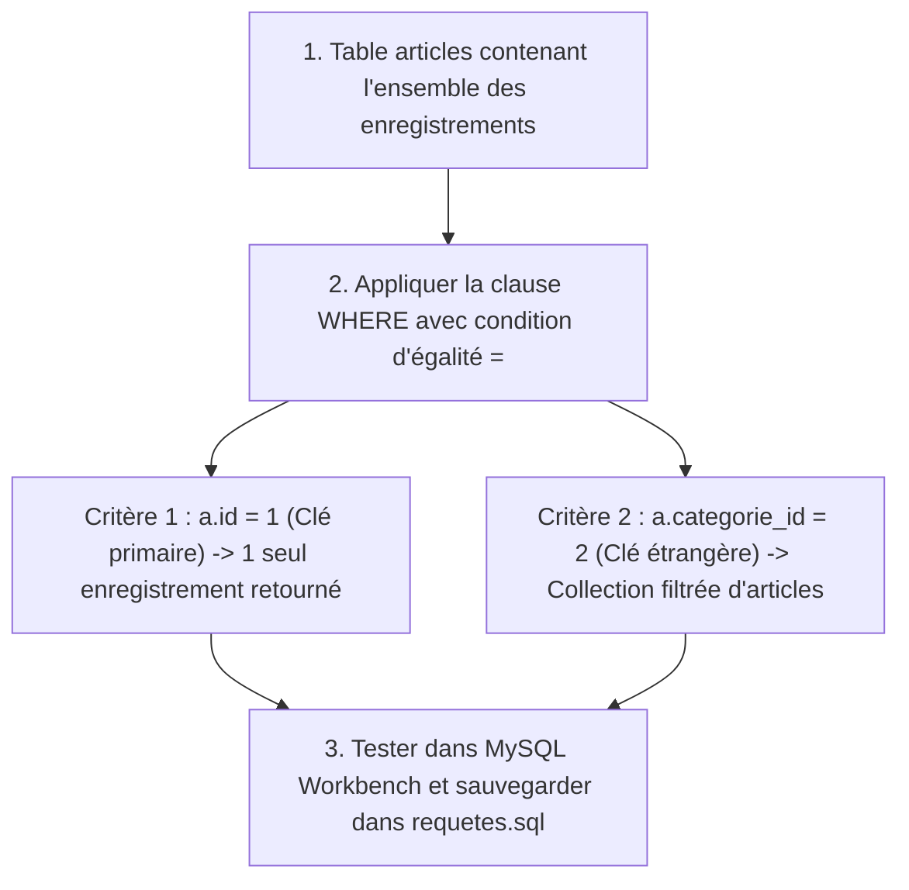

## 1. Contexte & Objectif

Dans la session précédente, vous avez appris à écrire des requêtes SQL `SELECT` avec jointures (`JOIN`) pour afficher l'ensemble des articles récents du blog. Cependant, la commande `SELECT * FROM articles` extrait sans distinction toutes les lignes de la table.

Pour permettre à un lecteur de consulter un article unique à partir de son identifiant, ou pour afficher exclusivement les articles d'une catégorie donnée (par exemple tous les articles de la catégorie *"PHP"*), la base de données doit être capable de **filtrer** les lignes retournées.

Dans ce tutoriel, vous allez maîtriser la clause SQL **`WHERE`**. Vous allez formuler des conditions de restriction sur une **clé primaire** (`id = 1`) pour cibler un enregistrement unique, et sur une **clé étrangère** (`categorie_id = 2`) pour regrouper les publications d'un thème précis.

* **Objectif technique :** Rédiger et exécuter dans MySQL Workbench deux requêtes `SELECT` filtrées avec la clause `WHERE`, valider les tableaux de résultats, et documenter les commandes dans `requetes.sql`.
* **Prérequis :** Maîtriser la syntaxe élémentaire de `SELECT ... FROM ... JOIN` et avoir initialisé la base de données `blog_n1`.



---

## 2. Théorie Pas-à-Pas

### 2.1. Jeu d'essai de démonstration

Pour comprendre le fonctionnement de la clause `WHERE`, voici un jeu d'essai simplifié reproduisant la structure de nos tables :

```sql
CREATE TABLE categories (
    id INT AUTO_INCREMENT PRIMARY KEY,
    libelle VARCHAR(50) NOT NULL
);

CREATE TABLE articles (
    id INT AUTO_INCREMENT PRIMARY KEY,
    titre VARCHAR(100) NOT NULL,
    categorie_id INT NOT NULL,
    FOREIGN KEY (categorie_id) REFERENCES categories(id)
);

INSERT INTO categories (id, libelle) VALUES 
(1, 'HTML & CSS'),
(2, 'PHP & MySQL');

INSERT INTO articles (id, titre, categorie_id) VALUES 
(1, 'Débuter avec Flexbox', 1),
(2, 'Comprendre PDO en PHP', 2),
(3, 'Sécuriser ses requêtes SQL', 2);
```

### 2.2. La clause WHERE et le filtrage sur clé primaire

La clause **`WHERE`** se place obligatoirement après la clause `FROM` (et après les éventuelles jointures `JOIN`). Elle définit une condition que chaque ligne doit satisfaire pour être conservée dans le résultat final.

Pour cibler un enregistrement précis et unique, on applique le filtre sur sa **clé primaire** (`id`) avec l'opérateur d'égalité **`=`** :

```sql
SELECT a.id, a.titre, c.libelle AS categorie
FROM articles a
JOIN categories c ON a.categorie_id = c.id
WHERE a.id = 2;
```

**Résultat attendu retourné par le SGBD :**

| id | titre | categorie |
| :---: | :--- | :--- |
| 2 | Comprendre PDO en PHP | PHP & MySQL |

* Comme la clé primaire est unique, cette requête ne renvoie **jamais plus d'une seule ligne**.
* Les nombres entiers s'écrivent directement sans guillemets (`WHERE a.id = 2` et non `'2'`).

### 2.3. Le filtrage sur clé étrangère et l'ordonnancement

Pour filtrer une thématique complète, on utilise la même clause `WHERE` en ciblant la **clé étrangère** qui relie l'article à sa catégorie (`categorie_id = 2`).  
On combine ce filtre avec la clause **`ORDER BY`** placée en toute fin de requête pour classer les résultats :

```sql
SELECT a.id, a.titre, c.libelle AS categorie
FROM articles a
JOIN categories c ON a.categorie_id = c.id
WHERE a.categorie_id = 2
ORDER BY a.id DESC;
```

**Résultat attendu retourné par le SGBD :**

| id | titre | categorie |
| :---: | :--- | :--- |
| 3 | Sécuriser ses requêtes SQL | PHP & MySQL |
| 2 | Comprendre PDO en PHP | PHP & MySQL |

* L'article n°1 (*Débuter avec Flexbox*) a été automatiquement exclu du résultat car son `categorie_id` vaut 1.
* L'ordre logique des mots-clés SQL est strict : `SELECT` → `FROM` → `JOIN ... ON` → `WHERE` → `ORDER BY`.

---

## 3. Pratique & Réalisation Guidée

### Étape 1 — Ouvrir l'éditeur SQL dans MySQL Workbench

1. Lancez votre logiciel **MySQL Workbench**.
2. Connectez-vous à votre instance locale MySQL (`Local instance MySQL80` ou similaire).
3. Ouvrez un nouvel onglet de requête SQL (`Ctrl + T`).
4. Indiquez à MySQL d'utiliser la base de données du blog :
   ```sql
   USE blog_n1;
   ```

### Étape 2 — Écrire et tester la requête de détail d'un article

1. Dans l'onglet de requête, saisissez la requête permettant d'extraire toutes les informations de l'article n°1 avec son auteur et sa catégorie :

```sql
-- Requête 1 : Sélectionner un article précis par son identifiant unique
SELECT a.id, a.titre, a.chapeau, a.contenu, a.date_creation,
       c.libelle AS categorie_libelle, c.couleur AS categorie_couleur,
       aut.nom AS auteur_nom, aut.prenom AS auteur_prenom
FROM articles a
JOIN categories c ON a.categorie_id = c.id
JOIN auteurs aut ON a.auteur_id = aut.id
WHERE a.id = 1;
```

2. Exécutez la requête en cliquant sur l'éclair jaune (`Ctrl + Enter`).
3. Vérifiez la grille de résultats : une seule ligne est affichée, contenant toutes les colonnes requises pour la future page de détail.

### Étape 3 — Écrire et tester la requête de filtrage par catégorie

1. Saisissez maintenant la requête permettant de récupérer la liste de tous les articles appartenant à la catégorie n°1 :

```sql
-- Requête 2 : Sélectionner tous les articles d'une catégorie spécifique
SELECT a.id, a.titre, a.chapeau, a.date_creation, a.image_url,
       c.libelle AS categorie_libelle, c.couleur AS categorie_couleur
FROM articles a
JOIN categories c ON a.categorie_id = c.id
WHERE a.categorie_id = 1
ORDER BY a.date_creation DESC;
```

2. Exécutez la requête.
3. Vérifiez que toutes les lignes retournées affichent bien la même catégorie et sont triées de la plus récente à la plus ancienne.

### Étape 4 — Sauvegarder les requêtes dans requetes.sql

1. Dans votre éditeur de code, ouvrez le fichier de requêtes à la racine de votre projet :
   ```text
   requetes.sql
   ```
2. Ajoutez ces deux nouvelles requêtes filtrées à la suite des requêtes déjà écrites lors de la session S6.

---

## 4. Livrable & Critères de Réussite

### 4.1. Emplacement dans votre dépôt d'autoformation

Dans votre dépôt GitHub annuel d'autoformations, créez l'arborescence suivante :

```text
sql/filtrer-donnees-sql/filtrer-enregistrements-clause-where/
```

### 4.2. Contenu attendu du livrable

Déposez dans ce dossier votre fichier **`requetes.sql`** contenant les requêtes de restriction :

```sql
-- Livrable : Requêtes SQL de sélection avec filtrage WHERE
USE blog_n1;

-- 1. Extraction d'un article précis pour la page de détail (clé primaire)
SELECT a.id, a.titre, a.chapeau, a.contenu, a.date_creation,
       c.libelle AS categorie_libelle, c.couleur AS categorie_couleur,
       aut.nom AS auteur_nom, aut.prenom AS auteur_prenom
FROM articles a
JOIN categories c ON a.categorie_id = c.id
JOIN auteurs aut ON a.auteur_id = aut.id
WHERE a.id = 1;

-- 2. Extraction des articles appartenant à une catégorie (clé étrangère)
SELECT a.id, a.titre, a.chapeau, a.date_creation, a.image_url,
       c.libelle AS categorie_libelle, c.couleur AS categorie_couleur
FROM articles a
JOIN categories c ON a.categorie_id = c.id
WHERE a.categorie_id = 1
ORDER BY a.date_creation DESC;
```

### 4.3. Critères de réussite

* [ ] Tous les mots-clés SQL sont écrits impérativement en **MAJUSCULES** (`SELECT`, `FROM`, `JOIN`, `ON`, `WHERE`, `ORDER BY`).
* [ ] La clause `WHERE` est positionnée après les déclarations de jointures `JOIN ... ON`.
* [ ] La condition d'égalité utilise l'opérateur `=` sans guillemets autour des identifiants numériques.
* [ ] La requête sur clé primaire ne retourne qu'une seule ligne dans MySQL Workbench.
* [ ] La requête sur clé étrangère retourne uniquement les articles de la catégorie ciblée et respecte le tri `ORDER BY`.

---

## 5. Glossaire

* **Clause `WHERE`** : Mot-clé SQL permettant de filtrer les enregistrements d'une table en ne retenant que les lignes satisfaisant une condition donnée.
* **Opérateur d'égalité (`=`)** : Symbole de comparaison vérifiant qu'une colonne possède exactement la même valeur que le critère fourni.
* **Restriction SQL** : Opération de l'algèbre relationnelle qui sélectionne un sous-ensemble de lignes d'une table selon un critère logique.
* **Filtrage par clé primaire** : Requête ciblant la colonne identifiant unique d'une table, garantissant l'obtention d'un seul résultat au maximum.
* **Filtrage par clé étrangère** : Requête ciblant une colonne de liaison pour regrouper tous les enregistrements dépendants d'une entité parent (ex. tous les articles d'une catégorie).
