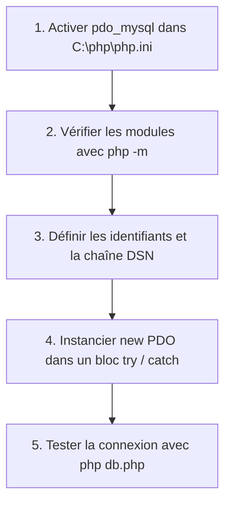

## 1. Contexte & Objectif

Dans les étapes précédentes, vous avez validé votre serveur MySQL, créé les tables de votre blog et testé vos requêtes dans MySQL Workbench.  
Votre serveur de données est opérationnel, mais votre application PHP ne sait pas encore communiquer avec lui.

Avant que PHP ne puisse se connecter à MySQL, il a besoin d'activer son pilote officiel dans son fichier de configuration : **`php.ini`**.  
Une fois ce pilote activé, vous allez créer le module centralisé d'accès aux données : **`db.php`**. Ce fichier va instancier un objet **PDO** (*PHP Data Objects*), appliquer l'encodage universel `utf8mb4`, activer la gestion des erreurs par exceptions et sécuriser la connexion avec un bloc **`try / catch`**.

* **Objectif technique :** Activer l'extension `pdo_mysql` dans `php.ini`, vérifier sa présence avec `php -m`, puis écrire et valider le script `db.php` se connectant à la base `blog_n1`.
* **Prérequis :** Avoir installé PHP dans `C:\php` (tutoriel T.123.110) et disposer d'une base `blog_n1` accessible sous MySQL.



---

## 2. Théorie Pas-à-Pas

### 2.1. L'extension PDO et le pilote pdo_mysql

**PDO** (*PHP Data Objects*) est une couche d'abstraction moderne : elle fournit une syntaxe objet unifiée pour dialoguer avec différentes bases de données.  
Cependant, PDO ne dialogue pas directement avec MySQL par magie : il utilise un **pilote de base de données** spécifique nommé **`pdo_mysql`**.

* Si le pilote n'est pas activé dans PHP, toute tentative de connexion déclenche une erreur fatale :  
  `Fatal error: Uncaught PDOException: could not find driver`.

### 2.2. L'activation du pilote dans php.ini

Lors de l'installation officielle de PHP dans `C:\php`, un fichier nommé **`php.ini`** contrôle toutes les options de configuration de l'interpréteur.  
Par défaut, toutes les extensions externes sont désactivées par un point-virgule (`;`) en début de ligne.

Pour autoriser PHP à dialoguer avec MySQL, vous devez activer deux directives :
1. **Le dossier des extensions :** `extension_dir = "ext"`
2. **Le pilote MySQL :** `extension=pdo_mysql`

Une fois ces deux lignes décommentées, la commande terminal **`php -m`** permet de vérifier immédiatement que `PDO` et `pdo_mysql` figurent bien dans la liste des modules chargés.

### 2.3. La chaîne DSN et la sécurisation avec try / catch

Pour se connecter, PDO a besoin d'une chaîne appelée **DSN** (*Data Source Name*) qui récapitule les coordonnées du serveur :

```php
<?php
$host = '127.0.0.1';
$dbname = 'blog_n1';
$username = 'root';
$password = 'admin';

// Le DSN spécifie le pilote, l'hôte, la base et le jeu de caractères
$dsn = "mysql:host=$host;dbname=$dbname;charset=utf8mb4";
echo "DSN prêt pour la connexion.";
```

Pour intercepter les erreurs sans exposer d'informations sensibles (mot de passe ou identifiants), nous sécurisons l'instanciation dans un bloc **`try / catch`** interceptant **`PDOException`** :

* **`PDO::ATTR_ERRMODE => PDO::ERRMODE_EXCEPTION`** : Déclenche une exception dès qu'une requête SQL est invalide.
* **`PDO::ATTR_DEFAULT_FETCH_MODE => PDO::FETCH_ASSOC`** : Retourne automatiquement chaque ligne sous forme de tableau associatif indexé par le nom des colonnes.

---

## 3. Pratique & Réalisation Guidée

### Étape 1 — Activer le pilote pdo_mysql dans php.ini

1. Ouvrez votre éditeur de code (VS Code) et ouvrez le fichier de configuration de votre installation PHP :
   ```text
   C:\php\php.ini
   ```
2. **Activer le répertoire des extensions :**
   - Utilisez la recherche (`Ctrl + F`) pour trouver la ligne contenant `extension_dir = "ext"`.
   - Si la ligne commence par un point-virgule (`;extension_dir = "ext"`), supprimez le point-virgule `;` pour la décommenter :
     ```ini
     extension_dir = "ext"
     ```
3. **Activer l'extension MySQL :**
   - Recherchez la ligne `;extension=pdo_mysql`.
   - Supprimez le point-virgule initial `;` pour obtenir exactement :
     ```ini
     extension=pdo_mysql
     ```
4. Enregistrez les modifications du fichier (`Ctrl + S`).

### Étape 2 — Vérifier l'activation du pilote dans le terminal

1. Ouvrez un terminal (PowerShell ou Invite de commandes).
2. Lancez la commande suivante pour lister les modules PHP actifs :

```bash
php -m
```

3. Parcourez la liste alphabétique affichée :
   - Vérifiez la présence de **`PDO`**.
   - Vérifiez la présence de **`pdo_mysql`**.

Le pilote MySQL est maintenant actif et prêt à être utilisé par PHP.

### Étape 3 — Créer et configurer le fichier db.php

1. À la racine de votre projet de blog, créez un nouveau fichier nommé **`db.php`**.
2. Saisissez le code suivant en renseignant le mot de passe `root` configuré lors de l'installation de MySQL (ex: `admin`) :

```php
<?php
// Configuration PDO (Niveau N1)
$host = '127.0.0.1';
$dbname = 'blog_n1';
$username = 'root';
$password = 'admin'; // Mot de passe root défini lors de l'installation de MySQL

try {
    $pdo = new PDO("mysql:host=$host;dbname=$dbname;charset=utf8mb4", $username, $password);
    
    // Configurer PDO pour lever des exceptions en cas d'erreur
    $pdo->setAttribute(PDO::ATTR_ERRMODE, PDO::ERRMODE_EXCEPTION);
    
    // Configurer PDO pour renvoyer les résultats sous forme de tableau associatif
    $pdo->setAttribute(PDO::ATTR_DEFAULT_FETCH_MODE, PDO::FETCH_ASSOC);

} catch (PDOException $e) {
    die("Erreur de connexion à la base de données : " . $e->getMessage());
}
?>
```

### Étape 4 — Tester la connexion en ligne de commande

1. Dans votre terminal, positionnez-vous dans le dossier de votre projet de blog.
2. Exécutez le script avec PHP CLI :

```bash
php db.php
```

3. **Analyse du résultat :**
   - Si la commande se termine immédiatement sans aucun message d'erreur, **la connexion est parfaitement établie**.
   - Si vous obtenez `could not find driver`, revoyez l'étape 1 pour vous assurer que `extension=pdo_mysql` et `extension_dir = "ext"` sont bien enregistrés dans `C:\php\php.ini`.
   - Si vous obtenez `Access denied for user 'root'`, vérifiez la valeur de la variable `$password`.

---

## 4. Livrable & Critères de Réussite

### 4.1. Emplacement dans votre dépôt d'autoformation

Dans votre dépôt GitHub annuel d'autoformations, créez l'arborescence suivante :

```text
php-sql/recuperer-resultats-sql-php/initialiser-connexion-securisee-pdo/
```

### 4.2. Contenu attendu du livrable

Déposez dans ce dossier votre fichier **`db.php`** opérationnel :

```php
<?php
// Module centralisé de connexion MySQL via PDO
$host = '127.0.0.1';
$dbname = 'blog_n1';
$username = 'root';
$password = 'admin';

try {
    $pdo = new PDO("mysql:host=$host;dbname=$dbname;charset=utf8mb4", $username, $password);
    
    $pdo->setAttribute(PDO::ATTR_ERRMODE, PDO::ERRMODE_EXCEPTION);
    $pdo->setAttribute(PDO::ATTR_DEFAULT_FETCH_MODE, PDO::FETCH_ASSOC);

} catch (PDOException $e) {
    die("Erreur de connexion à la base de données : " . $e->getMessage());
}
?>
```

### 4.3. Critères de réussite

* [ ] L'extension `pdo_mysql` est décommentée dans `C:\php\php.ini` et confirmée par `php -m`.
* [ ] Le fichier commence par la balise d'ouverture `<?php`.
* [ ] La chaîne DSN contient l'hôte, le nom de la base `blog_n1` et `charset=utf8mb4`.
* [ ] Le bloc `try / catch` capture les erreurs de type `PDOException`.
* [ ] L'attribut `PDO::ATTR_ERRMODE` est configuré sur `PDO::ERRMODE_EXCEPTION`.
* [ ] L'attribut `PDO::ATTR_DEFAULT_FETCH_MODE` est configuré sur `PDO::FETCH_ASSOC`.
* [ ] La commande `php db.php` s'exécute sans lever l'erreur `could not find driver`.

---

## 5. Glossaire

* **`php.ini`** : Fichier texte central de configuration de PHP définissant les paramètres d'exécution et les modules activés.
* **`pdo_mysql`** : Pilote logiciel spécialisé permettant à l'interface PDO de communiquer avec le serveur MySQL.
* **PDO** (*PHP Data Objects*) : Interface objet standard et sécurisée intégrée à PHP pour accéder à des bases de données relationnelles.
* **DSN** (*Data Source Name*) : Chaîne d'identification indiquant à PDO le type de base, l'hôte, le nom de la base et l'encodage des échanges.
* **Exception (`PDOException`)** : Objet créé par PHP pour signaler un dysfonctionnement survenu lors d'une opération avec la base de données.
* **`try / catch`** : Structure d'interception permettant de surveiller un bloc de code (`try`) et de traiter proprement les erreurs éventuelles (`catch`).
* **`FETCH_ASSOC`** : Mode d'extraction de données fournissant chaque ligne de résultat sous la forme d'un tableau associatif PHP avec les noms de colonnes en clés.
