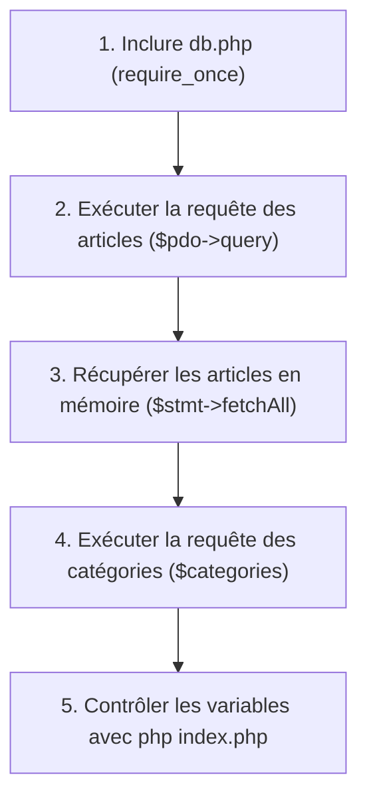

## 1. Contexte & Objectif

Dans le tutoriel précédent, vous avez créé le module `db.php` qui initialise la connexion PDO à votre base `blog_n1`.  
Dans le tutoriel T.124.121, vous avez rédigé et testé la requête SQL combinant les articles et leurs catégories.

À ce stade, le fichier `index.php` de votre blog charge encore les anciennes fonctions de lecture de fichiers JSON issues de la session S5.  
Dans ce tutoriel, vous allez moderniser ce contrôleur en intégrant votre connexion PDO, en exécutant vos requêtes SQL via **`$pdo->query()`** et en extrayant les résultats en mémoire grâce à la méthode **`fetchAll()`**.

* **Objectif technique :** Remplacer le chargement des fichiers JSON dans `index.php` par des requêtes PDO réelles extrayant les collections `$articles` et `$categories`.
* **Prérequis :** Avoir terminé les tutoriels T.124.121 (requête SQL validée) et T.124.211 (fichier `db.php` prêt).



---

## 2. Théorie Pas-à-Pas

### 2.1. Inclure le module de connexion

Pour utiliser la variable `$pdo` créée dans `db.php`, nous utilisons l'instruction **`require_once 'db.php';`** au tout début du contrôleur.  
Elle s'assure que le fichier de connexion est chargé exactement une seule fois.

### 2.2. Exécuter une requête SQL avec $pdo->query()

Lorsque notre requête SQL ne dépend d'aucune donnée saisie par l'utilisateur (aucun paramètre dynamique dans l'URL ou dans un formulaire), nous pouvons l'exécuter directement avec la méthode **`query()`** :

```php
<?php
$sql = "SELECT id, titre FROM articles";
// Exécution de l'ordre SQL par le serveur MySQL
// $stmt est un objet de type PDOStatement
echo "Requête SQL prête à être exécutée.";
```

* `$pdo->query($sql)` envoie la commande SQL au serveur MySQL.
* Il retourne un objet **`PDOStatement`** qui représente le jeu de résultats en attente de lecture.

### 2.3. Extraire l'ensemble des données avec fetchAll()

Pour transformer le curseur SQL en un tableau PHP contenant toutes les lignes de la table, nous appelons la méthode **`fetchAll()`** :

```php
<?php
// Exemple théorique de récupération
$articles = [
    ['id' => 1, 'titre' => 'Premier article'],
    ['id' => 2, 'titre' => 'Deuxième article']
];

foreach ($articles as $article) {
    echo $article['titre'] . PHP_EOL;
}
```

* Comme nous avons configuré `PDO::FETCH_ASSOC` dans `db.php`, chaque élément du tableau `$articles` est un tableau associatif indexé par le nom des colonnes SQL (`$article['titre']`, `$article['categorie_libelle']`).

---

## 3. Pratique & Réalisation Guidée

### Étape 1 — Préparer le contrôleur index.php

1. Ouvrez le fichier **`index.php`** situé à la racine de votre projet de blog.
2. Supprimez l'ancien appel `require_once 'fonctions.php';` ainsi que les appels de lecture JSON.
3. Insérez l'inclusion du module de connexion :

```php
<?php
// S6 : Connexion à la vraie base de données (PDO)
require_once 'db.php';
```

### Étape 2 — Exécuter la requête des articles et extraire les données

Sous l'inclusion de `db.php`, ajoutez la requête de sélection avec jointure conçue en T.124.121 :

```php
$sql = "
    SELECT a.*, c.libelle AS categorie_libelle, c.couleur AS categorie_couleur
    FROM articles a
    JOIN categories c ON a.categorie_id = c.id
    ORDER BY a.date_creation DESC
    LIMIT 6
";
$stmt = $pdo->query($sql);
$articles = $stmt->fetchAll();
```

### Étape 3 — Exécuter la requête des catégories

La page d'accueil affiche également la barre des filtres de catégories.  
Ajoutez une seconde requête pour extraire toutes les catégories par ordre alphabétique :

```php
$stmtCategories = $pdo->query("SELECT * FROM categories ORDER BY libelle ASC");
$categories = $stmtCategories->fetchAll();
```

### Étape 4 — Tester l'extraction des données en ligne de commande

1. Pour vérifier que les données sont bien présentes en mémoire, ajoutez temporairement une ligne de diagnostic à la fin du fichier :

```php
var_dump($articles);
```

2. Ouvrez un terminal dans le dossier du projet et lancez :

```bash
php index.php
```

3. **Analyse du résultat :**
   - Un tableau contenant 2 éléments s'affiche dans votre terminal.
   - Vérifiez que chaque élément contient bien les clés `titre`, `image`, `date_creation`, `categorie_libelle` et `categorie_couleur`.
4. Supprimez ou commentez la ligne `var_dump($articles);` après validation.

---

## 4. Livrable & Critères de Réussite

### 4.1. Emplacement dans votre dépôt d'autoformation

Dans votre dépôt GitHub annuel d'autoformations, créez l'arborescence suivante :

```text
php-sql/recuperer-resultats-sql-php/interroger-base-recuperer-resultats-fetchall/
```

### 4.2. Contenu attendu du livrable

Déposez dans ce dossier votre fichier **`index.php`** réusiné :

```php
<?php
// S6 : Connexion à la base de données relationnelle via PDO
require_once 'db.php';

// 1. Récupération des articles avec leur catégorie associée
$sql = "
    SELECT a.*, c.libelle AS categorie_libelle, c.couleur AS categorie_couleur
    FROM articles a
    JOIN categories c ON a.categorie_id = c.id
    ORDER BY a.date_creation DESC
    LIMIT 6
";
$stmt = $pdo->query($sql);
$articles = $stmt->fetchAll();

// 2. Récupération des catégories pour la navigation
$stmtCategories = $pdo->query("SELECT * FROM categories ORDER BY libelle ASC");
$categories = $stmtCategories->fetchAll();
?>
```

### 4.3. Critères de réussite

* [ ] Le fichier commence par `require_once 'db.php';`.
* [ ] La requête des articles contient la jointure `JOIN categories` et les alias `AS categorie_libelle` et `AS categorie_couleur`.
* [ ] La méthode `$stmt->fetchAll()` est appelée pour alimenter `$articles`.
* [ ] La variable `$categories` contient l'ensemble des catégories extraites de la base.
* [ ] La commande `php index.php` s'exécute sans erreur PHP ni exception PDO.

---

## 5. Glossaire

* **`$pdo->query()`** : Méthode PDO servant à soumettre une requête SQL statique au serveur MySQL et à obtenir un curseur de résultat.
* **`PDOStatement`** : Objet retourné par PDO représentant le résultat d'une requête exécutée.
* **`fetchAll()`** : Méthode de `PDOStatement` qui lit toutes les lignes restantes et les renvoie sous forme de tableau PHP.
* **Contrôleur** : Rôle joué par un script PHP (ici `index.php`) qui prépare les données avant de les transmettre à une page de présentation.
* **Curseur SQL** : Pointeur interne maintenu par le moteur de base de données pour parcourir les lignes d'un résultat.
