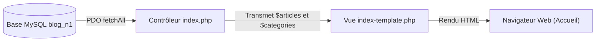

## 1. Contexte & Objectif

Dans le tutoriel précédent, vous avez modernisé le contrôleur `index.php` pour exécuter vos requêtes SQL et stocker les collections `$articles` et `$categories` en mémoire grâce à `fetchAll()`.  
Il ne reste plus qu'à transmettre ces données réelles à la vue `index-template.php` pour rendre votre blog totalement dynamique.

Dans ce tutoriel d'aboutissement de la session S6, vous allez relier vos données au gabarit d'affichage HTML/CSS, valider le rendu dans votre navigateur Web, puis réaliser le test ultime de la persistance : ajouter un nouvel article directement dans MySQL Workbench et observer son apparition instantanée sur votre site, sans retoucher au code PHP !

* **Objectif technique :** Finaliser le contrôleur `index.php` en incluant le template d'affichage, vérifier le rendu via le serveur PHP local et valider la réactivité de l'application à de nouvelles insertions en base.
* **Prérequis :** Avoir terminé le tutoriel T.124.212 et disposer des fichiers `db.php`, `index.php` et `index-template.php`.



---

## 2. Théorie Pas-à-Pas

### 2.1. L'architecture séparée : Données ➔ Contrôleur ➔ Vue

Le projet applique une séparation claire des responsabilités :
1. **La Base de Données (`blog_n1`) :** Stocke et sécurise les enregistrements.
2. **Le Contrôleur (`index.php`) :** Se connecte à la base via `db.php`, formule les requêtes SQL et prépare les variables `$articles` et `$categories`.
3. **La Vue (`index-template.php`) :** Se concentre uniquement sur la présentation visuelle en parcourant les données avec des boucles `foreach`.

À la fin de `index.php`, l'instruction **`require 'index-template.php';`** transmet automatiquement toutes les variables déclarées dans le contrôleur au template.

### 2.2. Adéquation parfaite des clés SQL et du template

Pour que l'affichage fonctionne sans la moindre erreur, les alias SQL définis dans notre requête doivent correspondre exactement aux clés lues dans le template :

```php
<?php
// Exemple théorique de correspondance de clés
$article = [
    'id' => 1,
    'titre' => 'Exemple',
    'categorie_libelle' => 'Développement',
    'categorie_couleur' => 'bleu'
];

echo $article['categorie_libelle']; // Affiche : Développement
```

Dans `index-template.php` :
* `$article['categorie_libelle']` est injecté dans le texte du badge.
* `$article['categorie_couleur']` est injecté comme classe CSS pour colorer le badge (`bleu`, `rose`, `vert`).

### 2.3. Sécurité de l'affichage avec htmlspecialchars()

Même si les données proviennent de notre propre base de données, la règle de sécurité fondamentale du développement Web s'applique : **on ne fait jamais confiance aux données affichées**.  
Toute sortie dans le template est protégée avec la fonction **`htmlspecialchars()`** pour neutraliser d'éventuelles balises HTML malveillantes (protection contre les attaques XSS).

---

## 3. Pratique & Réalisation Guidée

### Étape 1 — Finaliser le fichier index.php

1. Ouvrez le fichier **`index.php`** à la racine de votre projet.
2. Assurez-vous qu'aucun affichage de débogage (`var_dump` ou `print_r`) n'est présent.
3. Ajoutez l'appel de la vue en toute dernière ligne :

```php
<?php
// S6 : Connexion à la vraie base de données (PDO)
require_once 'db.php';

$sql = "
    SELECT a.*, c.libelle AS categorie_libelle, c.couleur AS categorie_couleur
    FROM articles a
    JOIN categories c ON a.categorie_id = c.id
    ORDER BY a.date_creation DESC
    LIMIT 6
";
$stmt = $pdo->query($sql);
$articles = $stmt->fetchAll();

$stmtCategories = $pdo->query("SELECT * FROM categories ORDER BY libelle ASC");
$categories = $stmtCategories->fetchAll();

// Chargement de la vue (template d'affichage)
require 'index-template.php';
?>
```

### Étape 2 — Démarrer le serveur Web local PHP

1. Ouvrez votre terminal à la racine de votre projet de blog.
2. Démarrez le serveur interne de PHP :

```bash
php -S localhost:8000
```

3. Le terminal indique que le serveur écoute à l'adresse `http://localhost:8000`. Laissez ce terminal ouvert.

### Étape 3 — Vérifier l'affichage du blog dans le navigateur

1. Ouvrez votre navigateur Web et accédez à :
   ```text
   http://localhost:8000/index.php
   ```
2. **Vérifications visuelles :**
   - La barre des thèmes affiche bien les boutons des 3 catégories (*Développement*, *Management*, *UI / UX*).
   - Les deux cartes d'articles s'affichent avec leurs images, leurs titres, leurs dates formatées et leurs badges colorés.

### Étape 4 — Le test ultime de persistance temps réel

1. Ouvrez **MySQL Workbench** sur la base `blog_n1`.
2. Insérez un troisième article directement avec l'instruction SQL suivante :

```sql
USE blog_n1;

INSERT INTO articles (titre, contenu, image, date_creation, categorie_id, auteur_id) VALUES
('Gérer son projet web avec la méthode Agile', 'La méthode Agile permet d’adapter le développement...', 'article-example.png', NOW(), 3, 1);
```

3. Exécutez cette requête dans Workbench.
4. Retournez dans votre navigateur Web et rafraîchissez la page (`F5`).
5. **Résultat :** Le nouvel article portant le badge vert *Management* apparaît immédiatement en première position, sans que vous n'ayez touché à la moindre ligne de code PHP !

Votre blog est désormais connecté à une base de données relationnelle en direct.

---

## 4. Livrable & Critères de Réussite

### 4.1. Emplacement dans votre dépôt d'autoformation

Dans votre dépôt GitHub annuel d'autoformations, créez l'arborescence suivante :

```text
php-sql/afficher-donnees-sql-interface/lier-resultats-sql-template-affichage/
```

### 4.2. Contenu attendu du livrable

Déposez dans ce dossier votre fichier contrôleur finalisé **`index.php`** :

```php
<?php
// Contrôleur de la page d'accueil connecté à MySQL via PDO
require_once 'db.php';

// 1. Récupération des articles récents avec les données de catégorie
$sql = "
    SELECT a.*, c.libelle AS categorie_libelle, c.couleur AS categorie_couleur
    FROM articles a
    JOIN categories c ON a.categorie_id = c.id
    ORDER BY a.date_creation DESC
    LIMIT 6
";
$stmt = $pdo->query($sql);
$articles = $stmt->fetchAll();

// 2. Récupération de la liste des catégories pour la navigation
$stmtCategories = $pdo->query("SELECT * FROM categories ORDER BY libelle ASC");
$categories = $stmtCategories->fetchAll();

// 3. Délégation de l'affichage à la vue
require 'index-template.php';
?>
```

### 4.3. Critères de réussite

* [ ] Le contrôleur `index.php` délègue l'affichage à `index-template.php` via `require`.
* [ ] La page d'accueil s'affiche sans avertissement (*Warning*) ni notice PHP.
* [ ] Les badges de catégorie affichent la bonne couleur CSS (`bleu`, `rose`, `vert`).
* [ ] Un nouvel enregistrement inséré dans MySQL s'affiche instantanément après actualisation (`F5`).
* [ ] Le fichier `index.php` est consigné dans le dossier prévu du dépôt d'autoformation.

---

## 5. Glossaire

* **Architecture 3 tiers** : Principe de conception découpant une application en trois couches spécialisées : Stockage (Base), Logique métier (Contrôleur) et Présentation (Vue).
* **Vue (Template)** : Fichier spécialisé dans l'affichage du code HTML et la présentation des données préparées par le contrôleur.
* **`htmlspecialchars()`** : Fonction de sécurisation PHP transformant les caractères réservés (`<`, `>`, `&`, `"`) en entités HTML inoffensives.
* **Persistance dynamique** : Principe selon lequel l'état de l'application affiché à l'écran reflète fidèlement et instantanément l'état actuel de la base de données.
