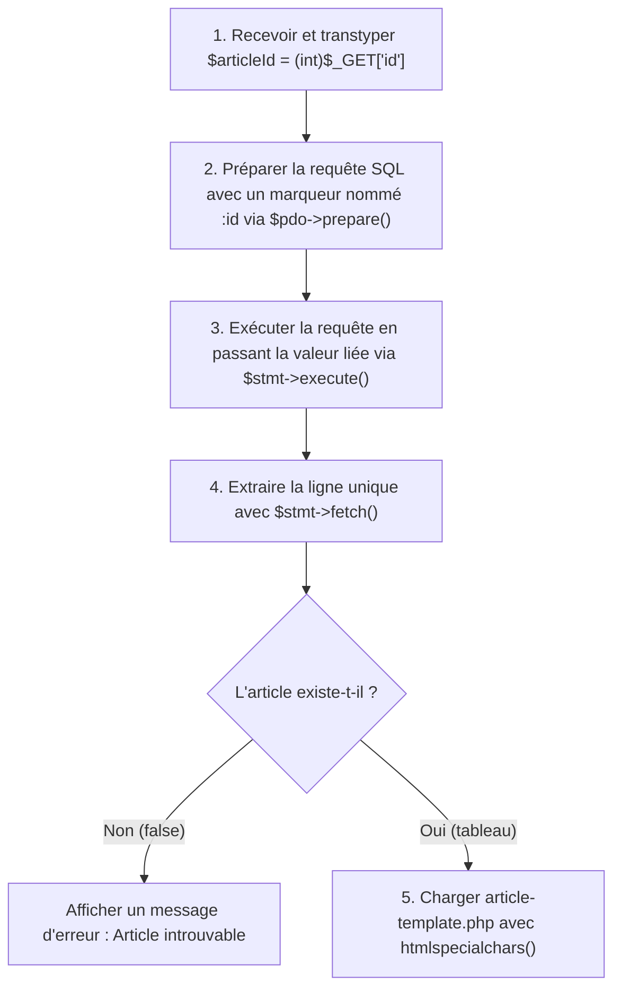

## 1. Contexte & Objectif

Dans les étapes précédentes, vous avez appris à intercepter un paramètre d'URL (`$_GET['id']`) dans `article.php` et vous avez validé dans MySQL Workbench votre requête de filtrage avec la clause `WHERE a.id = 1`.

La tentation immédiate d'un débutant serait d'insérer directement la variable PHP dans la chaîne SQL :  
`$pdo->query("SELECT * FROM articles WHERE id = " . $_GET['id']);`.  
**Attention : Cette pratique est formellement interdite !** Elle ouvre la faille la plus dévastatrice du Web : **l'injection SQL**, qui permet à un pirate de voler, modifier ou effacer l'intégralité de votre base de données.

Dans ce tutoriel, vous allez apprendre à utiliser la technique standard de l'industrie : les **requêtes préparées PDO** avec `$pdo->prepare()` et `$stmt->execute()`. Vous allez utiliser un paramètre lié nommé (`:id`), extraire l'enregistrement unique avec `$stmt->fetch()` et l'afficher de manière sécurisée dans votre page de détail dynamique `article-template.php`.

* **Objectif technique :** Remplacer toute concaténation SQL par une requête préparée PDO avec marqueur nommé `:id`, extraire l'article unique avec `$stmt->fetch()`, gérer le cas d'un article inexistant, et injecter les données dans `article-template.php`.
* **Prérequis :** Avoir réalisé le contrôleur `article.php` (T.123.171) et maîtriser l'objet PDO instancié dans `db.php`.



---

## 2. Théorie Pas-à-Pas

### 2.1. Le danger majeur de l'injection SQL

L'**injection SQL** se produit lorsque du texte tapé par un utilisateur dans l'URL ou un formulaire est injecté directement dans la commande SQL sans être isolé.

```php
// ❌ DANGEREUX ET INTERDIT : Concaténation directe
// Si $_GET['id'] vaut "1 OR 1=1", la condition est toujours vraie !
// Si $_GET['id'] vaut "1; DROP TABLE articles;", la table est détruite !
$sql = "SELECT * FROM articles WHERE id = " . $_GET['id'];
$pdo->query($sql);
```

* Même avec un transtypage `(int)`, la bonne pratique absolue du développeur Web professionnel est de **ne jamais concaténer de variable dans une chaîne SQL**.

### 2.2. Le mécanisme des requêtes préparées (prepare et execute)

Une requête préparée sépare physiquement l'**instruction SQL** des **données** :

1. **La préparation (`$pdo->prepare()`) :** Le serveur MySQL compile et valide la structure de la commande SQL à l'avance, en laissant des espaces réservés appelés **marqueurs nommés** (précédés de deux-points, comme `:id`).
2. **L'exécution (`$stmt->execute()`) :** Les données sont envoyées séparément dans un tableau associatif. Le serveur de base de données les traite strictement comme du texte ou des nombres bruts, rendant toute injection SQL mathématiquement impossible.

```php
<?php
// Exemple autonome de requête préparée sécurisée
$articleId = 1;

// 1. Structure SQL avec marqueur nommé :id
$sql = "SELECT id, titre FROM articles WHERE id = :id";

// 2. Préparation
$stmt = $pdo->prepare($sql);

// 3. Exécution avec passage des paramètres liés
$stmt->execute(['id' => $articleId]);

echo "Requête préparée et exécutée en toute sécurité.";
?>
```

### 2.3. L'extraction unitaire avec fetch()

Contrairement à `fetchAll()` qui extrait un tableau de plusieurs lignes, la méthode **`fetch()`** lit une seule ligne à la fois.

* Si un enregistrement correspond à l'identifiant, `fetch()` renvoie un tableau associatif représentant la ligne :
  ```php
  $article = $stmt->fetch();
  // $article['titre'], $article['chapeau'], etc.
  ```
* Si aucun article ne possède cet identifiant en base, `fetch()` renvoie la valeur **`false`**. Il est donc facile de vérifier si l'article existe avant de poursuivre :
  ```php
  if (!$article) {
      die("Erreur : Cet article n'existe pas ou a été supprimé.");
  }
  ```

---

## 3. Pratique & Réalisation Guidée

### Étape 1 — Écrire la requête préparée dans article.php

1. Ouvrez votre fichier contrôleur :
   ```text
   article.php
   ```
2. Supprimez l'affichage temporaire `echo` et insérez la requête préparée complète avec jointures :

```php
<?php
// article.php : Contrôleur de détail sécurisé
require_once 'db.php';

// 1. Validation de l'identifiant GET
if (!isset($_GET['id']) || empty($_GET['id'])) {
    die("Erreur : Aucun article spécifié. Veuillez sélectionner un article.");
}

$articleId = (int)$_GET['id'];
if ($articleId <= 0) {
    die("Erreur : Identifiant d'article invalide.");
}

// 2. Requête préparée sécurisée avec marqueur nommé :id
$sql = "
    SELECT a.id, a.titre, a.chapeau, a.contenu, a.date_creation, a.image_url,
           c.id AS categorie_id, c.libelle AS categorie_libelle, c.couleur AS categorie_couleur,
           aut.nom AS auteur_nom, aut.prenom AS auteur_prenom, aut.image_profil AS auteur_image
    FROM articles a
    JOIN categories c ON a.categorie_id = c.id
    JOIN auteurs aut ON a.auteur_id = aut.id
    WHERE a.id = :id
";

$stmt = $pdo->prepare($sql);
$stmt->execute(['id' => $articleId]);
$article = $stmt->fetch();

// 3. Vérifier que l'article existe bien en base
if (!$article) {
    die("Erreur : L'article demandé n'existe pas.");
}

// 4. Charger la vue de présentation
require 'article-template.php';
```

### Étape 2 — Créer la vue article-template.php

1. À partir de votre maquette statique `public-article.html`, créez un nouveau fichier nommé **`article-template.php`** à la racine de votre projet.
2. Remplacez les textes d'exemple figés par les balises d'affichage PHP protégées avec `htmlspecialchars()` :

```html
<!DOCTYPE html>
<html lang="fr">
<head>
    <meta charset="UTF-8">
    <meta name="viewport" content="width=device-width, initial-scale=1.0">
    <title><?= htmlspecialchars($article['titre']) ?> - Mon Blog</title>
    <link rel="stylesheet" href="css/global.css">
    <link rel="stylesheet" href="css/layout.css">
    <link rel="stylesheet" href="css/components.css">
</head>
<body>
    <header class="en-tete">
        <div class="container">
            <a href="index.php" class="logo">Mon Blog</a>
            <nav class="navigation">
                <a href="index.php">Accueil</a>
                <a href="categories.php">Catégories</a>
                <a href="apropos.php">À propos</a>
            </nav>
        </div>
    </header>

    <main class="container page-article">
        <article class="article-complet">
            <span class="badge-categorie" style="background-color: <?= htmlspecialchars($article['categorie_couleur']) ?>; color: #fff;">
                <?= htmlspecialchars($article['categorie_libelle']) ?>
            </span>

            <h1 class="titre-article-detail"><?= htmlspecialchars($article['titre']) ?></h1>

            <div class="meta-article">
                <span>Par <?= htmlspecialchars($article['auteur_prenom'] . ' ' . $article['auteur_nom']) ?></span>
                <span>• Publié le <?= date('d/m/Y', strtotime($article['date_creation'])) ?></span>
            </div>

            <?php if (!empty($article['image_url'])): ?>
                " alt="<?= htmlspecialchars($article['titre']) ?>" class="image-detail">
            <?php endif; ?>

            <p class="chapeau-detail"><?= htmlspecialchars($article['chapeau']) ?></p>

            <div class="corps-texte">
                <p><?= nl2br(htmlspecialchars($article['contenu'])) ?></p>
            </div>

            <div class="actions-retour">
                <a href="index.php" class="bouton-principal">← Retour à l'accueil</a>
            </div>
        </article>
    </main>

    <footer class="pied-page">
        <div class="container">
            <p>&copy; 2026 - Mon Blog Personnel</p>
            <p id="statut-client" class="texte-discret"></p>
        </div>
    </footer>

    <script src="js/script.js"></script>
</body>
</html>
```

### Étape 3 — Tester la page de détail dynamique

1. Lancez votre serveur PHP local (`php -S localhost:8000`).
2. Ouvrez votre navigateur sur `http://localhost:8000/article.php?id=1`.
3. Vérifiez que toutes les données de l'article n°1 (titre, auteur, catégorie, contenu) s'affichent dynamiquement depuis MySQL.
4. Testez avec un autre identifiant : `http://localhost:8000/article.php?id=2`.
5. Testez avec un identifiant inexistant : `http://localhost:8000/article.php?id=999`. Le message d'erreur *"Erreur : L'article demandé n'existe pas."* doit s'afficher sans avertissement PHP.

---

## 4. Livrable & Critères de Réussite

### 4.1. Emplacement dans votre dépôt d'autoformation

Dans votre dépôt GitHub annuel d'autoformations, créez l'arborescence suivante :

```text
php-sql/exploiter-criteres-recherche-php/securiser-requete-sql-prepare-execute/
```

### 4.2. Contenu attendu du livrable

Déposez dans ce dossier votre fichier **`article.php`** sécurisé par requête préparée :

```php
<?php
// Livrable : Contrôleur d'article sécurisé par requête préparée PDO
require_once 'db.php';

// 1. Validation de l'identifiant GET
if (!isset($_GET['id']) || empty($_GET['id'])) {
    die("Erreur : Aucun article sélectionné.");
}

$articleId = (int)$_GET['id'];
if ($articleId <= 0) {
    die("Erreur : Identifiant d'article invalide.");
}

// 2. Requête préparée avec marqueur nommé :id
$sql = "
    SELECT a.id, a.titre, a.chapeau, a.contenu, a.date_creation, a.image_url,
           c.id AS categorie_id, c.libelle AS categorie_libelle, c.couleur AS categorie_couleur,
           aut.nom AS auteur_nom, aut.prenom AS auteur_prenom, aut.image_profil AS auteur_image
    FROM articles a
    JOIN categories c ON a.categorie_id = c.id
    JOIN auteurs aut ON a.auteur_id = aut.id
    WHERE a.id = :id
";

$stmt = $pdo->prepare($sql);
$stmt->execute(['id' => $articleId]);
$article = $stmt->fetch();

// 3. Gestion du cas d'article inexistant
if (!$article) {
    die("Erreur : L'article demandé n'existe pas.");
}

// 4. Transmission à la vue
require 'article-template.php';
```

### 4.3. Critères de réussite

* [ ] Aucune variable n'est concaténée directement dans la chaîne SQL.
* [ ] La requête utilise la méthode `$pdo->prepare()` avec un marqueur nommé `:id`.
* [ ] L'exécution transmet les paramètres liés dans le tableau de `$stmt->execute()`.
* [ ] L'extraction de la ligne unique est réalisée avec `$stmt->fetch()`.
* [ ] Le script vérifie la valeur de retour de `fetch()` pour bloquer les identifiants inexistants.
* [ ] Toutes les données affichées dans `article-template.php` sont protégées par `htmlspecialchars()`.

---

## 5. Glossaire

* **Injection SQL** : Faille de sécurité critique permettant à un attaquant de détourner une requête de base de données en injectant du code SQL malveillant à travers des paramètres non protégés.
* **Requête préparée** : Fonctionnalité des moteurs de base de données qui compile la structure de la commande SQL avant d'y injecter séparément les paramètres réels.
* **Marqueur nommé (Named placeholder)** : Espace réservé dans une requête SQL préparée précédé d'un deux-points (ex. `:id`) remplacé par la valeur réelle lors de l'exécution.
* **`prepare()`** : Méthode PDO créant un objet instruction (*statement*) à partir d'un modèle de requête SQL.
* **`execute()`** : Méthode exécutant une requête préparée en lui fournissant les valeurs effectives des marqueurs.
* **`fetch()`** : Méthode extrayant une seule ligne de résultat sous la forme d'un tableau associatif, ou retournant `false` s'il n'y a plus de résultat.
