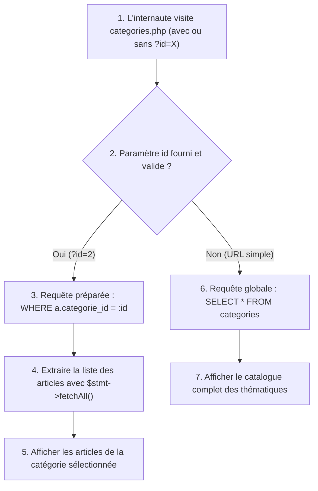

## 1. Contexte & Objectif

Dans le tutoriel précédent, vous avez utilisé `$stmt->fetch()` pour extraire une seule ligne correspondant à un article unique.  
Mais que faire lorsqu'un lecteur clique sur une catégorie (par exemple la catégorie *"HTML & CSS"*) ? Dans ce cas, la base de données doit renvoyer **plusieurs articles** appartenant à cette même catégorie.

Dans ce tutoriel, vous allez concevoir la page de filtrage thématique **`categories.php`**. Vous allez mettre en œuvre une logique conditionnelle :
1. Si un paramètre d'URL est fourni (`categories.php?id=2`), vous exécutez une requête préparée filtrée sur la clé étrangère `categorie_id` et vous extrayez la collection complète avec **`$stmt->fetchAll()`**.
2. Si aucun paramètre n'est fourni (`categories.php`), vous affichez l'ensemble des catégories disponibles pour permettre au visiteur de choisir son thème de lecture.

* **Objectif technique :** Écrire le contrôleur `categories.php`, exécuter une requête préparée avec `$stmt->fetchAll()` pour récupérer une liste d'articles filtrés, gérer l'affichage conditionnel et concevoir `categories-template.php`.
* **Prérequis :** Maîtriser les requêtes préparées avec `prepare()` et `execute()`, ainsi que les boucles PHP `foreach` sur un tableau de résultats.



---

## 2. Théorie Pas-à-Pas

### 2.1. La différence fondamentale entre fetch() et fetchAll()

Lorsque vous interrogez une base de données avec PDO, vous choisissez votre méthode d'extraction selon le nombre de lignes attendues :

* **`$stmt->fetch()` (Unitaire) :** Récupère la ligne suivante du curseur sous la forme d'un tableau associatif à une dimension (`$article['titre']`). Retourne `false` s'il n'y a plus de ligne. Utilisé typiquement lors d'une recherche par clé primaire (`WHERE id = :id`).
* **`$stmt->fetchAll()` (Collection) :** Extrait **immédiatement l'ensemble des lignes retournées** dans un tableau à deux dimensions (une liste de tableaux associatifs). Si aucun enregistrement ne correspond, elle retourne un tableau vide (`[]`).

```php
<?php
// Exemple autonome de collection extraite avec fetchAll()
$categorieId = 1;

$sql = "SELECT id, titre FROM articles WHERE categorie_id = :id";
$stmt = $pdo->prepare($sql);
$stmt->execute(['id' => $categorieId]);

// $articles est un tableau contenant toutes les lignes retournées
$articles = $stmt->fetchAll();

echo "Nombre d'articles trouvés : " . count($articles);
?>
```

### 2.2. Requête paramétrée sur clé étrangère

Pour filtrer une collection par sa catégorie, nous utilisons la clé étrangère `categorie_id` avec le marqueur nommé `:id` :

```sql
SELECT a.id, a.titre, a.chapeau, a.date_creation,
       c.libelle AS categorie_libelle, c.couleur AS categorie_couleur
FROM articles a
JOIN categories c ON a.categorie_id = c.id
WHERE a.categorie_id = :id
ORDER BY a.date_creation DESC;
```

* Tous les articles retournés partagent la même catégorie.
* Le tri `ORDER BY a.date_creation DESC` place les publications les plus récentes en tête de liste.

### 2.3. L'aiguillage conditionnel dans le contrôleur

Un bon contrôleur Web sait adapter ses requêtes selon la demande de l'utilisateur :

```php
// Vérifier si un identifiant de catégorie est transmis
$categorieId = isset($_GET['id']) ? (int)$_GET['id'] : null;

if ($categorieId && $categorieId > 0) {
    // Mode 1 : Affichage des articles d'une catégorie précise
    // Requête préparée avec WHERE a.categorie_id = :id -> fetchAll()
} else {
    // Mode 2 : Affichage de toutes les catégories disponibles
    // Requête globale -> fetchAll()
}
```

---

## 3. Pratique & Réalisation Guidée

### Étape 1 — Créer le contrôleur categories.php

1. À la racine de votre projet de blog, créez un nouveau fichier nommé **`categories.php`**.
2. Écrivez le code du contrôleur avec aiguillage conditionnel :

```php
<?php
// categories.php : Contrôleur de filtrage par catégorie
require_once 'db.php';

// 1. Détecter si un filtre de catégorie est demandé
$categorieId = (isset($_GET['id']) && !empty($_GET['id'])) ? (int)$_GET['id'] : null;

$categorieActuelle = null;
$articlesFiltres = [];
$toutesLesCategories = [];

if ($categorieId && $categorieId > 0) {
    // 2. Récupérer les informations de la catégorie choisie
    $stmtCat = $pdo->prepare("SELECT * FROM categories WHERE id = :id");
    $stmtCat->execute(['id' => $categorieId]);
    $categorieActuelle = $stmtCat->fetch();

    if (!$categorieActuelle) {
        die("Erreur : La catégorie demandée n'existe pas.");
    }

    // 3. Extraire la collection de tous les articles de cette catégorie
    $stmtArticles = $pdo->prepare("
        SELECT a.id, a.titre, a.chapeau, a.date_creation, a.image_url,
               c.libelle AS categorie_libelle, c.couleur AS categorie_couleur
        FROM articles a
        JOIN categories c ON a.categorie_id = c.id
        WHERE a.categorie_id = :id
        ORDER BY a.date_creation DESC
    ");
    $stmtArticles->execute(['id' => $categorieId]);
    $articlesFiltres = $stmtArticles->fetchAll();

} else {
    // 4. Mode catalogue : Récupérer toutes les catégories
    $stmtToutes = $pdo->query("SELECT * FROM categories ORDER BY libelle ASC");
    $toutesLesCategories = $stmtToutes->fetchAll();
}

// 5. Charger la vue de présentation
require 'categories-template.php';
```

### Étape 2 — Créer la vue categories-template.php

1. À partir de votre maquette statique `public-categorie.html`, créez le fichier **`categories-template.php`**.
2. Intégrez l'affichage conditionnel des résultats :

```html
<!DOCTYPE html>
<html lang="fr">
<head>
    <meta charset="UTF-8">
    <meta name="viewport" content="width=device-width, initial-scale=1.0">
    <title>Catégories - Mon Blog</title>
    <link rel="stylesheet" href="css/global.css">
    <link rel="stylesheet" href="css/layout.css">
    <link rel="stylesheet" href="css/components.css">
</head>
<body>
    <header class="en-tete">
        <div class="container">
            <a href="index.php" class="logo">Mon Blog</a>
            <nav class="navigation">
                <a href="index.php">Accueil</a>
                <a href="categories.php" class="actif">Catégories</a>
                <a href="apropos.php">À propos</a>
            </nav>
        </div>
    </header>

    <main class="container page-categories">
        <?php if ($categorieActuelle): ?>
            <!-- Affichage des articles filtrés d'une catégorie -->
            <div class="en-tete-categorie">
                <h1>Catégorie : <?= htmlspecialchars($categorieActuelle['libelle']) ?></h1>
                <p><?= count($articlesFiltres) ?> article(s) trouvé(s)</p>
            </div>

            <?php if (empty($articlesFiltres)): ?>
                <p class="message-vide">Aucun article n'a encore été publié dans cette catégorie.</p>
            <?php else: ?>
                <div class="grille-articles">
                    <?php foreach ($articlesFiltres as $article): ?>
                        <article class="carte-article">
                            <span class="badge-categorie" style="background-color: <?= htmlspecialchars($article['categorie_couleur']) ?>; color: #fff;">
                                <?= htmlspecialchars($article['categorie_libelle']) ?>
                            </span>
                            <h2 class="titre-carte"><?= htmlspecialchars($article['titre']) ?></h2>
                            <p class="chapeau-carte"><?= htmlspecialchars($article['chapeau']) ?></p>
                            <a href="article.php?id=<?= $article['id'] ?>" class="bouton-principal">Lire l'article</a>
                        </article>
                    <?php endforeach; ?>
                </div>
            <?php endif; ?>

            <div class="actions-retour">
                <a href="categories.php" class="lien-secondaire">← Voir toutes les catégories</a>
            </div>

        <?php else: ?>
            <!-- Affichage du catalogue des thèmes -->
            <h1>Toutes les Catégories</h1>
            <p>Sélectionnez un thème pour explorer les articles associés :</p>

            <div class="grille-categories">
                <?php foreach ($toutesLesCategories as $cat): ?>
                    <div class="carte-categorie">
                        <h2><?= htmlspecialchars($cat['libelle']) ?></h2>
                        <a href="categories.php?id=<?= $cat['id'] ?>" class="bouton-principal">Consulter les articles</a>
                    </div>
                <?php endforeach; ?>
            </div>
        <?php endif; ?>
    </main>

    <footer class="pied-page">
        <div class="container">
            <p>&copy; 2026 - Mon Blog Personnel</p>
            <p id="statut-client" class="texte-discret"></p>
        </div>
    </footer>

    <script src="js/script.js"></script>
</body>
</html>
```

### Étape 3 — Tester le filtrage dans le navigateur

1. Démarrez votre serveur PHP local (`php -S localhost:8000`).
2. Ouvrez l'URL de catalogue général : `http://localhost:8000/categories.php`. Vous devez voir la liste de tous les thèmes disponibles.
3. Cliquez sur un thème ou saisissez directement l'URL : `http://localhost:8000/categories.php?id=1`.
4. Vérifiez que seuls les articles correspondant à cette catégorie s'affichent à l'écran.
5. Testez avec un autre identifiant : `http://localhost:8000/categories.php?id=2`.

---

## 4. Livrable & Critères de Réussite

### 4.1. Emplacement dans votre dépôt d'autoformation

Dans votre dépôt GitHub annuel d'autoformations, créez l'arborescence suivante :

```text
php-sql/exploiter-criteres-recherche-php/extraire-collection-filtree-prepare-fetchall/
```

### 4.2. Contenu attendu du livrable

Déposez dans ce dossier votre fichier **`categories.php`** :

```php
<?php
// Livrable : Contrôleur de filtrage par catégorie avec prepare() et fetchAll()
require_once 'db.php';

// 1. Récupération optionnelle de l'identifiant
$categorieId = (isset($_GET['id']) && !empty($_GET['id'])) ? (int)$_GET['id'] : null;

$categorieActuelle = null;
$articlesFiltres = [];
$toutesLesCategories = [];

if ($categorieId && $categorieId > 0) {
    // 2. Extraction sécurisée de la catégorie sélectionnée
    $stmtCat = $pdo->prepare("SELECT * FROM categories WHERE id = :id");
    $stmtCat->execute(['id' => $categorieId]);
    $categorieActuelle = $stmtCat->fetch();

    if (!$categorieActuelle) {
        die("Erreur : La catégorie demandée n'existe pas.");
    }

    // 3. Extraction sécurisée de la collection d'articles
    $stmtArticles = $pdo->prepare("
        SELECT a.id, a.titre, a.chapeau, a.date_creation, a.image_url,
               c.libelle AS categorie_libelle, c.couleur AS categorie_couleur
        FROM articles a
        JOIN categories c ON a.categorie_id = c.id
        WHERE a.categorie_id = :id
        ORDER BY a.date_creation DESC
    ");
    $stmtArticles->execute(['id' => $categorieId]);
    $articlesFiltres = $stmtArticles->fetchAll();

} else {
    // 4. Extraction du catalogue complet des catégories
    $stmtToutes = $pdo->query("SELECT * FROM categories ORDER BY libelle ASC");
    $toutesLesCategories = $stmtToutes->fetchAll();
}

// 5. Chargement de la vue
require 'categories-template.php';
```

### 4.3. Critères de réussite

* [ ] Le script utilise `$pdo->prepare()` avec marqueur nommé `:id` pour filtrer sur `categorie_id`.
* [ ] L'extraction de la collection d'articles est réalisée avec `$stmt->fetchAll()`.
* [ ] En l'absence de paramètre `id`, le script affiche la liste générale des thèmes sans erreur PHP.
* [ ] La vue `categories-template.php` utilise une boucle `foreach` protégée par `htmlspecialchars()`.
* [ ] Le compteur d'articles trouvés (`count($articlesFiltres)`) reflète fidèlement les données en base.

---

## 5. Glossaire

* **`fetchAll()`** : Méthode PDO extrayant en une seule instruction l'ensemble des lignes retournées par une requête sous la forme d'un tableau de tableaux.
* **Collection de données** : Ensemble ordonné d'enregistrements partageant la même structure (ex. la liste des articles d'une catégorie).
* **Filtrage par clé étrangère** : Sélection d'enregistrements appartenant à une entité parente en vérifiant l'égalité sur la colonne de liaison (`categorie_id = :id`).
* **Contrôleur à aiguillage conditionnel** : Script PHP capable de délivrer des vues et des jeux de données différents selon les paramètres reçus dans la requête HTTP.
* **`count()`** : Fonction native PHP comptabilisant le nombre d'éléments présents dans un tableau.
