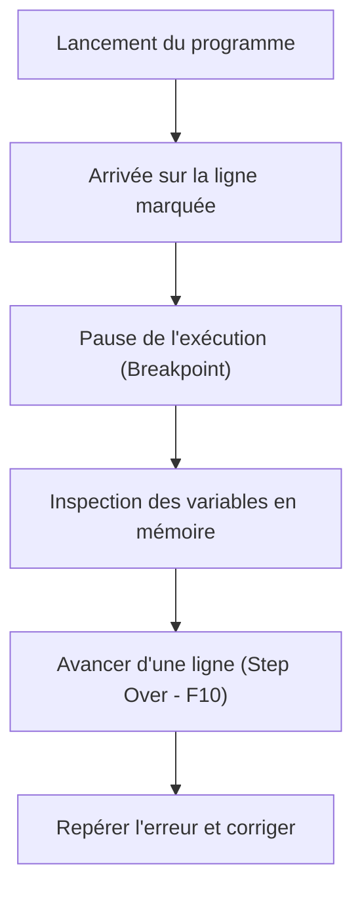

## 1. Contexte & Objectif

- **Objectif :** Utiliser les outils de développement du navigateur pour poser un point d'arrêt (*breakpoint*), exécuter un script JavaScript pas à pas et corriger une erreur de calcul.
- **Prérequis :** Savoir déclarer des variables en JavaScript et utiliser `console.log()`.

---

## 2. Théorie Pas-à-Pas

### 2.1. Qu'est-ce qu'un point d'arrêt (Breakpoint) ?

Un **point d'arrêt** indique au navigateur où suspendre temporairement l'exécution du code.

Lorsque l'exécution se fige, le programme s'arrête dans le temps. Vous pouvez alors regarder le contenu exact des variables stockées dans la mémoire.



### 2.2. L'onglet Sources et le panneau Scope

Pour analyser un script, ouvrez les **DevTools** de votre navigateur avec la touche `F12` :

- **L'onglet Sources (ou Débogueur) :** Affiche la liste des fichiers de votre site et le code source JavaScript.
- **La marge numérotée :** Cliquez sur un numéro de ligne pour ajouter un point d'arrêt (repéré par une puce bleue ou rouge).
- **Le panneau Scope (Portée) :** Situé à droite, il liste toutes les variables locales et leur valeur réelle à l'instant précis de la pause.

### 2.3. Avancer pas à pas avec Step Over (`F10`)

Le bouton **Step Over** (raccourci clavier `F10`) permet d'exécuter une seule instruction à la fois :

- Chaque clic sur `F10` fait avancer le programme d'une ligne.
- Vous observez en direct le changement de valeur des variables dans le panneau Scope.
- Vous identifiez immédiatement la ligne où la valeur devient incorrecte.

---

## 3. Pratique & Réalisation Guidée

Dans le Blog, un script calcule le nombre total de lectures de trois articles récents. Le résultat affiché est faux. Vous allez localiser l'erreur avec un point d'arrêt et la corriger.

### 3.1. Préparer la page de test

Créez un fichier `debug.html` et collez le code suivant :

```html
<!DOCTYPE html>
<html lang="fr">
<head>
    <meta charset="UTF-8">
    <title>Test Débogage - Blog</title>
</head>
<body>
    <h1>Calcul des lectures du Blog</h1>
    <p>Ouvrez la console (F12) pour observer le résultat.</p>

    <script>
        let articleSport = 150;
        let articleCulture = 250;
        let articleTech = 100;

        // Calcul erroné à identifier et corriger
        let totalLectures = articleSport - articleCulture + articleTech;

        console.log("Total des lectures :", totalLectures);
    </script>
</body>
</html>
```

### 3.2. Poser un point d'arrêt dans les DevTools

1. Ouvrez le fichier `debug.html` dans votre navigateur (Chrome, Firefox ou Edge).
2. Appuyez sur la touche `F12` pour ouvrir les DevTools.
3. Cliquez sur l'onglet **Sources** (ou **Débogueur** sous Firefox).
4. Dans l'arborescence à gauche, cliquez sur `debug.html` pour afficher son code.
5. Cliquez sur le numéro de la ligne contenant le calcul (`let totalLectures = ...`). Une puce bleue ou rouge apparaît : le point d'arrêt est actif.

### 3.3. Exécuter pas à pas et inspecter les variables

1. Rechargez la page avec la touche `F5`.
2. L'exécution se fige immédiatement sur la ligne du point d'arrêt. La ligne est surlignée.
3. Regardez le panneau **Scope** à droite :
   - `articleSport` vaut `150`.
   - `articleCulture` vaut `250`.
   - `articleTech` vaut `100`.
   - `totalLectures` vaut encore `undefined` car la ligne n'est pas encore exécutée.
4. Appuyez une fois sur **Step Over** (`F10`).
5. La ligne est exécutée. Observez la valeur prise par `totalLectures` dans le panneau Scope : elle affiche `0` au lieu de `500`.

### 3.4. Corriger l'erreur et vérifier

1. Observez l'opération : un signe moins (`-`) a été utilisé à la place du signe plus (`+`).
2. Ouvrez `debug.html` dans votre éditeur de code.
3. Corrigez la ligne :
   ```javascript
   let totalLectures = articleSport + articleCulture + articleTech;
   ```
4. Enregistrez le fichier et rechargez la page dans le navigateur (`F5`).
5. Avancez de nouveau avec `F10` ou cliquez sur **Reprendre** (`F8`).
6. Vérifiez la console : elle affiche bien `Total des lectures : 500`.

---

## 4. Critères de Réussite

- Le point d'arrêt suspend correctement l'exécution du code sur la ligne ciblée.
- Les valeurs des variables sont observées dans le panneau Scope.
- L'instruction pas à pas (`F10`) permet de suivre le passage à la ligne suivante.
- L'erreur de calcul est résolue dans le code source.
- La console affiche la valeur attendue : `500`.

---

## 5. Glossaire

- **Débogage :** Méthode pour rechercher, comprendre et corriger une erreur dans un programme.
- **Point d'arrêt (Breakpoint) :** Marqueur placé sur une ligne de code pour mettre l'exécution en pause.
- **DevTools :** Outils intégrés au navigateur pour tester, inspecter et déboguer une page Web.
- **Scope :** Espace des DevTools qui présente les variables en mémoire au moment de la pause.
- **Step Over :** Commande qui exécute une seule ligne de code puis s'arrête à la ligne suivante.
