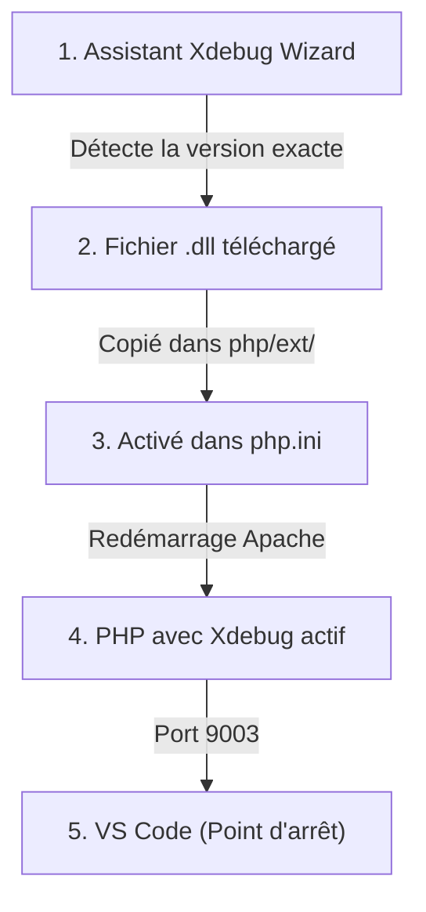

## 1. Contexte & Objectif

- **Objectif :** Télécharger et installer le module Xdebug dans PHP, l'activer dans le fichier `php.ini`, installer l'extension dans VS Code et valider le premier point d'arrêt sur un script test.
- **Prérequis :** Avoir un environnement PHP local opérationnel (XAMPP, WampServer ou PHP autonome) et Visual Studio Code.

---

## 2. Théorie Pas-à-Pas

### 2.1. Qu'est-ce que Xdebug ?

Par défaut, PHP exécute tout le script d'un coup et renvoie le HTML. Il est impossible de s'arrêter au milieu pour regarder dans la mémoire.

**Xdebug** est une extension (fichier `.dll` sous Windows) qui s'ajoute au moteur PHP :
- Il peut suspendre l'exécution du code sur une ligne précise.
- Il dialogue avec Visual Studio Code via le **port 9003**.



### 2.2. L'importance de la version exacte du fichier `.dll`

Sous Windows, le fichier Xdebug doit correspondre **exactement** à votre installation de PHP :
- Même numéro de version (ex: PHP 8.1, 8.2 ou 8.3).
- Même architecture (64 bits ou 32 bits).
- Même mode de compilation (*Thread Safe* avec Apache, ou *Non Thread Safe*).

Pour éviter toute erreur de version, nous utilisons l'outil officiel **Xdebug Wizard**.

### 2.3. Les directives obligatoires dans `php.ini`

Pour que Xdebug démarre et écoute vos demandes de débogage, ces 4 lignes sont requises :

```ini
[xdebug]
zend_extension = "php_xdebug.dll"
xdebug.mode = debug
xdebug.start_with_request = yes
xdebug.client_port = 9003
```

---

## 3. Pratique & Réalisation Guidée

Suivez rigoureusement ces étapes pour installer Xdebug dans votre PHP local et vérifier son bon fonctionnement.

### 3.1. Obtenir les informations de votre version de PHP

1. Ouvrez un terminal (PowerShell ou invite de commandes).
2. Tapez la commande suivante pour afficher la configuration complète de votre PHP :
   ```bash
   php -i
   ```
3. Sélectionnez tout le texte affiché dans le terminal et copiez-le (`Ctrl + A`, puis `Ctrl + C`).
   *(Alternative : créez un fichier `info.php` contenant `<?php phpinfo(); ?>`, ouvrez-le dans votre navigateur, faites `Ctrl + A` et copiez tout le texte).*

### 3.2. Télécharger le bon fichier `.dll` avec Xdebug Wizard

1. Ouvrez votre navigateur web et rendez-vous sur l'assistant officiel :
   [https://xdebug.org/wizard](https://xdebug.org/wizard)
2. Collez le texte copié dans le grand champ de formulaire.
3. Cliquez sur le bouton bleu **Analyse my phpinfo() output**.
4. L'assistant analyse votre configuration et affiche une section **Instructions** :
   - Il vous fournit un lien de téléchargement direct vers le fichier `.dll` adapté (ex: `php_xdebug-3.3.1-8.2-vs16-x86_64.dll`).
5. Cliquez sur ce lien pour télécharger le fichier.

### 3.3. Déplacer et renommer le fichier dans le dossier `ext`

1. Ouvrez votre explorateur de fichiers.
2. Déplacez le fichier téléchargé dans le dossier des extensions de PHP :
   - Sous **XAMPP** : `C:\xampp\php\ext\`
   - Sous **WampServer** : `C:\wamp64\bin\php\php8.x.x\ext\`
3. Renommez le fichier en :
   ```text
   php_xdebug.dll
   ```
   *(Ce nom plus court simplifie la ligne de configuration dans `php.ini`).*

### 3.4. Activer Xdebug dans le fichier `php.ini`

1. Ouvrez votre fichier de configuration `php.ini` dans votre éditeur de code :
   - Sous **XAMPP** : `C:\xampp\php\php.ini`
   - Sous **WampServer** : Clic gauche sur l'icône Wamp > **PHP** > **php.ini**
2. Allez à la toute fin du fichier et ajoutez les lignes suivantes :
   ```ini
   [xdebug]
   zend_extension = "php_xdebug.dll"
   xdebug.mode = debug
   xdebug.start_with_request = yes
   xdebug.client_port = 9003
   ```
3. Enregistrez les modifications du fichier `php.ini`.
4. **Redémarrez votre serveur Web :**
   - Sous XAMPP : Dans le panneau de contrôle, cliquez sur **Stop** puis **Start** en face du module Apache.
   - Sous WampServer : Clic gauche sur l'icône > **Redémarrer les services**.

### 3.5. Valider l'activation de Xdebug

1. Ouvrez un nouveau terminal.
2. Tapez :
   ```bash
   php -v
   ```
3. Vérifiez la sortie :
   ```text
   PHP 8.2.x (cli) ...
   with Xdebug v3.x.x, Copyright (c) 2002-..., by Derick Rethans
   ```
   La ligne `with Xdebug` confirme que le module est correctement installé et actif.

---

### 3.6. Installer l'extension PHP Debug dans VS Code

1. Ouvrez Visual Studio Code.
2. Cliquez sur l'onglet **Extensions** dans la barre latérale gauche (`Ctrl + Maj + X`).
3. Tapez dans la recherche : `PHP Debug`.
4. Installez l'extension officielle développée par **Xdebug / Felix Becker**.

### 3.7. Créer la configuration de débogage (`launch.json`)

1. Ouvrez le dossier de votre projet dans VS Code.
2. Cliquez sur l'icône **Exécuter et déboguer** dans la barre de gauche.
3. Cliquez sur **créer un fichier launch.json** et choisissez **PHP**.
4. Le fichier `.vscode/launch.json` est créé avec la configuration par défaut :
   ```json
   {
       "version": "0.2.0",
       "configurations": [
           {
               "name": "Listen for Xdebug",
               "type": "php",
               "request": "launch",
               "port": 9003
           }
       ]
   }
   ```
5. Enregistrez le fichier.

---

### 3.8. Tester votre premier point d'arrêt

1. Dans votre dossier web (ex: `htdocs` ou `www`), créez un fichier `test-debug.php` :
   ```php
   <?php
   $site = "Spartel Dev Academy";
   $annee = 2026;

   // Ligne où nous allons poser le point d'arrêt
   $message = "Bienvenue sur " . $site . " en " . $annee;

   echo $message;
   ```
2. Ouvrez `test-debug.php` dans VS Code.
3. Cliquez à gauche du numéro de ligne `$message = ...` pour poser un point d'arrêt rouge.
4. Dans le panneau de débogage de VS Code, cliquez sur le bouton vert **Démarrer le débogage** (`F5`) sur la configuration **Listen for Xdebug**.
5. Ouvrez votre navigateur et rendez-vous sur : `http://localhost/test-debug.php`.
6. VS Code s'arrête sur le point d'arrêt :
   - Regardez dans le volet **Variables** à gauche : `$site` vaut `"Spartel Dev Academy"` et `$annee` vaut `2026`.
7. Appuyez sur **Step Over** (`F10`) : `$message` est calculé et apparaît dans le panneau.
8. Cliquez sur **Continuer** (`F5`) : le script se termine et le navigateur affiche le résultat.

---

## 4. Critères de Réussite

- L'assistant Xdebug Wizard a identifié le fichier `.dll` exact compatible avec votre PHP.
- Le fichier `php_xdebug.dll` est placé dans le dossier `ext/`.
- Le bloc `[xdebug]` est renseigné dans `php.ini` et Apache a été redémarré.
- La commande `php -v` affiche la ligne de confirmation `with Xdebug v3...`.
- Le script `test-debug.php` s'interrompt bien dans VS Code sur le point d'arrêt lors de la visite dans le navigateur.

---

## 5. Glossaire

- **Xdebug Wizard :** Outil en ligne officiel analysant la configuration PHP pour fournir le lien direct du bon fichier DLL.
- **Dossier `ext/` :** Répertoire de PHP où sont regroupées toutes les bibliothèques d'extensions `.dll`.
- **php.ini :** Fichier central de configuration définissant les modules actifs et les réglages du moteur PHP.
- **Port 9003 :** Port réseau standard d'écoute entre Xdebug et l'éditeur Visual Studio Code.
- **Step Over (F10) :** Instruction de débogage permettant d'exécuter la ligne courante et de s'arrêter à la suivante.
