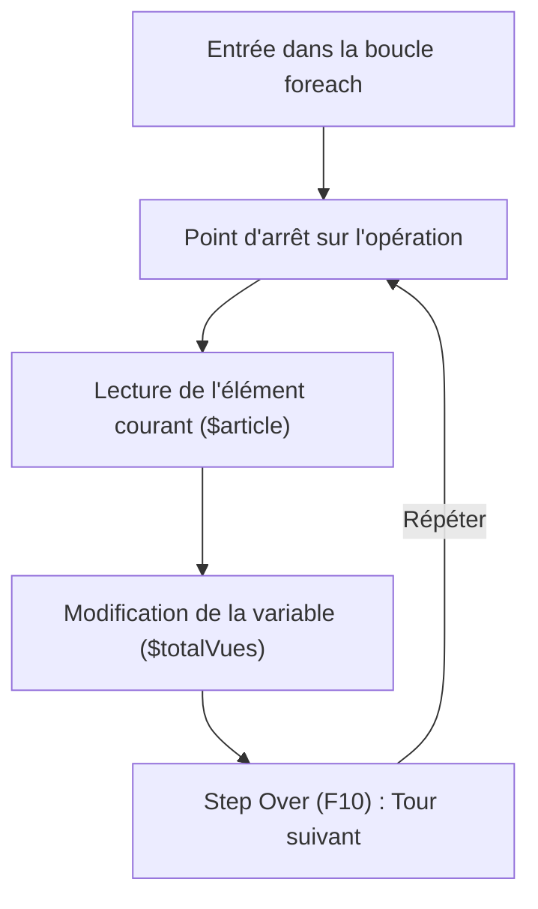

## 1. Contexte & Objectif

- **Objectif :** Utiliser les points d'arrêt et l'exécution pas à pas avec Xdebug dans VS Code pour suivre une boucle en PHP, observer l'évolution d'une variable en direct et corriger une erreur de logique de calcul.
- **Prérequis :** Avoir configuré et testé Xdebug avec VS Code (tutoriel T.125.221), connaître la syntaxe des tableaux et de la boucle `foreach` en PHP.

---

## 2. Théorie Pas-à-Pas

### 2.1. Les erreurs de logique en PHP

Une erreur dans un programme ne provoque pas toujours un message rouge ou un écran blanc :
- Parfois, le script PHP s'exécute jusqu'au bout sans afficher aucun message d'alerte.
- Pourtant, le résultat final affiché à l'écran est faux.

On appelle cela une **erreur de logique** : le code est syntaxiquement correct, mais l'opération demandée à l'ordinateur ne correspond pas au calcul attendu.

### 2.2. Observer l'évolution d'une variable dans une boucle

Placer un point d'arrêt à l'intérieur d'une boucle permet de comprendre comment la mémoire évolue à chaque répétition :



### 2.3. Le bouton Step Over (`F10`) et le volet Variables

À chaque fois que vous appuyez sur **Step Over** (`F10`) dans VS Code :
- PHP avance d'une instruction.
- La variable de boucle prend la valeur de l'élément suivant du tableau.
- Vous vérifiez si votre calcul ajoute bien la nouvelle valeur à la précédente au lieu de l'écraser.

---

## 3. Pratique & Réalisation Guidée

Dans le Blog, un script calcule le nombre total de lectures accumulées par trois articles récents. Le total affiché est `80` alors que les articles ont cumulé `120`, `200` et `80` vues (soit un total réel attendu de `400`). Vous allez utiliser Xdebug pour localiser l'erreur et la corriger.

### 3.1. Préparer le script de calcul

Créez un fichier `statistiques.php` dans votre dossier web local avec le code suivant :

```php
<?php
// Données des articles du Blog sous forme de tableau PHP
$articles = [
    ["titre" => "Débuter avec PHP", "vues" => 120],
    ["titre" => "Comprendre les tableaux", "vues" => 200],
    ["titre" => "Astuces de code", "vues" => 80]
];

$totalVues = 0;

// Parcours des articles pour calculer le cumul des lectures
foreach ($articles as $article) {
    // Instruction contenant l'anomalie de logique
    $totalVues = $article['vues']; 
}
?>
<!DOCTYPE html>
<html lang="fr">
<head>
    <meta charset="UTF-8">
    <title>Statistiques du Blog</title>
</head>
<body>
    <h1>Tableau de bord des lectures</h1>
    <p>Nombre total de vues : <strong><?= $totalVues ?></strong></p>
</body>
</html>
```

### 3.2. Poser un point d'arrêt dans la boucle

1. Ouvrez `statistiques.php` dans Visual Studio Code.
2. Repérez la ligne située à l'intérieur de la boucle :
   ```php
   $totalVues = $article['vues'];
   ```
3. Cliquez à gauche du numéro de ligne pour poser un point d'arrêt rouge.

### 3.3. Démarrer l'écoute et lancer l'exécution

1. Dans la barre latérale de VS Code, cliquez sur **Exécuter et déboguer**.
2. Vérifiez que la configuration active est **Listen for Xdebug**.
3. Cliquez sur le bouton vert **Démarrer le débogage** (`F5`).
4. Ouvrez votre navigateur et chargez : `http://localhost/statistiques.php`.
5. VS Code s'arrête sur la ligne marquée. L'exécution est suspendue au premier tour de boucle.

### 3.4. Suivre pas à pas et observer les valeurs

1. Regardez dans le volet **Variables** à gauche sous **Variables locales** :
   - `$article['vues']` vaut `120`.
   - `$totalVues` vaut encore `0`.
2. Appuyez sur **Step Over** (`F10`) pour exécuter l'instruction :
   - `$totalVues` passe à `120`.
3. Appuyez de nouveau sur `F10` pour passer au deuxième tour de boucle :
   - `$article['vues']` vaut maintenant `200`.
4. Appuyez sur `F10` pour exécuter le calcul :
   - Regardez bien la valeur de `$totalVues` : elle affiche `200` au lieu de `320` !
   - **Diagnostic :** Le code écrase la valeur précédente au lieu d'ajouter la nouvelle.
5. Appuyez encore sur `F10` pour le troisième tour :
   - `$totalVues` est de nouveau écrasé et prend la valeur `80`.

### 3.5. Corriger l'instruction et vérifier

1. Ouvrez `statistiques.php` dans l'éditeur.
2. Modifiez la ligne dans la boucle pour additionner les vues au cumul existant :
   ```php
   $totalVues += $article['vues'];
   ```
   *(Ou : `$totalVues = $totalVues + $article['vues'];`).*
3. Enregistrez le fichier.
4. Rechargez la page dans le navigateur (`F5`).
5. Appuyez sur **Continuer** (`F5`) dans la barre de débogage pour laisser le script se terminer.
6. Vérifiez la page web : elle affiche désormais **Nombre total de vues : 400**.

---

## 4. Critères de Réussite

- Le point d'arrêt s'active bien dans VS Code à l'intérieur de la boucle PHP.
- L'évolution de la variable `$totalVues` est observée à chaque tour de boucle avec `F10`.
- L'erreur d'écrasement de variable est identifiée sans nécessiter de `var_dump()`.
- La correction avec l'opérateur d'accumulation (`+=`) est appliquée.
- Le résultat affiché dans le navigateur est exact (`400`).

---

## 5. Glossaire

- **Erreur de logique :** Problème dans la conception du calcul qui produit un résultat faux sans bloquer l'exécution du code.
- **Boucle foreach :** Structure de contrôle PHP conçue pour parcourir chaque ligne d'un tableau les unes après les autres.
- **Accumulation :** Action d'ajouter successivement des valeurs à une variable globale (avec `+=`).
- **Variables locales :** Données créées et accessibles à l'intérieur du fichier en cours d'exécution.
