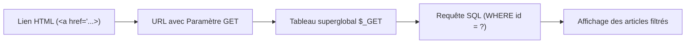

## 1. Contexte & Objectif

- **Objectif :** Diagnostiquer une anomalie de transmission de paramètres dans l'URL (`$_GET`), inspecter la superglobale avec le débogueur et corriger le code pour rétablir le filtrage des articles.
- **Prérequis :** Maîtriser les formulaires et liens en méthode GET, et les requêtes préparées avec PDO.

---

## 2. Théorie Pas-à-Pas

### 2.1. Le parcours d'un paramètre GET

Lorsqu'un utilisateur clique sur un lien de filtre, l'information transite directement dans l'adresse de la page web :

```text
http://localhost/blog/articles.php?categorie=2
                                  └──┬──────┘
                          Nom du paramètre et sa valeur
```

Le serveur PHP intercepte cette adresse et remplit automatiquement le tableau **`$_GET`** :
- Clé : `'categorie'`
- Valeur : `'2'`



### 2.2. Les anomalies fréquentes de transmission

L'absence de données lors d'un filtrage est le plus souvent due à :

1. **Un décalage de nom de clé :** Le lien envoie `?cat=2` mais le script PHP lit `$_GET['categorie']`.
2. **Une valeur non typée ou vide :** Le lien envoie `?categorie=` sans valeur, ce qui fausse la condition SQL.
3. **Une omission de vérification :** Le code ne teste pas si la clé existe avant d'exécuter la requête.

### 2.3. Inspecter la superglobale `$_GET`

Grâce aux points d'arrêt, vous n'avez pas besoin d'écrire des `var_dump($_GET)` temporaires :
- Placez un point d'arrêt à la première ligne du script de réception.
- Ouvrez le panneau **Variables globales** de VS Code.
- Déroulez `$_GET` pour comparer le nom de la clé reçue avec celui attendu par votre code.

---

## 3. Pratique & Réalisation Guidée

Dans l'espace public du Blog, la page propose des boutons pour filtrer les articles par thématique (*Développement*, *Design*, *Réseau*). Lorsque vous cliquez sur le bouton *Design*, aucun article ne s'affiche alors que la base de données en contient trois.

### 3.1. Identifier le code du lien et du traitement

Voici le menu de filtrage dans `navigation.php` :

```html
<!-- Menu de filtres du Blog -->
<nav class="filtres">
    <a href="articles.php">Tous les articles</a>
    <a href="articles.php?id_cat=2">Design</a>
</nav>
```

Et voici le script `articles.php` qui charge les articles :

```php
<?php
$pdo = new PDO('mysql:host=localhost;dbname=blog_db;charset=utf8', 'root', '');

// Lecture du filtre depuis l'URL
$categorieId = $_GET['categorie'] ?? null;

if ($categorieId !== null) {
    // Filtrage par catégorie
    $stmt = $pdo->prepare("SELECT * FROM articles WHERE categorie_id = :cat");
    $stmt->execute(['cat' => $categorieId]);
} else {
    // Affichage complet
    $stmt = $pdo->query("SELECT * FROM articles");
}

$articles = $stmt->fetchAll(PDO::FETCH_ASSOC);
?>
```

### 3.2. Placer le point d'arrêt d'inspection

1. Ouvrez `articles.php` dans Visual Studio Code.
2. Placez un point d'arrêt sur la ligne de lecture du paramètre :
   ```php
   $categorieId = $_GET['categorie'] ?? null;
   ```
3. Activez le débogueur (**Listen for Xdebug**).

### 3.3. Déclencher le scénario et inspecter `$_GET`

1. Ouvrez votre navigateur sur la page du Blog.
2. Cliquez sur le lien **Design**.
3. VS Code intercepte la requête et met le programme en pause.
4. Regardez dans le panneau **Variables** à gauche :
   - Déroulez la superglobale **`$_GET`**.
   - Vous constatez que la clé présente s'appelle `id_cat` avec la valeur `"2"`.
5. Appuyez sur **Step Over** (`F10`) :
   - Observez la variable `$categorieId` : elle prend la valeur `null` car votre script cherche la clé `'categorie'` qui n'existe pas dans `$_GET`.
   - Le programme bascule à tort dans la branche d'affichage de tous les articles ou échoue à filtrer.

### 3.4. Corriger le code et vérifier

Pour résoudre l'anomalie de façon propre, alignez le nom du paramètre dans le lien de navigation :

1. Ouvrez le fichier `navigation.php`.
2. Modifiez le lien pour envoyer la clé attendue par le traitement :
   ```html
   <a href="articles.php?categorie=2">Design</a>
   ```
3. Enregistrez le fichier.
4. Cliquez à nouveau sur le lien dans le navigateur.
5. Observez dans le débogueur : `$_GET['categorie']` contient désormais bien la valeur `"2"`.
6. Cliquez sur **Reprendre** (`F8`). La page affiche immédiatement les articles de la catégorie *Design*.

---

## 4. Critères de Réussite

- Le point d'arrêt permet d'observer les clés et valeurs de la superglobale `$_GET`.
- La divergence entre le nom envoyé par le lien HTML (`id_cat`) et le nom lu par PHP (`categorie`) est identifiée.
- Le lien est corrigé pour respecter la convention de nommage du traitement.
- Le filtrage par catégorie fonctionne et affiche les articles attendus.

---

## 5. Glossaire

- **Paramètre GET :** Information passée dans l'adresse URL sous la forme `cle=valeur`.
- **Superglobale :** Variable prédéfinie en PHP (comme `$_GET` ou `$_POST`) accessible depuis n'importe quel endroit du code.
- **Opérateur de coalescence nulle (`??`) :** Syntaxe PHP qui renvoie la valeur d'une variable si elle existe, ou une valeur par défaut sinon.
- **Filtrage SQL :** Utilisation de la clause `WHERE` pour restreindre les résultats retournés par une requête.
