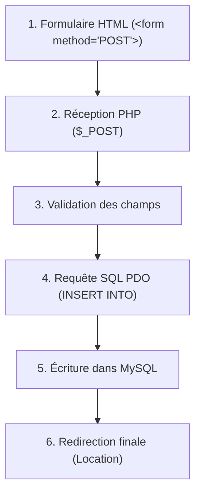

## 1. Contexte & Objectif

- **Objectif :** Suivre une donnée tout au long d'un parcours complet (formulaire HTML → réception PHP → insertion SQL → redirection) à l'aide de points d'arrêt, localiser l'étape défaillante et résoudre le problème d'enregistrement.
- **Prérequis :** Formulaires HTML en méthode POST, requêtes d'insertion PDO (`INSERT INTO`) et redirections avec `header()`.

---

## 2. Théorie Pas-à-Pas

### 2.1. Les étapes d'un parcours complet

Dans une application web, une action utilisateur traverse plusieurs couches techniques successives :



### 2.2. Pourquoi l'erreur est-elle plus difficile à localiser ?

Lorsqu'un formulaire "ne marche pas", le symptôme final est souvent le même : la page recharge, mais rien n'apparaît dans la base de données. 

Le problème peut se trouver à n'importe quelle étape :
- L'attribut `name` manque sur un champ `<input>`.
- Le traitement PHP ne reçoit pas les bonnes clés dans `$_POST`.
- Une contrainte SQL de la base de données est violée (ex: champ obligatoire oublié).
- Une redirection masquant l'erreur est déclenchée trop tôt.

### 2.3. La stratégie du traçage par points d'arrêt

Pour déboguer un parcours complet sans deviner :
1. **Point d'arrêt 1 :** À l'entrée du script de traitement pour valider la réception de `$_POST`.
2. **Point d'arrêt 2 :** Juste avant l'appel à `$stmt->execute()` pour inspecter les valeurs envoyées à MySQL.
3. **Point d'arrêt 3 :** Dans le bloc `catch (PDOException $e)` pour intercepter le message exact renvoyé par la base de données.

---

## 3. Pratique & Réalisation Guidée

Dans l'administration du Blog, le formulaire d'ajout d'article semble fonctionner. Quand vous cliquez sur *Enregistrer*, vous êtes redirigé vers la liste, mais le nouvel article n'apparaît jamais. Vous allez inspecter le cycle complet pour identifier et corriger le bug.

### 3.1. Examiner le formulaire et le script de traitement

Le formulaire dans `admin/article-form.php` :

```html
<form action="article-traitement.php" method="POST">
    <label for="titre">Titre</label>
    <input type="text" id="titre" name="titre" required>

    <label for="contenu">Contenu</label>
    <textarea id="contenu" name="contenu" required></textarea>

    <button type="submit">Enregistrer</button>
</form>
```

Le traitement dans `admin/article-traitement.php` :

```php
<?php
$pdo = new PDO('mysql:host=localhost;dbname=blog_db;charset=utf8', 'root', '', [
    PDO::ATTR_ERRMODE => PDO::ERRMODE_EXCEPTION
]);

if ($_SERVER['REQUEST_METHOD'] === 'POST') {
    $titre = trim($_POST['titre'] ?? '');
    $contenu = trim($_POST['contenu'] ?? '');

    try {
        // Requête d'insertion (erreur SQL masquée ici)
        $sql = "INSERT INTO articles (titre, contenu, date_creation) VALUES (:titre, :contenu, :date)";
        $stmt = $pdo->prepare($sql);
        $stmt->execute([
            'titre' => $titre,
            'contenu' => $contenu
            // Oubli du paramètre :date alors que la colonne est obligatoire en base
        ]);

        header('Location: articles-liste.php');
        exit;
    } catch (PDOException $e) {
        // Redirection silencieuse qui cache le problème !
        header('Location: articles-liste.php');
        exit;
    }
}
```

### 3.2. Poser les points d'arrêt stratégiques

1. Ouvrez `admin/article-traitement.php` dans Visual Studio Code.
2. Placez un point d'arrêt sur la ligne de préparation :
   ```php
   $stmt = $pdo->prepare($sql);
   ```
3. Placez un second point d'arrêt dans le bloc `catch` :
   ```php
   header('Location: articles-liste.php');
   ```
4. Lancez le débogueur (**Listen for Xdebug**).

### 3.3. Déclencher la soumission et observer le flux

1. Ouvrez le formulaire dans votre navigateur : `http://localhost/blog/admin/article-form.php`.
2. Saisissez :
   - Titre : `Mon nouvel article`
   - Contenu : `Contenu de test de débogage`
3. Cliquez sur **Enregistrer**.
4. VS Code s'arrête sur le premier point d'arrêt :
   - Inspectez `$_POST` dans le panneau Variables : les variables `$titre` et `$contenu` contiennent bien vos textes. L'étape Frontend → PHP est validée.
5. Appuyez sur **Step Over** (`F10`) pour tenter l'exécution `$stmt->execute(...)`.
6. L'exécution bascule immédiatement dans le bloc `catch` sur votre second point d'arrêt !
7. Déroulez la variable `$e` (l'exception PDO) dans le panneau Variables :
   - Vous lisez le message : `SQLSTATE[HY093]: Invalid parameter number: parameter was not defined (:date)`.

### 3.4. Corriger l'insertion et vérifier l'enregistrement

Le diagnostic est précis : la requête SQL attend un paramètre `:date`, mais le tableau d'exécution ne lui en fournit aucun.

1. Corrigez le tableau passé à `$stmt->execute()` dans `article-traitement.php` :
   ```php
   $stmt->execute([
       'titre' => $titre,
       'contenu' => $contenu,
       'date' => date('Y-m-d H:i:s')
   ]);
   ```
2. Enregistrez le fichier.
3. Retournez sur le formulaire dans le navigateur et soumettez-le de nouveau.
4. Dans VS Code, avancez avec `F10` : l'instruction `execute` s'exécute avec succès sans déclencher d'exception.
5. Cliquez sur **Reprendre** (`F8`).
6. La redirection s'effectue et votre nouvel article s'affiche immédiatement en haut de la liste d'administration.

---

## 4. Critères de Réussite

- Les points d'arrêt permettent de suivre l'avancement des données entre le formulaire, le traitement et la base de données.
- L'inspection de l'exception `$e` révèle le paramètre manquant dans la requête préparée.
- La requête PDO est corrigée en fournissant toutes les clés attendues.
- La soumission du formulaire insère avec succès l'enregistrement dans MySQL et la redirection affiche l'article.

---

## 5. Glossaire

- **Parcours complet :** Enchaînement de toutes les étapes depuis l'action de l'utilisateur jusqu'au stockage durable et au retour visuel.
- **Requête préparée :** Mécanisme qui sépare le code SQL des valeurs saisies pour éviter les injections et garantir la sécurité.
- **Bloc Try / Catch :** Structure de code permettant de tester une opération risquée et d'intercepter proprement une éventuelle erreur d'exécution.
- **Redirection HTTP :** Entête serveur (`header('Location: ...')`) demandant au navigateur d'ouvrir automatiquement une autre page.
