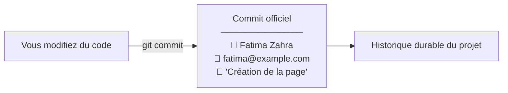

## 1. Contexte & Objectif

- **Objectif :** Vérifier la présence de Git sur son ordinateur, l'installer si nécessaire et renseigner son identité (nom et adresse email) pour signer l'ensemble de ses futurs commits.
- **Prérequis :** Un ordinateur avec accès à Internet et un terminal (PowerShell, Invite de commandes ou Git Bash).

---

## 2. Théorie Pas-à-Pas

### 2.1. Git et l'identité d'un commit

Git est un outil de **gestion de versions** : il enregistre l'historique de toutes les modifications apportées à vos fichiers.

Chaque enregistrement s'appelle un **commit** :
- Pour identifier qui est l'auteur des modifications, Git associe un nom et une adresse email à chaque commit.
- Ces informations s'affichent publiquement sur GitHub dans l'historique du projet.



### 2.2. La configuration globale (`--global`)

Vous n'avez pas besoin de saisir votre nom à chaque projet. L'option `--global` enregistre votre identité une seule fois pour tout votre ordinateur.

---

## 3. Pratique & Réalisation Guidée

### 3.1. Vérifier si Git est déjà installé

1. Ouvrez votre terminal (dans VS Code : `Ctrl + ù` ou menu *Terminal > Nouveau terminal*).
2. Tapez la commande suivante :
   ```bash
   git --version
   ```
3. Observez le retour :
   - Si une version s'affiche (ex: `git version 2.43.0`), Git est déjà installé. Passez directement à l'étape 3.3.
   - Si un message d'erreur s'affiche (*"commande introuvable"*), passez à l'étape 3.2 pour installer Git.

### 3.2. Installer Git (si absent)

1. Rendez-vous sur le site officiel : [git-scm.com/downloads](https://git-scm.com/downloads).
2. Téléchargez l'installateur correspondant à votre système (Windows 64 bits).
3. Lancez le fichier téléchargé et conservez toutes les options par défaut en cliquant sur *Next* jusqu'à la fin.
4. Fermez puis rouvrez votre terminal pour activer Git.

### 3.3. Configurer votre nom et votre adresse email

Tapez les deux commandes suivantes en remplaçant par votre vrai prénom, nom et adresse email :

```bash
git config --global user.name "Votre Prénom et Nom"
git config --global user.email "votre.email@example.com"
```

**Exemple concret :**
```bash
git config --global user.name "Amine Bennani"
git config --global user.email "amine.bennani@spartel.ma"
```

### 3.4. Vérifier la prise en compte

Affichez les valeurs enregistrées pour confirmer la configuration :

```bash
git config --global user.name
git config --global user.email
```

**Résultat attendu :**
```text
Amine Bennani
amine.bennani@spartel.ma
```

---

## 4. Critères de Réussite

- La commande `git --version` confirme la présence de Git sur votre machine.
- Les commandes `git config --global user.name` et `user.email` retournent votre identité sans erreur.
- La liste complète obtenue avec `git config --list` contient bien vos informations d'auteur.

---

## 5. Glossaire

- **Git :** Logiciel de gestion de versions installé localement sur l'ordinateur.
- **Commit :** Instantané officiel et daté qui enregistre un ensemble de modifications dans l'historique du projet.
- **git config :** Commande servant à consulter et modifier les réglages de Git.
- **Option --global :** Paramètre qui applique la configuration à l'ensemble des dépôts de l'utilisateur sur la machine.
