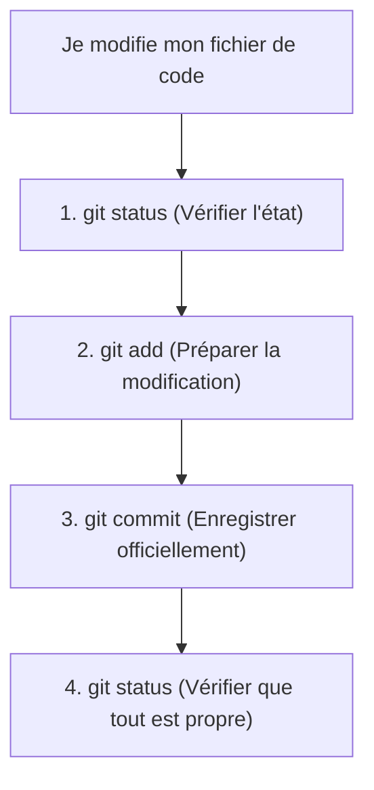

## 1. Contexte & Objectif

- **Objectif :** Maîtriser le cycle fondamental de sauvegarde locale dans le terminal à l'aide des trois commandes clés : `git status`, `git add` et `git commit`.
- **Prérequis :** Avoir compris les 3 zones de Git (T.151.121) et avoir un dépôt local initialisé.

---

## 2. Théorie Pas-à-Pas

### 2.1. Le cycle de travail en ligne de commande

Pour enregistrer une modification de code dans Git, vous répétez toujours ce même enchaînement :



1. **`git status` :** C'est votre radar. Il indique précisément dans quelle zone se trouvent vos fichiers (modifiés en rouge, préparés en vert, ou inchangés).
2. **`git add <fichier>` :** Déplace le fichier du *Dossier de travail* vers la *Zone de préparation*.
3. **`git commit -m "..."` :** Grave l'ensemble de la zone de préparation dans l'historique permanent du projet.

---

## 3. Pratique & Réalisation Guidée

Ouvrez votre terminal à la racine de votre projet Blog.

### 3.1. Modifier un fichier

1. Ouvrez `index.html` dans VS Code et ajoutez un paragraphe :
   ```html
   <p>Bienvenue sur mon premier blog technique.</p>
   ```
2. Enregistrez avec `Ctrl + S`.

### 3.2. Exécuter la routine locale étape par étape

1. **Vérifier l'état (Étape 1) :**
   ```bash
   git status
   ```
   *Git affiche `index.html` en rouge sous "Fichiers modifiés".*

2. **Préparer la modification (Étape 2) :**
   ```bash
   git add index.html
   ```
   *Vérifiez à nouveau avec `git status` : le fichier passe en vert sous "Modifications qui seront validées".*

3. **Créer le commit officiel (Étape 3) :**
   ```bash
   git commit -m "feat: ajout du message de bienvenue dans la page d'accueil"
   ```
   *Git confirme la sauvegarde avec le hash du commit et le nombre de lignes ajoutées.*

4. **Confirmer la propreté du dépôt (Étape 4) :**
   ```bash
   git status
   ```
   *Le terminal affiche : `rien à valider, la copie de travail est propre`.*

---

## 4. Critères de Réussite

- Vous exécutez `git status` avant et après chaque action.
- Le fichier modifié passe du rouge (non préparé) au vert (préparé avec `git add`).
- Le commit est créé avec un message clair expliquant le changement.
- `git status` confirme que la copie de travail est propre à la fin du cycle.

---

## 5. Glossaire

- **git status :** Commande affichant l'état des fichiers dans les différentes zones de Git.
- **git add :** Commande qui place une modification dans la zone de préparation.
- **git commit -m :** Commande qui enregistre définitivement la zone de préparation avec un message explicatif.
- **Copie de travail propre :** État où toutes les modifications faites dans les fichiers ont été enregistrées dans un commit.
