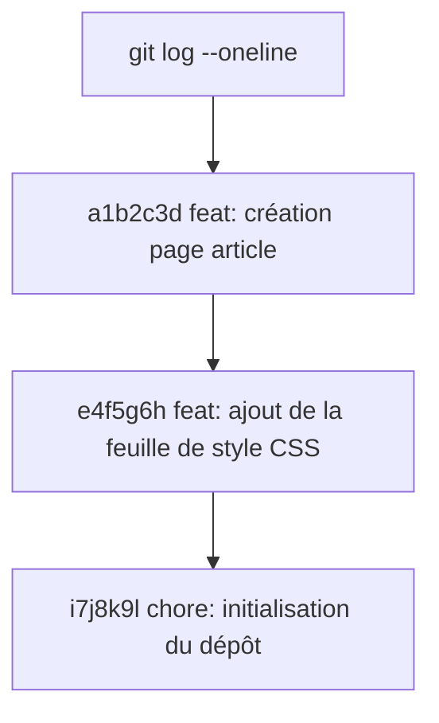

## 1. Contexte & Objectif

- **Objectif :** Consulter l'historique chronologique des commits d'un projet Git, identifier l'auteur, la date et le hash d'une version, et utiliser la vue synthétique `git log --oneline`.
- **Prérequis :** Avoir un dépôt Git local contenant au moins deux commits.

---

## 2. Théorie Pas-à-Pas

### 2.1. Qu'est-ce que l'historique Git ?

Chaque fois que vous créez un commit, Git enregistre une fiche d'identité complète dans le journal du projet :

```text
commit 7b3a1c2d9e8f4a5b6c7d8e9f0a1b2c3d4e5f6a7b (HEAD -> main)
Author: Fatima Zahra <fatima@example.com>
Date:   Mon Oct 25 10:30:00 2026 +0100

    feat: création de la page de détail d'un article
```

- **Le hash (SHA-1) :** Code unique de 40 caractères qui identifie ce commit de manière infalsifiable.
- **L'auteur et la date :** Qui a réalisé la sauvegarde et à quel moment précis.
- **Le message :** Ce qui a été accompli dans cette version.

### 2.2. La commande `git log` et l'option `--oneline`

- **`git log` :** Affiche la liste détaillée des commits du plus récent au plus ancien.
- **Touche `q` :** Si la liste dépasse de l'écran, Git ouvre un lecteur. Appuyez sur la touche `q` (quit) de votre clavier pour revenir à la ligne de commande.
- **`git log --oneline` :** Affiche chaque commit sur une seule ligne (hash court + message). C'est la commande la plus utilisée pour avoir une vue d'ensemble rapide.



---

## 3. Pratique & Réalisation Guidée

Ouvrez votre terminal dans le dossier du Blog.

### 3.1. Afficher l'historique complet

1. Tapez la commande suivante :
   ```bash
   git log
   ```
2. Lisez les commits affichés. Repérez le premier commit et le plus récent.
3. Si le curseur se bloque en bas avec des deux-points (`:`), appuyez sur la touche **`q`** pour quitter.

### 3.2. Afficher la vue compacte d'une ligne

1. Tapez :
   ```bash
   git log --oneline
   ```
2. Observez le résultat synthétique :
   ```text
   7b3a1c2 feat: ajout du message de bienvenue dans la page d'accueil
   2a8f90c feat: création de la structure HTML du Blog
   ```
3. Chaque ligne commence par un hash court de 7 caractères qui suffit amplement pour désigner le commit.

### 3.3. Limiter le nombre de résultats

Si votre projet compte des dizaines de versions et que vous ne voulez voir que les 3 dernières :
```bash
git log -n 3 --oneline
```

---

## 4. Critères de Réussite

- La commande `git log` affiche correctement la liste des commits avec leurs métadonnées complètes.
- Vous savez quitter le lecteur de journal sans bloquer le terminal grâce à la touche `q`.
- La commande `git log --oneline` présente l'historique sous forme condensée et lisible.

---

## 5. Glossaire

- **git log :** Commande affichant le journal chronologique des commits enregistrés.
- **Hash (SHA-1) :** Empreinte numérique unique qui identifie chaque commit de façon certaine.
- **Option --oneline :** Format d'affichage compact condensant chaque commit en une seule ligne.
- **Touche q :** Touche permettant de quitter la pagination du journal et de reprendre la main dans le terminal.
