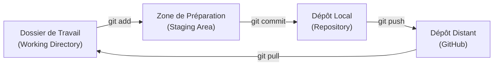

# Plan de Réalisation — Versionner son travail avec Git (D.151.1)

**Domaine de compétence :** Versionner son propre travail (`D.151.1`)  
**Session de première mobilisation :** S2 — Page de détail d’un article — V1 statique  
**Niveau :** N1 (Débutant)  

> **Règle d'Unicité Pédagogique :**  
> Ce document est rédigé une seule fois dans la session S2 (première session mobilisant Git). Il formalise la méthodologie générale et l'ensemble des tutoriels Git pour **les 12 sessions de la formation**. Dans les sessions suivantes (S3, S5, S6, S7, S8, S9, S10), l'apprenant réalisera l'Unité d'Apprentissage prévue à son sprint à partir de ce document unique de référence.

---

## 1. Méthodologie Pédagogique de Git en Niveau N1

L'apprentissage de Git suit une démarche progressive, pratique et rassurante :

* **Démarrage graphique puis passage en ligne de commande :** Découverte du cycle dans l'interface de VS Code en S2 pour lever l'appréhension initiale, puis acquisition progressive de la routine du terminal dès S3 (`status`, `add`, `commit`, `log`, `restore`, `push`, `pull`, `clone`).
* **Vocabulaire simple et imagé :**
  - Le *dossier de travail* (*Working Directory*) : mon bureau où je crée et modifie mes fichiers.
  - La *zone de préparation* (*Staging Area*) : la table de tri où je pose les fichiers prêts à être enregistrés.
  - Le *commit* (*Repository*) : la photo officielle et datée de mon projet.
  - Le *dépôt distant* GitHub (`origin`) : la sauvegarde sécurisée accessible en ligne.
* **Routine sécurisée :** Toujours vérifier l'état avec `git status` avant et après chaque manipulation.

---

## 2. Articulation Temporelle par Session (S2 à S12)

### ⏮️ Acquis Passés (Session S1)
- Découverte du rôle de Git et de l'intérêt de sauvegarder l'historique du projet pour collaborer (Veille prospective `UA.161.11`).

### 🎯 Unité d'Apprentissage Mobilisée dans ce Sprint (Session S2)
- **UA.151.11 — Préparer l'environnement et déposer son premier travail avec VS Code :**  
  Installer Git, configurer son identité (`user.name`, `user.email`), comprendre la différence avec GitHub, cloner son dépôt et réaliser son premier commit/sync via l'interface graphique de VS Code.

### ⏭️ Perspectives Futures (Sessions S3 à S12)
- **S3 (UA.151.12) :** Sauvegarder son travail localement en ligne de commande (`git status`, `git add`, `git commit`).
- **S5 (UA.151.13) :** Rédiger des messages de commit professionnels et sécurisés.
- **S6 (UA.151.14) :** Consulter l'historique du projet avec `git log`.
- **S7 (UA.151.15) :** Créer un fichier `.gitignore` et annuler des erreurs avec `git restore`.
- **S8 (UA.151.16) :** Synchroniser son travail avec GitHub (`git push` et `git pull`).
- **S9 (UA.151.17) :** Cloner et récupérer son projet dans un autre dossier avec `git clone`.
- **S10 (UA.151.18) :** Maintenir un travail versionné, propre et toujours récupérable.

---

## 3. Grille Complète des Tutoriels Git (S2 à S10)

| Identifiant | Session | Titre du tutoriel | Unité ciblée | Action & Résultat attendu |
| :--- | :---: | :--- | :---: | :--- |
| **T.151.11.1** | **S2** | Installer et configurer Git sur son ordinateur | UA.151.11 | Git installé, identité (`user.name`, `user.email`) enregistrée. |
| **T.151.11.2** | **S2** | Comprendre les concepts de base : Git et GitHub | UA.151.11 | Distinction locale vs distante assimilée avec schémas. |
| **T.151.11.3** | **S2** | Sauvegarder son code en un clic avec VS Code | UA.151.11 | Premier dépôt cloné, commit et synchronisation via l'interface. |
| **T.151.12.1** | **S3** | Les 3 zones de Git expliquées simplement | UA.151.12 | Modèle mental assimilé (Dossier → Préparation → Dépôt). |
| **T.151.12.2** | **S3** | La routine locale du développeur (Terminal) | UA.151.12 | Cycle complet maîtrisé : `git status`, `git add`, `git commit`. |
| **T.151.13.1** | **S5** | Rédiger des messages de commit professionnels | UA.151.13 | Commits atomiques avec verbes d'action et vérification préalable. |
| **T.151.14.1** | **S6** | Lire l'historique du projet avec git log | UA.151.14 | Historique affiché, hashes identifiés et options `--oneline`. |
| **T.151.15.1** | **S7** | Créer et configurer un fichier .gitignore | UA.151.15 | Fichiers temporaires et secrets ignorés par Git. |
| **T.151.15.2** | **S7** | Réparer une erreur avant la sauvegarde avec git restore | UA.151.15 | Annulation de modifications non souhaitées sans perte de données. |
| **T.151.16.1** | **S8** | Partager son travail sur Internet avec git push | UA.151.16 | Commits locaux envoyés avec succès sur GitHub. |
| **T.151.16.2** | **S8** | Mettre à jour son ordinateur avec git pull | UA.151.16 | Modifications distantes récupérées localement sans conflit. |
| **T.151.17.1** | **S9** | Cloner un projet existant depuis GitHub | UA.151.17 | Projet cloné en terminal avec `git clone` dans un nouveau dossier. |
| **T.151.18.1** | **S10** | Vérifier l'état de sauvegarde complète du projet | UA.151.18 | Dépôt propre, synchronisé et certifié récupérable. |

---

## 4. Fiches Détaillées — Session S2 (UA.151.11)

### T.151.11.1 — Installer et configurer Git sur son ordinateur
- **Objectif :** Vérifier l'installation de Git et renseigner son identité auteur pour signer les sauvegardes.
- **Notions :** `git --version`, `git config --global user.name`, `git config --global user.email`.
- **Validation :** La commande `git config --list` affiche le nom et l'email de l'apprenant.

### T.151.11.2 — Comprendre les concepts de base : Git et GitHub
- **Objectif :** Différencier l'outil local (Git) de la plateforme de partage distante (GitHub).
- **Notions :** Gestion de versions, dépôt local, dépôt distant, synchronisation.
- **Validation :** L'apprenant sait identifier si une action relève de la machine locale ou d'Internet.

### T.151.11.3 — Sauvegarder son code en un clic avec VS Code
- **Objectif :** Cloner son premier dépôt GitHub et effectuer le cycle de sauvegarde complet via les boutons de VS Code.
- **Notions :** Panneau Contrôle de code source, bouton Cloner, bouton Préparer (`+`), Commit et Synchroniser.
- **Validation :** Le fichier `index.html` est visible sur GitHub avec son message de commit.
