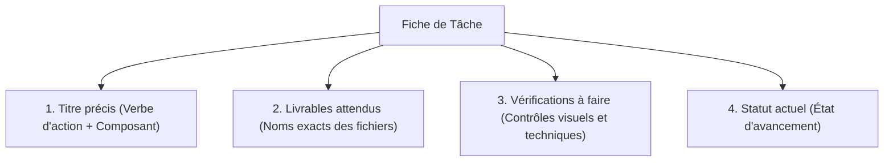
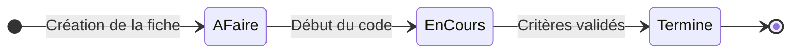

## 1. Contexte & Objectif

- **Objectif :** Rédiger une fiche de tâche courte en Markdown pour formaliser sa mission, ses livrables et ses vérifications avant de commencer à coder.
- **Prérequis :** Avoir analysé la consigne et extrait les critères d'acceptation (Tutoriel `T.152.21.1`).

---

## 2. Théorie Pas-à-Pas

### 2.1. Pourquoi formaliser une fiche de tâche avant de coder ?

Un développeur professionnel prépare toujours son plan d'action avant d'ouvrir son éditeur de code :

- **Éviter les oublis :** Garder sous les yeux la liste exacte des fichiers à livrer.
- **Rester concentré :** Travailler sur un objectif précis sans se disperser sur des fonctionnalités hors sujet.
- **Communiquer facilement :** Montrer à son formateur ou à son équipe ce que l'on est en train de fabriquer.

### 2.2. Les quatre sections standard d'une fiche de tâche N1

Une fiche de tâche efficace tient sur une seule page et comporte 4 informations clés :



| Section | Rôle | Exemple pour la session S2 |
| :--- | :--- | :--- |
| **Titre** | Indiquer clairement l'action principale. | *Intégration statique de la page article du Blog* |
| **Livrables** | Lister les fichiers de code à produire. | `public-article.html`, `css/style.css` |
| **Vérifications** | Décrire comment tester le bon fonctionnement. | *Affichage du titre, de l'image et du style 800px* |
| **Statut** | Indiquer où en est le travail. | *À faire*, *En cours*, ou *Terminé* |

### 2.3. Les trois statuts élémentaires d'une tâche

Une tâche évolue toujours selon le même cycle de vie :



- **À faire :** La consigne est analysée, la fiche est rédigée, mais le code n'a pas encore commencé.
- **En cours :** Vous développez activement la solution.  
  > [!IMPORTANT]
  > **Règle d'or Spartel N1 :** Une seule tâche à la fois dans le statut *« En cours »*. Ne commencez jamais une deuxième tâche avant d'avoir terminé et testé la précédente.
- **Terminé :** Tous les livrables sont produits, les vérifications sont validées et le code est commité sur GitHub.

---

## 3. Pratique & Réalisation Guidée

Vous allez créer votre fiche de tâche pour le développement de la page article de la session S2.

### 3.1. Créer le fichier de travail

Dans votre éditeur de code, créez un fichier nommé `tache-s2-detail-article.md`.

### 3.2. Rédiger la structure standard en Markdown

Copiez la structure suivante dans votre fichier :

```markdown
# Fiche de Tâche — Session S2

## 1. Intitulé de la tâche
Intégration statique de la page de détail d'un article.

## 2. Livrables attendus
- `public-article.html` (structure HTML5 sémantique).
- `css/style.css` (mise en forme et largeur maximale 800px).

## 3. Vérifications à réaliser avant validation
- [ ] La page s'ouvre correctement dans le navigateur via un double-clic ou Live Server.
- [ ] Le titre principal apparaît dans une balise `<h1>`.
- [ ] L'image d'illustration s'affiche avec son attribut `alt`.
- [ ] Le texte de l'article est découpé en paragraphes lisibles (`<p>`).
- [ ] La feuille de style CSS est bien liée et limite la largeur de lecture à 800px.

## 4. Statut d'avancement
- **Statut initial :** À faire
```

### 3.3. Mettre à jour le statut pendant l'action

1. Dès que vous créez les fichiers `public-article.html` et `css/style.css` pour commencer à coder, modifiez la ligne de statut :
   ```markdown
   Statut : En cours
   ```
2. Lorsque toutes les cases de la section *Vérifications* sont cochées et que votre code est commité sur GitHub, passez le statut à :
   ```markdown
   Statut : Terminé ✅
   ```

---

## 4. Livrable & Critères de Réussite

### Emplacement dans votre dépôt d'autoformation
Dans votre dépôt GitHub d'autoformation annuel, déposez votre fiche finalisée dans :
```text
gestion/comprehension-tache/rediger-fiche-tache/tache-s2-detail-article.md
```

### Contenu attendu du livrable
Le fichier `tache-s2-detail-article.md` complété, comportant les 4 sections obligatoires avec le statut final *Terminé*.

### Critères de réussite du livrable
- [ ] Le fichier est commité dans le dossier `gestion/comprehension-tache/rediger-fiche-tache/`.
- [ ] Les 4 sections standard (*Titre*, *Livrables*, *Vérifications*, *Statut*) sont toutes renseignées.
- [ ] La liste des vérifications reprend des critères mesurables et observables.
- [ ] Le document est rédigé en Markdown clair sans capture d'écran.

---

## 5. Glossaire

- **Fiche de tâche :** Document court décrivant l'objectif, les fichiers à produire et les critères de fin d'une tâche.
- **Statut :** Indicateur d'avancement d'un travail (*À faire*, *En cours*, *Terminé*).
- **Cadrage :** Action de définir précisément les limites et les attentes d'un travail avant de commencer.
- **Vérification :** Test pratique réalisé par le développeur pour s'assurer que le résultat correspond à la demande.
