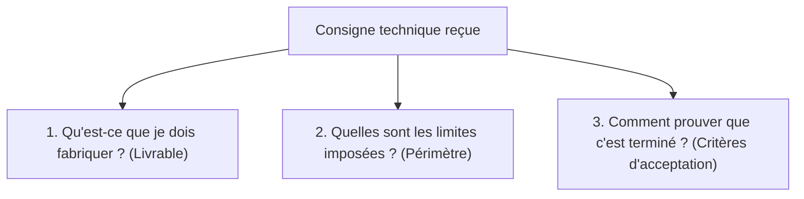

## 1. Contexte & Objectif

- **Objectif :** Lire une consigne technique de développement, déterminer le périmètre de travail et lister les critères d'acceptation qui confirment que la tâche est réussie.
- **Prérequis :** Savoir lire une consigne en français simple et identifier les éléments d'une page Web.

---

## 2. Théorie Pas-à-Pas

### 2.1. Qu'est-ce qu'une consigne technique ?

Une **consigne technique** est une instruction écrite qui décrit le besoin d'un client ou d'un chef de projet.

Avant d'écrire la moindre ligne de code, le développeur analyse la consigne pour répondre à trois questions :



### 2.2. Identifier le périmètre : Inclus vs Exclu

Le **périmètre** définit exactement les frontières du travail à réaliser :

- **Ce qui est inclus :** Les éléments obligatoires demandés dans le sprint courant.
- **Ce qui est exclu :** Les fonctionnalités avancées reportées à plus tard (par exemple : ajouter une base de données ou un espace de connexion alors qu'on demande une maquette HTML statique).

| Élément | Dans le périmètre S2 ? | Justification |
| :--- | :---: | :--- |
| Page HTML structurée | **Oui** | Fichier obligatoire demandé dans la consigne. |
| Feuille de style CSS liée | **Oui** | Mise en forme visuelle demandée. |
| Données dynamiques MySQL | **Non** | Non demandé en S2 (prévu en session S5). |
| Formulaire de connexion | **Non** | Hors périmètre du sprint courant. |

### 2.3. Les critères d'acceptation

Un **critère d'acceptation** est une condition mesurable et vérifiable. Si toutes les conditions sont remplies, la tâche est acceptée et validée :

- Un critère n'est pas vague (*« Le site est beau »* est un mauvais critère).
- Un critère est binaire et observable (*« Le titre principal apparaît dans une balise `<h1>` »* est un bon critère).

---

## 3. Pratique & Réalisation Guidée

Dans ce sprint S2, votre mission consiste à réaliser la page de détail d'un article pour le Blog personnel. Vous allez analyser sa consigne avant d'engager le code.

### 3.1. Lire la consigne du sprint S2

Lisez attentivement la consigne technique reçue pour la session S2 :

> **Consigne S2 — Détail d'un article du Blog :**  
> Créez la page Web statique `public-article.html` présentant l'article complet.  
> La page doit comporter :
> 1. Un en-tête avec le titre de l'article (`<h1>`) et la date de publication.
> 2. Une image d'illustration principale avec son texte alternatif (`alt`).
> 3. Le corps de l'article composé de deux paragraphes de texte (`<p>`).
> 4. Un fichier de style séparé `css/style.css` pour définir la police et la largeur maximale de lecture (800 pixels).  
> *Rappel : Aucun code serveur (PHP) ni base de données ne sont autorisés dans cette version.*

### 3.2. Répondre aux trois questions de cadrage

Prenez une feuille ou votre éditeur et répondez aux 3 questions :

1. **Quels fichiers devez-vous produire ?**  
   `public-article.html` et `css/style.css`.
2. **Quelles sont les contraintes techniques imposées ?**  
   HTML5 pur, CSS séparé dans le dossier `css/`, largeur max de 800px, aucun PHP ni base de données.
3. **Que doit voir l'utilisateur à l'écran ?**  
   Un titre `<h1>`, une date, une image visible et deux paragraphes bien lisibles.

### 3.3. Établir la checklist des critères d'acceptation

Transformez la consigne en 5 critères observables :

1. Le fichier `public-article.html` s'ouvre sans erreur dans le navigateur.
2. Le titre de l'article est balisé avec une balise `<h1>`.
3. L'image s'affiche correctement avec un attribut `alt` descriptif.
4. Le texte de l'article est découpé en deux balises `<p>`.
5. La feuille de style `css/style.css` est correctement liée et limite la largeur à 800px.

---

## 4. Livrable & Critères de Réussite

### Emplacement dans votre dépôt d'autoformation
Dans votre dépôt GitHub d'autoformation annuel, créez le fichier :
```text
gestion/comprehension-tache/analyser-consigne/criteres-acceptation.md
```

### Contenu attendu du livrable
Votre fichier Markdown doit contenir :
1. Le résumé du besoin de la page article en 2 phrases simples.
2. Le tableau du périmètre (ce qui est inclus et ce qui est exclu).
3. La checklist des 5 critères d'acceptation cochables.

### Critères de réussite du livrable
- [ ] Le fichier est commité dans le dossier `gestion/comprehension-tache/analyser-consigne/`.
- [ ] Le périmètre distingue nettement le code statique du code dynamique exclu.
- [ ] Les 5 critères d'acceptation sont concrets, mesurables et vérifiables.
- [ ] Le document ne contient aucune capture d'écran.

---

## 5. Glossaire

- **Consigne :** Instruction écrite qui précise le travail attendu par le client ou le formateur.
- **Périmètre :** Frontière délimitant ce qui fait partie de la tâche et ce qui en est exclu.
- **Critère d'acceptation :** Condition précise et mesurable qui confirme qu'une tâche est terminée avec succès.
- **Livrable :** Résultat concret (code, fichier texte ou document) produit et déposé sur GitHub.
