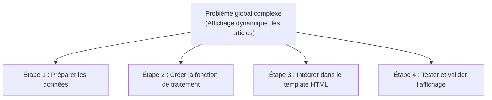

## 1. Contexte & Objectif

- **Objectif :** Décomposer une demande globale de sprint en une suite de 4 sous-tâches techniques indépendantes, ordonnées selon leurs dépendances et vérifiables une par une.
- **Prérequis :** Savoir estimer la durée d'une action technique (`T.152.221`) et identifier les langages du Web.

---

## 2. Théorie Pas-à-Pas

### 2.1. Pourquoi découper un problème complexe ?

Face à une consigne volumineuse comme *« Rendre la page d'accueil dynamique avec PHP »*, un débutant risque de se sentir submergé et de bloquer.

Le découpage technique résout ce problème :
- **Clarté d'esprit :** Vous ne pensez qu'à une seule action précise à la fois.
- **Avancement mesurable :** Chaque étape validée est une victoire intermédiaire qui motive l'apprenant.
- **Débogage rapide :** Si une erreur survient, vous savez exactement dans quelle petite étape elle se trouve.



### 2.2. Identifier l'ordre logique et les dépendances

Une **dépendance** signifie qu'une tâche B ne peut pas démarrer tant que la tâche A n'est pas terminée.

- Exemple évident : On ne peut pas afficher des articles en PHP (B) si le fichier de données contenant ces articles n'existe pas encore (A).
- **Règle méthodologique :** Rangez toujours vos étapes dans l'ordre logique de production :
  1. Les données d'abord (source).
  2. Le traitement logique (fonction PHP).
  3. L'affichage utilisateur (HTML/CSS).
  4. La vérification finale.

### 2.3. L'étape obligatoire de vérification

Un découpage professionnel se termine **toujours** par une action de contrôle explicite :
- Jamais de sous-tâche vague comme *« Finir le projet »*.
- Une sous-tâche de recette concrète : *« Ouvrir le navigateur et vérifier que 3 articles s'affichent correctement sans message d'erreur PHP »*.

---

## 3. Pratique & Réalisation Guidée

Dans ce sprint S5, vous devez afficher dynamiquement les articles du Blog à partir d'un fichier de données PHP. Vous allez découper cette mission en 4 sous-tâches ordonnées.

### 3.1. Lire la mission globale du sprint S5

> **Mission S5 :**  
> Créer une page PHP modulaire qui charge une liste d'articles stockée dans un tableau et l'affiche proprement dans la page d'accueil.

### 3.2. Construire le plan de travail découpé

Remplissez le tableau des 4 sous-tâches en précisant pour chacune l'action, le fichier modifié et le critère de fin :

| Étape | Intitulé technique de l'action | Fichier cible | Condition pour passer à l'étape suivante |
| :-: | :--- | :--- | :--- |
| **1** | Déclarer le tableau d'articles en PHP | `data/articles.php` | Le fichier contient un tableau `$articles` avec 3 entrées valides. |
| **2** | Écrire la fonction de formatage d'un article | `includes/functions.php` | La fonction prend un article en paramètre et renvoie du HTML propre. |
| **3** | Inclure les données et boucler dans la page | `index.php` | La boucle `foreach` parcourt le tableau sans erreur de syntaxe. |
| **4** | Recette visuelle et test dans le navigateur | Navigateur Web | Les 3 articles apparaissent à l'écran avec leur titre et résumé. |

Chaque étape est autonome : vous terminez et testez l'étape 1 avant d'écrire la moindre ligne de code pour l'étape 2.

---

## 4. Livrable & Critères de Réussite

### Emplacement dans votre dépôt d'autoformation
Dans votre dépôt GitHub d'autoformation annuel, déposez votre découpage dans :
```text
gestion/decouper-travail/plan-actions-sprint/decoupage-sprint5.md
```

### Contenu attendu du livrable
Le document Markdown `decoupage-sprint5.md` comprenant :
1. L'intitulé de la mission globale du sprint.
2. Le tableau des 4 sous-tâches ordonnées avec colonnes *Étape*, *Action*, *Fichier cible* et *Condition de validation*.
3. La confirmation de la présence d'une étape finale de vérification.

### Critères de réussite du livrable
- [ ] Le fichier est commité dans le dossier `gestion/decouper-travail/plan-actions-sprint/`.
- [ ] Le travail est découpé en 4 sous-tâches ordonnées chronologiquement.
- [ ] Chaque étape possède une condition de validation vérifiable.
- [ ] L'étape finale est obligatoirement dédiée à la vérification/recette.
- [ ] Le document ne contient aucune capture d'écran.

---

## 5. Glossaire

- **Sous-tâche :** Petite unité de travail ciblée, réalisable en moins de 2 heures.
- **Dépendance :** Relation entre deux tâches où l'une doit impérativement être finie pour permettre le démarrage de l'autre.
- **Séquence :** Ordre chronologique dans lequel les actions doivent s'exécuter.
- **Recette :** Contrôle méthodique qui vérifie que le résultat fonctionne sans anomalie.
