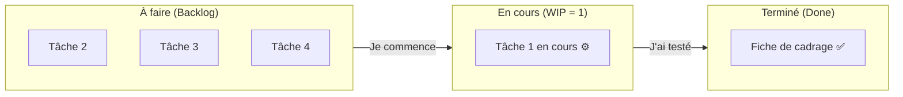

## 1. Contexte & Objectif

- **Objectif :** Créer un tableau Kanban à trois colonnes (*À faire*, *En cours*, *Terminé*), y organiser ses tâches techniques et actualiser leur état au fur et à mesure du développement.
- **Prérequis :** Savoir découper un travail en sous-tâches indépendantes (`T.152.231`).

---

## 2. Théorie Pas-à-Pas

### 2.1. Qu'est-ce qu'un tableau Kanban ?

Le mot **Kanban** vient du japonais et signifie « étiquette visuelle ». C'est un outil très simple utilisé par toutes les équipes de développement dans le monde.

Le tableau permet de visualiser en un coup d'œil :
- Tout ce qu'il reste à faire.
- Ce qui est activement en cours de développement.
- Tout ce qui a déjà été produit et validé.



### 2.2. Les trois colonnes indispensables

1. **À faire :** Les tâches découpées en attente de traitement.
2. **En cours :** La tâche technique sur laquelle vous travaillez activement en ce moment.
3. **Terminé :** Les tâches pour lesquelles le code est écrit, testé et commité sur GitHub.

### 2.3. La règle d'or N1 : Limiter le travail en cours (WIP)

Le piège classique du développeur débutant est de commencer plusieurs choses en même temps et de n'en finir aucune :

> [!IMPORTANT]
> **Règle absolue :** Une seule tâche technique à la fois dans la colonne *« En cours »*.  
> On ne tire une nouvelle tâche de la colonne *« À faire »* que lorsque la tâche précédente a rejoint la colonne *« Terminé »*.

---

## 3. Pratique & Réalisation Guidée

Dans ce sprint S6, vous devez connecter le Blog personnel à une base de données MySQL. Vous allez construire et actualiser votre tableau Kanban.

### 3.1. Préparer les tâches du sprint S6

Les 4 tâches techniques identifiées pour le sprint sont :
- Tâche 1 : Écrire le script de création de la table `articles` dans MySQL.
- Tâche 2 : Configurer le fichier de connexion `config/db.php` avec PDO.
- Tâche 3 : Réaliser la requête `SELECT * FROM articles` en PHP.
- Tâche 4 : Tester l'affichage dynamique des articles dans le navigateur.

### 3.2. Initialiser le tableau Kanban en Markdown

Créez un tableau structuré avec les 3 colonnes :

| À faire | En cours | Terminé |
| :--- | :--- | :--- |
| - Tâche 2 : Connexion PDO (`config/db.php`)<br/>- Tâche 3 : Requête `SELECT`<br/>- Tâche 4 : Recette navigateur | **- Tâche 1 : Script SQL de la table `articles`** | *(Aucune tâche pour l'instant)* |

### 3.3. Faire vivre le tableau au fil de la séance

1. Lorsque le script SQL est écrit et exécuté dans phpMyAdmin avec succès, déplacez la tâche 1 dans *Terminé*.
2. Basculez la tâche 2 dans *En cours* pour coder la connexion PDO :

| À faire | En cours | Terminé |
| :--- | :--- | :--- |
| - Tâche 3 : Requête `SELECT`<br/>- Tâche 4 : Recette navigateur | **- Tâche 2 : Connexion PDO (`config/db.php`)** | - Tâche 1 : Script SQL de la table `articles` ✅ |

En procédant ainsi, votre formateur sait immédiatement sur quoi vous travaillez sans avoir besoin de vous interrompre.

---

## 4. Livrable & Critères de Réussite

### Emplacement dans votre dépôt d'autoformation
Dans votre dépôt GitHub d'autoformation annuel, déposez votre tableau dans :
```text
gestion/rendre-travail-visible/kanban-suivi-sprint/tableau-kanban.md
```

### Contenu attendu du livrable
Le document Markdown `tableau-kanban.md` présentant :
1. Les 4 tâches du sprint S6 réparties dans les 3 colonnes.
2. Le tableau figé à la fin du sprint avec les 4 tâches déplacées dans la colonne *Terminé*.
3. Une note bilan d'une phrase confirmant le respect de la règle d'une seule tâche en cours à la fois.

### Critères de réussite du livrable
- [ ] Le fichier est commité dans le dossier `gestion/rendre-travail-visible/kanban-suivi-sprint/`.
- [ ] Le tableau comporte les trois colonnes standard (*À faire*, *En cours*, *Terminé*).
- [ ] Toutes les tâches sont formulées avec un titre technique clair et un fichier cible.
- [ ] L'état final montre la totalité des tâches dans la colonne *Terminé*.
- [ ] Le document ne contient aucune capture d'écran.

---

## 5. Glossaire

- **Kanban :** Système visuel de gestion du flux de travail sous forme de colonnes d'avancement.
- **WIP (Work In Progress) :** Nombre de tâches traitées simultanément dans la colonne *En cours*.
- **Flux tiré :** Méthode où le développeur prend une tâche de la réserve uniquement lorsqu'il est disponible.
- **Done (Terminé) :** État d'une tâche dont le code est terminé, testé et sauvegardé sur GitHub.
