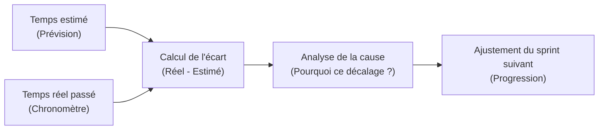

## 1. Contexte & Objectif

- **Objectif :** Noter le temps réel passé sur ses développements, calculer l'écart avec les heures prévues et analyser les causes pour améliorer ses estimations futures.
- **Prérequis :** Savoir estimer une tâche technique (`T.152.221`) et suivre son travail avec un Kanban (`T.152.241`).

---

## 2. Théorie Pas-à-Pas

### 2.1. L'écart n'est pas une faute mais une information

Il est parfaitement normal pour un développeur junior d'avoir des écarts entre son estimation et la réalité :

- **Prendre conscience du temps :** Sans chronométrage, on pense avoir passé 30 minutes alors qu'on a passé 2 heures sur un bug.
- **Progresser continuellement :** Observer ses écarts permet d'ajuster ses prévisions lors des sprints suivants.
- **Garder la confiance de l'équipe :** Un développeur transparent qui annonce ses écarts est beaucoup plus fiable qu'un développeur qui cache son retard.



### 2.2. La formule de calcul de l'écart

On utilise une formule mathématique très simple :

$$\text{Écart} = \text{Temps réel} - \text{Temps estimé}$$

- **Écart positif (+1 h 00) :** La tâche a pris plus de temps que prévu (retard).
- **Écart négatif (-30 min) :** La tâche a été plus rapide que prévu (avance).
- **Écart nul (0 min) :** L'estimation était parfaitement exacte.

### 2.3. Les trois causes courantes d'un dépassement

Lorsqu'un retard survient, analysez toujours la cause :
1. **Sous-estimation technique :** La tâche paraissait simple, mais le code SQL ou PHP était plus difficile que prévu.
2. **Blocage inattendu :** Une erreur de configuration ou un bogue a bloqué le travail pendant 45 minutes.
3. **Périmètre mal compris :** On a développé des détails non demandés dans la consigne.

---

## 3. Pratique & Réalisation Guidée

Dans ce sprint S7, vous devez créer le filtre par catégorie pour les articles du Blog (`filtre.php`). Vous allez comparer votre prévision avec vos temps réels.

### 3.1. Relever les durées constatées

Voici les données enregistrées pendant votre séance de 4 heures :

- **Tâche 1 : Formulaire de sélection HTML/CSS :**
  - Prévu : 45 min
  - Réel : 45 min
- **Tâche 2 : Requête SQL avec clause `WHERE categorie_id = ?` :**
  - Prévu : 1 h 00
  - Réel : 1 h 45 (difficulté avec la syntaxe de la requête préparée PDO)
- **Tâche 3 : Affichage dynamique des résultats et recette :**
  - Prévu : 1 h 15
  - Réel : 1 h 00

### 3.2. Construire le tableau d'analyse des écarts

Complétez le tableau Markdown :

| Tâche technique | Temps estimé | Temps réel | Écart constaté | Cause principale |
| :--- | :---: | :---: | :---: | :--- |
| 1. Formulaire HTML/CSS | 0 h 45 | 0 h 45 | **0 min** | Conforme aux attentes. |
| 2. Requête SQL préparée | 1 h 00 | 1 h 45 | **+ 45 min** | Erreur de paramètre PDO à corriger. |
| 3. Affichage et recette | 1 h 15 | 1 h 00 | **- 15 min** | Réutilisation du composant de carte S5. |
| **Total du sprint** | **3 h 00** | **3 h 30** | **+ 30 min** | Retard absorbé sans dépasser la journée. |

### 3.3. Rédiger la conclusion d'apprentissage

Formulez une conclusion en 2 phrases :
- *« La requête préparée PDO a demandé 45 minutes de plus car la syntaxe des marqueurs `?` n'était pas encore automatisée. »*
- *« Pour le prochain sprint, j'ajouterai 30 minutes de marge sur toute nouvelle manipulation SQL. »*

---

## 4. Livrable & Critères de Réussite

### Emplacement dans votre dépôt d'autoformation
Dans votre dépôt GitHub d'autoformation annuel, déposez votre bilan dans :
```text
gestion/suivre-avancement/mesure-ecarts-temps/bilan-temps-s7.md
```

### Contenu attendu du livrable
Le document Markdown `bilan-temps-s7.md` comprenant :
1. Le tableau comparatif à 5 colonnes (*Tâche*, *Temps estimé*, *Temps réel*, *Écart*, *Cause*).
2. La ligne de totalisation générale du sprint.
3. Le paragraphe d'analyse expliquant ce que vous ferez pour vous améliorer au prochain sprint.

### Critères de réussite du livrable
- [ ] Le fichier est commité dans le dossier `gestion/suivre-avancement/mesure-ecarts-temps/`.
- [ ] Les calculs d'écarts sont mathématiquement justes (avec signes `+` ou `-`).
- [ ] Une cause claire et technique est attribuée à chaque tâche en retard.
- [ ] Le document se conclut par une règle concrète pour le sprint suivant.
- [ ] Le document ne contient aucune capture d'écran.

---

## 5. Glossaire

- **Temps réel :** Durée effectivement passée pour réaliser et tester une tâche.
- **Écart :** Différence numérique entre le temps réel et le temps initialement estimé.
- **Sous-estimation :** Évaluation trop optimiste qui ne prend pas en compte les difficultés potentielles.
- **Rétrospective :** Moment d'analyse où le développeur tire les leçons de son travail passé.
