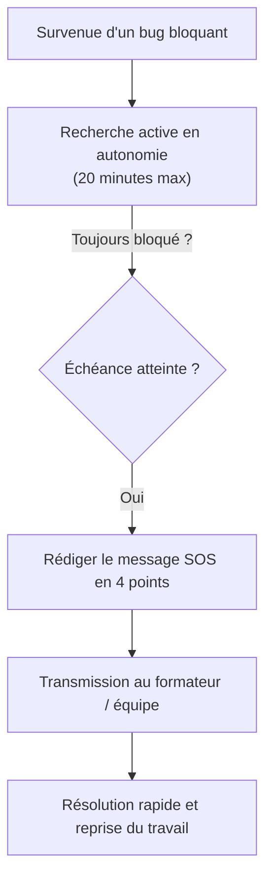

## 1. Contexte & Objectif

- **Objectif :** Déclencher une demande d'aide technique après 20 minutes d'effort infructueux et rédiger un message structuré permettant à un pair ou un formateur de vous débloquer rapidement.
- **Prérequis :** Savoir repérer un message d'erreur dans son terminal ou son navigateur.

---

## 2. Théorie Pas-à-Pas

### 2.1. La règle des 20 minutes face au blocage

Être bloqué par un bug fait partie intégrante du quotidien d'un développeur. Ce qui fait la différence entre un débutant et un professionnel est la manière de gérer ce blocage :

- **Mauvaise réaction :** Rester bloqué 3 heures en silence à essayer au hasard, sans rien comprendre, par peur de déranger.
- **Bonne réaction — La règle des 20 minutes :**
  1. Vous cherchez activement pendant **20 minutes** en lisant l'erreur et la documentation.
  2. Si au bout de 20 minutes vous ne progressez pas, vous formulez **immédiatement** une demande d'aide structurée.



### 2.2. Les quatre sections obligatoires du message SOS

Pour qu'une autre personne puisse vous aider, votre message doit contenir 4 réponses claires :

| Section | Question à laquelle vous répondez | Mauvais exemple à bannir |
| :--- | :--- | :--- |
| **1. Objectif** | Que cherchiez-vous à accomplir ? | *« Mon code marche pas »* |
| **2. Constat** | Quel comportement anormal ou message d'erreur s'affiche ? | *« Y a une erreur rouge bizarre »* |
| **3. Essais** | Qu'avez-vous déjà testé pour résoudre le problème ? | *« J'ai tout essayé »* |
| **4. Blocage précis** | Sur quelle ligne ou quel concept êtes-vous coincé ? | *« Aidez-moi vite svp »* |

---

## 3. Pratique & Réalisation Guidée

Dans ce sprint S8, vous développez l'ajout d'une nouvelle catégorie d'article dans l'espace administration (`admin/ajouter-categorie.php`).

### 3.1. Identifier la situation de blocage

Lors de la soumission de votre formulaire, le message suivant s'affiche à l'écran :
```text
Fatal error: Uncaught PDOException: SQLSTATE[23000]: Integrity constraint violation: 
1048 Column 'nom' cannot be null in /admin/ajouter-categorie.php on line 24
```
Vous avez relu votre code, vérifié la table MySQL, mais vous ne comprenez pas pourquoi la colonne `nom` reçoit une valeur vide. Vous avez atteint les 20 minutes de recherche.

### 3.2. Rédiger le message SOS structuré

Ouvrez un fichier texte et rédigez votre demande selon les 4 points imposés :

```markdown
### 1. Ce que je souhaite accomplir
Insérer une nouvelle catégorie dans la table `categories` depuis le formulaire `admin/ajouter-categorie.php`.

### 2. Ce qui se produit actuellement
L'insertion échoue avec l'erreur PDO :
`SQLSTATE[23000]: Integrity constraint violation: 1048 Column 'nom' cannot be null on line 24`.

### 3. Ce que j'ai déjà essayé
1. J'ai vérifié dans phpMyAdmin : la table `categories` existe bien et la colonne `nom` est en `VARCHAR(100) NOT NULL`.
2. J'ai fait un `var_dump($_POST)` avant la requête : il affiche bien `array(1) { ["nom_categorie"]=> string(5) "Sport" }`.
3. J'ai vérifié ma requête SQL : `INSERT INTO categories (nom) VALUES (:nom)`.

### 4. Le point précis où je suis bloqué
Je ne comprends pas pourquoi ma variable `$nom` passée dans `execute([':nom' => ...])` reste vide alors que le champ du formulaire est bien rempli.
```

Grâce à ce message précis, la personne qui vous aide voit immédiatement l'erreur en 5 secondes : le champ du formulaire s'appelle `nom_categorie` dans `$_POST`, mais vous avez écrit `$_POST['nom']` dans votre code PHP !

---

## 4. Livrable & Critères de Réussite

### Emplacement dans votre dépôt d'autoformation
Dans votre dépôt GitHub d'autoformation annuel, déposez votre message dans :
```text
gestion/signaler-blocage/demande-aide-structuree/message-sos.md
```

### Contenu attendu du livrable
Le document Markdown `message-sos.md` comprenant :
1. Le contexte précis du bug rencontré.
2. Les 4 sections standard rédigées avec précision (*Objectif*, *Constat*, *Essais réalisés*, *Point de blocage précis*).
3. Le texte exact du message d'erreur relevé.

### Critères de réussite du livrable
- [ ] Le fichier est commité dans le dossier `gestion/signaler-blocage/demande-aide-structuree/`.
- [ ] Les 4 sections obligatoires sont toutes présentes et complétées.
- [ ] Le message d'erreur réel est copié fidèlement.
- [ ] La section des essais démontre que l'apprenant a cherché de manière autonome pendant 20 minutes.
- [ ] Le document ne contient aucune capture d'écran.

---

## 5. Glossaire

- **Blocage technique :** Situation où le développeur ne peut plus avancer en raison d'une erreur non résolue.
- **Message SOS :** Format standardisé de demande d'aide technique fournissant tout le contexte nécessaire en un seul message.
- **Integrity constraint :** Règle de base de données interdisant d'enregistrer une valeur vide (`NULL`) dans un champ obligatoire.
- **var_dump() :** Fonction PHP indispensable pour inspecter le contenu réel d'une variable à l'écran.
