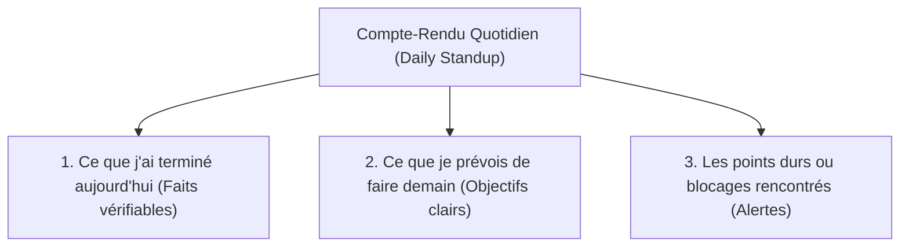

## 1. Contexte & Objectif

- **Objectif :** Rédiger un compte-rendu d'activité journalier (Daily Reporting) clair et synthétique, structuré autour des 3 questions clés de l'industrie logicielle.
- **Prérequis :** Savoir suivre ses tâches avec un tableau Kanban (`T.152.241`) et formuler un blocage (`T.152.261`).

---

## 2. Théorie Pas-à-Pas

### 2.1. Pourquoi rendre compte chaque jour ?

Dans une entreprise comme en centre de formation, le travail invisible n'existe pas :

- **Rassurer son tuteur ou formateur :** Montrer que le projet avance conformément au planning.
- **Valoriser sa contribution :** Garder une trace écrite des fonctionnalités que vous avez personnellement conçues et testées.
- **Détecter les risques rapidement :** Si une tâche traîne depuis deux jours, le compte-rendu permet au tuteur d'intervenir pour vous aider avant que le retard ne s'accumule.



### 2.2. La règle des faits vérifiables

Un bon compte-rendu évite les phrases vagues :
- Mauvais reporting : *« J'ai bien codé aujourd'hui et j'ai fait du PHP »*.
- Bon reporting professionnel : *« J'ai terminé le script `admin/creer-article.php` avec validation du titre et insertion dans la table `articles` (commit validé sur GitHub) »*.

### 2.3. La structure standard en 3 volets

1. **Ce qui a été réalisé :** Liste à puces des tâches terminées avec les noms des fichiers produits.
2. **Ce qui est prévu ensuite :** Les 1 ou 2 prochaines sous-tâches tirées du tableau Kanban pour le lendemain.
3. **Difficultés et points de vigilance :** Les alertes éventuelles nécessitant une clarification du formateur.

---

## 3. Pratique & Réalisation Guidée

Dans ce sprint S9, vous développez la gestion complète des articles dans l'administration du Blog. À la fin de votre journée de développement, vous rédigez votre reporting quotidien.

### 3.1. Faire le bilan de sa journée de développement

Pendant la journée, vous avez :
- Créé le formulaire d'ajout d'article `admin/form-article.php` avec les champs titre, contenu et catégorie.
- Écrit le traitement POST `admin/enregistrer-article.php` pour sauvegarder l'article en base de données.
- Rencontré une difficulté sur l'upload de l'image de couverture qui n'enregistre pas le bon chemin de dossier.

### 3.2. Rédiger le compte-rendu en Markdown

Rédigez le message synthétique structuré :

```markdown
# Daily Reporting — Session S9 (Fin de journée)

**Développeur :** [Votre Prénom et Nom]  
**Date :** 25 octobre 2026  
**Sprint :** S9 — CRUD Articles Admin  

### 1. Ce que j'ai réalisé aujourd'hui
- Création de la vue formulaire `admin/form-article.php` (champs titre, catégorie et zone de texte).
- Écriture du script d'insertion `admin/enregistrer-article.php` avec requête préparée PDO.
- Test d'insertion validé : 2 articles de test enregistrés avec succès dans MySQL.
- Code commité et poussé sur la branche `sprint-9`.

### 2. Ce qui est prévu demain
- Traiter l'upload de l'image d'illustration de l'article vers le dossier `uploads/`.
- Construire la page de liste des articles dans le tableau de bord admin (`admin/liste-articles.php`).

### 3. Difficultés / Points d'alerte
- L'image est bien envoyée dans `$_FILES`, mais la fonction `move_uploaded_file()` échoue en raison d'un problème de droits d'accès sur le dossier `uploads/`. Si le problème persiste demain matin après 20 minutes, j'enverrai un message SOS.
```

---

## 4. Livrable & Critères de Réussite

### Emplacement dans votre dépôt d'autoformation
Dans votre dépôt GitHub d'autoformation annuel, déposez votre compte-rendu dans :
```text
gestion/rendre-compte/compte-rendu-quotidien/daily-reporting-s9.md
```

### Contenu attendu du livrable
Le document Markdown `daily-reporting-s9.md` comprenant :
1. L'en-tête identifiant le développeur, la date et le sprint concerné.
2. Les 3 sections obligatoires (*Réalisé aujourd'hui*, *Prévu demain*, *Difficultés/Alertes*).
3. La mention des fichiers techniques modifiés et des commits effectués.

### Critères de réussite du livrable
- [ ] Le fichier est commité dans le dossier `gestion/rendre-compte/compte-rendu-quotidien/`.
- [ ] Les 3 sections du Daily Standup sont toutes complétées.
- [ ] Les réalisations s'appuient sur des livrables et fichiers concrets.
- [ ] Les prévisions pour le lendemain sont limitées à 1 ou 2 actions précises.
- [ ] Le document ne contient aucune capture d'écran.

---

## 5. Glossaire

- **Daily Reporting :** Synthèse quotidienne courte de l'avancement individuel d'un développeur.
- **Daily Standup :** Courte réunion matinale (10 à 15 minutes debout) où chaque membre d'une équipe agile partage ses 3 volets.
- **Factuel :** Qualifie une information basée sur des preuves observables (fichiers, commits, tests) plutôt que sur des impressions.
- **Point de vigilance :** Risque potentiel identifié avant qu'il ne devienne un retard bloquant pour le projet.
