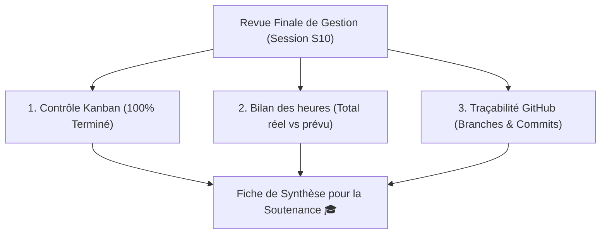

## 1. Contexte & Objectif

- **Objectif :** Effectuer la revue finale de l'ensemble de ses outils de gestion (tableau Kanban complet, historique des temps, conformité des livrables) et rédiger la synthèse méthodologique pour la soutenance.
- **Prérequis :** Avoir appliqué les méthodes de gestion tout au long des sprints S2 à S9 (`T.152.21` à `T.152.27`).

---

## 2. Théorie Pas-à-Pas

### 2.1. Qu'est-ce que la revue finale de gestion ?

À l'approche de la fin du cycle de développement (Session S10), le développeur ne se contente pas de vérifier que le code tourne :

- **Prouver sa rigueur méthodologique :** Montrer que le projet a été construit étape par étape sans improvisation.
- **Consolider les données du projet :** Rassembler dans un document unique les heures consommées, les tâches livrées et les difficultés surmontées.
- **Préparer la soutenance technique :** Fournir au jury les preuves concrètes de votre autonomie et de votre sens de l'organisation.



### 2.2. Les trois piliers de la traçabilité professionnelle

1. **Le tableau Kanban à jour :** Aucune tâche fantôme abandonnée dans la colonne *« En cours »*.
2. **Le bilan des heures :** Un tableau synthétique présentant le cumul des heures prévues et réelles sur les grands modules (HTML/CSS, Base de données, Back-Office, Sécurité).
3. **L'historique des commits GitHub :** Des messages de commit clairs qui correspondent exactement aux fiches de tâches découpées.

### 2.3. La valeur ajoutée pour un développeur N1

En entreprise, un développeur qui sait expliquer son organisation et justifier son temps est immédiatement perçu comme mature, fiable et prêt à collaborer en équipe.

---

## 3. Pratique & Réalisation Guidée

Dans cette session S10, vous finalisez l'espace d'authentification et vous dressez le bilan méthodologique de votre projet de Blog.

### 3.1. Consolider le tableau des heures par grand module

Faites la somme des heures investies sur le projet du Blog personnel :

| Module du projet | Sessions | Heures prévues | Heures réelles | Écart global |
| :--- | :---: | :---: | :---: | :---: |
| 1. Maquette & Intégration HTML/CSS | S1 à S3 | 15 h 00 | 16 h 30 | + 1 h 30 |
| 2. Programmation dynamique & Fonctions | S4 à S5 | 12 h 00 | 12 h 00 | 0 h 00 |
| 3. Base de données & Filtres SQL | S6 à S7 | 12 h 00 | 14 h 00 | + 2 h 00 |
| 4. Back-Office Admin & CRUD | S8 à S9 | 14 h 00 | 15 h 30 | + 1 h 30 |
| 5. Authentification & Sécurité | S10 | 07 h 00 | 06 h 00 | - 1 h 00 |
| **Total Général** | **S1 à S10** | **60 h 00** | **64 h 00** | **+ 4 h 00** |

### 3.2. Rédiger la fiche de synthèse pour le jury

Complétez votre document de synthèse finale :

```markdown
# Synthèse Globale de Gestion de Projet — Blog Personnel

**Développeur :** [Votre Prénom et Nom]  
**Projet :** Blog Personnel N1 (Sessions S1 à S10)  
**Volume horaire total :** 64 heures réelles (pour 60 heures prévues)  

### 1. Bilan d'avancement des fonctionnalités
- ✅ Page d'accueil et détail des articles (HTML5 sémantique et CSS responsive).
- ✅ Base de données MySQL relationnelle opérationnelle (articles et catégories).
- ✅ Espace d'administration complet avec gestion CRUD sécurisée.
- ✅ Authentification administrateur avec sessions PHP et mots de passe hachés.

### 2. Analyse méthodologique
- **Tableau Kanban :** 100% des tâches sont soldées et déplacées dans la colonne *Terminé*.
- **Gestion des écarts de temps :** Le décalage total est de +4 heures (+6,6%), principalement concentré sur les requêtes préparées PDO en S6/S7. Ce temps a été compensé par une plus grande rapidité sur le module de sécurité en S10.
- **Gestion des blocages :** 3 messages SOS ont été formulés selon le standard en 4 points, résolus en moins de 15 minutes avec le formateur.
```

---

## 4. Livrable & Critères de Réussite

### Emplacement dans votre dépôt d'autoformation
Dans votre dépôt GitHub d'autoformation annuel, déposez votre bilan dans :
```text
gestion/maintenir-suivi/revue-finale-gestion/synthese-projet-s10.md
```

### Contenu attendu du livrable
Le document Markdown `synthese-projet-s10.md` comprenant :
1. Le tableau récapitulatif des heures par grand module avec totaux généraux.
2. L'état d'avancement de toutes les fonctionnalités majeures livrées.
3. Le retour d'expérience méthodologique (Kanban, écarts et blocages).

### Critères de réussite du livrable
- [ ] Le fichier est commité dans le dossier `gestion/maintenir-suivi/revue-finale-gestion/`.
- [ ] Le tableau horaire couvre l'ensemble des modules du projet avec des calculs exacts.
- [ ] Toutes les fonctionnalités développées sont mentionnées avec leur statut final.
- [ ] Le bilan méthodologique analyse concrètement les points forts et axes de progrès.
- [ ] Le document ne contient aucune capture d'écran.

---

## 5. Glossaire

- **Revue finale :** Évaluation globale et définitive de la conformité des livrables et des processus d'un projet.
- **Traçabilité :** Capacité à prouver et retrouver l'historique de chaque action technique réalisée.
- **Soutenance technique :** Présentation orale au cours de laquelle le développeur démontre le fonctionnement de son application et son organisation.
- **Bilan méthodologique :** Analyse critique de ses méthodes d'organisation pour mesurer son évolution professionnelle.
