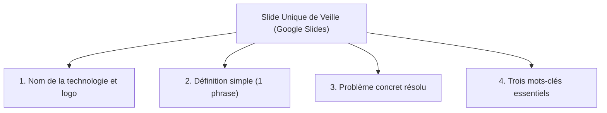
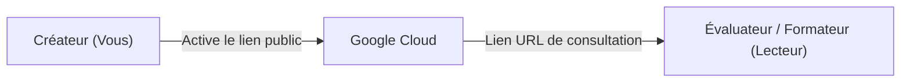

## 1. Objectif

Dans ce premier tutoriel de veille technologique, vous allez découvrir l'outil de présentation en ligne Google Slides et créer la **slide modèle** qui servira de support pour toutes vos restitutions de veille durant votre formation.

Vous allez apprendre à :
* créer une présentation synthétique d'une seule slide ;
* structurer les informations essentielles selon le standard de veille Spartel N1 ;
* configurer les droits d'accès public en mode « Lecteur » ;
* copier et vérifier le lien de partage dans une fenêtre privée.

## 2. Prérequis

* Disposer d'un compte Google (Gmail).
* Savoir utiliser un navigateur Web et ouvrir un nouvel onglet.

---

## Partie 1 — Théorie

### 1.1. Le principe de la slide unique de veille

En niveau N1, l'exercice de veille technologique vise l'esprit de synthèse, la clarté et l'autonomie documentaire.
Pour éviter les exposés trop longs et maintenir l'attention de l'auditoire, chaque veille tient sur **une seule slide** présentée en 3 minutes maximum.



### 1.2. Les droits d'accès d'un document en ligne

Lorsque vous partagez un document via Google Slides, trois rôles sont possibles :

| Rôle | Ce que le destinataire peut faire | Usage recommandé |
| :--- | :--- | :--- |
| **Lecteur** | Consulter le document sans rien modifier | **Idéal pour la veille et les rendus de livrables** |
| **Commentateur** | Lire et ajouter des annotations dans la marge | Travail collaboratif et retours du formateur |
| **Éditeur** | Modifier directement le texte, les images et la mise en page | Travail d'équipe en binôme |

Pour vos livrables de veille, choisissez systématiquement le rôle **Lecteur**.

### 1.3. Le cycle du partage par lien

Pour que votre formateur ou vos pairs puissent évaluer votre travail, le document doit être accessible à toute personne disposant de l'adresse URL :



---

## Partie 2 — Pratique

### 2.1. Exercice d'application : Créer et configurer votre slide modèle

Dans cet exercice, vous allez créer votre présentation de veille initiale, la compléter avec votre profil de développeur apprenant, et générer son lien public.

#### Étape 1 : Créer la présentation Google Slides
1. Rendez-vous sur [Google Slides](https://slides.google.com).
2. Cliquez sur **Créer une présentation vierge** (+).
3. Renommez le document en haut à gauche : `Veille N1 — [Votre Prénom et Nom]`.

#### Étape 2 : Mettre en page la slide modèle
Conservez **une seule slide** et appliquez la structure suivante :

```text
[Titre] : Veille Technologique — Profil Développeur N1
[Sous-titre] : Présenté par [Votre Prénom et Nom] — Session S1

1. Qui suis-je ?
   Apprenant développeur Web & Mobile à la Spartel Dev Academy.

2. Mon projet cible :
   Développer une application Web complète de Blog personnel en HTML, CSS, JavaScript et PHP.

3. Ce que m'apporte la veille technologique :
   Découvrir les technologies professionnelles, comprendre leur utilité concrète et anticiper les futurs sprints.

4. Mes 3 mots-clés d'apprentissage :
   Curiosité — Pratique active — Rigueur
```

#### Étape 3 : Activer le partage public
1. Cliquez sur le bouton bleu **Partager** en haut à droite.
2. Dans la section *Accès général*, modifiez *Limité* par : **Tous les utilisateurs disposant du lien**.
3. Assurez-vous que le rôle sélectionné à droite est bien **Lecteur**.
4. Cliquez sur **Copier le lien**.

#### Étape 4 : Tester le lien d'accès
1. Ouvrez une nouvelle fenêtre en **Navigation privée** (`Ctrl + Maj + N`).
2. Collez l'URL copiée dans la barre d'adresse et validez.
3. Vérifiez que la slide s'affiche correctement sans demander de mot de passe ni de connexion Google.

### 2.2. Livrable attendu

Dans votre dépôt annuel de travail, créez le fichier Markdown suivant pour consigner votre travail :

```text
veille/culture-web/partage-google-slides/lien.md
```

**Contenu à inscrire dans votre fichier `lien.md` :**
```markdown
# Livrable de Veille : Présentation Google Slides

- **Auteur :** [Votre Prénom et Nom]
- **Session :** S1 — Premiers pas dans le Web
- **Lien public de la présentation :** [Coller ici votre URL Google Slides]

## Synthèse de la slide
- **Profil :** Apprenant développeur Web N1
- **Projet fil rouge :** Blog personnel
- **Objectif :** Maîtriser le format de restitution de veille en 1 slide
```

Commitez et poussez votre fichier sur votre dépôt GitHub.

### Critères de réussite

* La présentation Google Slides ne comporte qu'une seule slide structurée.
* Le paramètre d'accès est configuré sur *« Tous les utilisateurs disposant du lien »* avec le rôle *Lecteur*.
* Le lien testé en navigation privée s'ouvre sans aucune restriction d'accès.
* Le fichier `lien.md` est commité dans le dépôt à l'emplacement indiqué.

---

## Bilan

* Vous disposez désormais du support et de la méthode standardisés pour mener l'ensemble des veilles du cursus.
* Une restitution efficace repose sur la concision : une seule slide claire vaut mieux qu'un long document verbeux.
* Le partage en lecture seule garantit l'accès immédiat à vos travaux pour votre formateur et vos pairs.

## Glossaire

* **Google Slides** : Outil bureautique en ligne gratuit permettant de concevoir et partager des présentations.
* **Slide de veille** : Page unique synthétisant l'essentiel d'une technologie ou d'un sujet technique.
* **Lien de partage** : Adresse Web (URL) permettant à un tiers d'accéder à un document distant.
* **Droit Lecteur** : Niveau d'autorisation permettant uniquement la visualisation du contenu, sans possibilité d'altération.