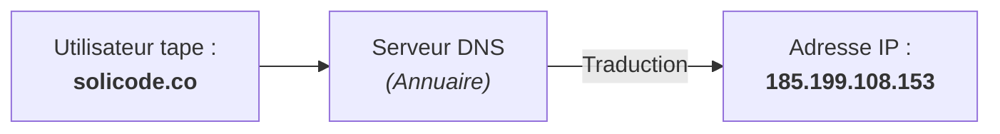
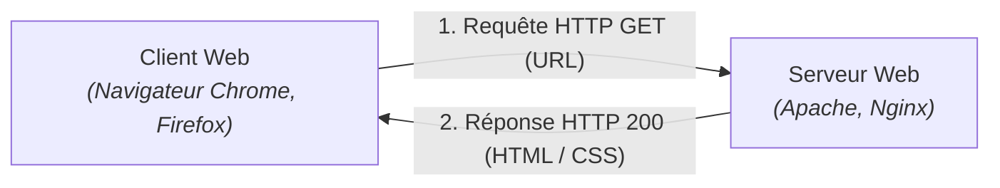
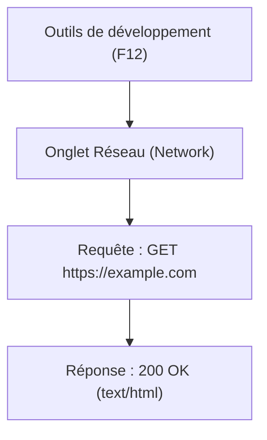

## 1. Objectif

Dans ce tutoriel, vous allez comprendre comment fonctionnent les technologies fondamentales qui permettent d'afficher une page Web sur votre écran.

Vous allez apprendre à :
* distinguer formellement le réseau **Internet** du service **Web** ;
* comprendre les rôles d'une **adresse IP** et du système **DNS** à l'aide d'analogies concrètes ;
* décrire le modèle d'échange **Client / Serveur** via le protocole **HTTP** ;
* observer concrètement le trajet d'une requête Web dans les outils de développement de votre navigateur.

## 2. Prérequis

* Avoir suivi le tutoriel [Créer et partager une présentation de veille](/tutos/partage-google-slides/).
* Savoir ouvrir un navigateur Web.

---

## Partie 1 — Théorie

### 1.1. Ne confondez plus Internet et le Web

Bien que souvent utilisés comme synonymes, Internet et le Web désignent deux réalités distinctes :

* **Internet (l'infrastructure) :** C'est le réseau physique mondial de câbles, de routeurs et d'ordinateurs connectés entre eux.  
  *Analogie :* C'est le **réseau routier** mondial composé d'autoroutes et de routes.
* **Le Web (le service) :** C'est l'ensemble des pages, des sites et des applications multimédias qui circulent sur ce réseau grâce à des liens hypertextes.  
  *Analogie :* Ce sont les **véhicules et camions de livraison** qui circulent sur ce réseau routier.

> **À retenir :** D'autres services utilisent Internet sans être le Web (les e-mails, le transfert de fichiers FTP, les jeux en ligne ou les applications de messagerie).

### 1.2. Comment deux machines se trouvent-elles ? (IP et DNS)

Chaque appareil connecté à Internet possède une adresse numérique unique appelée **Adresse IP** (ex: `142.250.74.206`).
* **L'adresse IP :** C'est l'équivalent de l'**adresse postale** de votre maison.
* **Le DNS (Domain Name System) :** Comme il est difficile pour un humain de mémoriser des suites de chiffres, le DNS agit comme un **annuaire téléphonique** géant : il traduit automatiquement le nom lisible d'un site (`google.com`) en son adresse IP numérique.



### 1.3. L'architecture Client / Serveur et le protocole HTTP

Toute navigation sur le Web repose sur un dialogue structuré entre deux acteurs :
1. **Le Client (votre navigateur) :** Il passe une commande en envoyant une **Requête HTTP** (ex: *« Donne-moi la page d'accueil »*).
2. **Le Serveur (l'ordinateur distant) :** Il reçoit la demande, la traite, et renvoie une **Réponse HTTP** contenant le code de la page (HTML, CSS, images).
3. **Le protocole HTTP :** C'est la **langue commune** normalisée parlée par le client et le serveur.



---

## Partie 2 — Pratique

### 2.1. Exercice d'application : Observer une requête HTTP en direct

Dans cet exercice, vous allez ouvrir les outils d'inspection de votre navigateur pour visualiser le dialogue réel entre votre ordinateur et un serveur Web.

#### Étape 1 : Ouvrir les outils de développement
1. Dans votre navigateur (Google Chrome ou Mozilla Firefox), appuyez sur la touche **F12** (ou faites un clic droit n'importe où sur une page puis cliquez sur **Inspecter**).
2. Dans le panneau qui s'affiche, cliquez sur l'onglet **Réseau** (ou *Network*).

#### Étape 2 : Déclencher un échange Client / Serveur
1. Dans la barre d'adresse, saisissez l'adresse : `https://example.com` et appuyez sur **Entrée**.
2. Observez la liste des lignes qui s'affichent dans l'onglet Réseau.

#### Étape 3 : Analyser la réponse
Cliquez sur la première ligne nommée `example.com` et observez les informations techniques réelles :
* **Request Method :** `GET` (demande de lecture).
* **Status Code :** `200 OK` (le serveur confirme que la page a été trouvée et renvoyée avec succès).
* **Remote Address :** L'adresse IP du serveur distant.
* **Response Headers :** Le type de contenu renvoyé (`Content-Type: text/html`).



### 2.2. Livrable attendu

1. Ajoutez **une nouvelle slide** dans votre présentation Google Slides de veille (créée dans T.161.111).
2. Titre de la slide : **« Comment fonctionne Internet et le Web ? »**.
3. Présentez sur cette slide :
   * La différence entre Internet (réseau) et le Web (service) en 2 phrases simples.
   * Le rôle du Client, du Serveur et du protocole HTTP.
   * Le schéma du trajet de votre requête test observée dans l'inspecteur.
4. Dans votre dépôt annuel de travail, créez le fichier de traçabilité :

```text
veille/culture-web/comprendre-internet-web/requete-http.md
```

**Contenu de votre fichier `requete-http.md` :**
```markdown
# Livrable : Comprendre Internet et le Web

- **Auteur :** [Votre Prénom et Nom]
- **Session :** S1
- **Lien de la présentation mise à jour :** [Coller votre lien Google Slides]

## Synthèse de la requête observée
- **Site testé :** https://example.com
- **Méthode HTTP :** GET
- **Code de statut :** 200 OK
- **Rôle du DNS :** A converti le domaine example.com en adresse IP
```

Commitez et poussez votre fichier sur votre dépôt GitHub.

### Critères de réussite

* Vous savez expliquer oralement la distinction entre Internet et le Web sans hésiter.
* La slide Google Slides résume les rôles du Client, du Serveur et de l'annuaire DNS.
* Le code de statut `200 OK` d'une requête HTTP réelle a été observé dans l'inspecteur F12.
* Le fichier `requete-http.md` est commité dans votre dépôt.

---

## Bilan

* **Internet** est l'infrastructure globale de télécommunication reliant les ordinateurs à l'échelle planétaire.
* **Le Web** est une application d'Internet fonctionnant sur le modèle **Client / Serveur**.
* Le navigateur envoie des requêtes **HTTP**, le **DNS** localise le serveur grâce à son **adresse IP**, et le serveur renvoie les fichiers nécessaires à l'affichage.

## Glossaire

* **Internet** : Réseau informatique mondial reliant des millions d'ordinateurs via des liaisons filaires ou sans fil.
* **Web (World Wide Web)** : Système hypertexte fonctionnant sur Internet permettant de consulter des pages avec un navigateur.
* **Adresse IP** : Identifiant numérique unique attribué à chaque appareil connecté au réseau.
* **DNS (Domain Name System)** : Système traduisant les noms de domaine textuels en adresses IP compréhensibles par les machines.
* **Client Web** : Logiciel (navigateur) qui émet une requête de consultation vers un serveur.
* **Serveur Web** : Ordinateur hébergeant les fichiers d'un site et répondant aux requêtes des clients.
* **HTTP (Hypertext Transfer Protocol)** : Protocole de communication standard définissant les règles d'échange entre client et serveur Web.