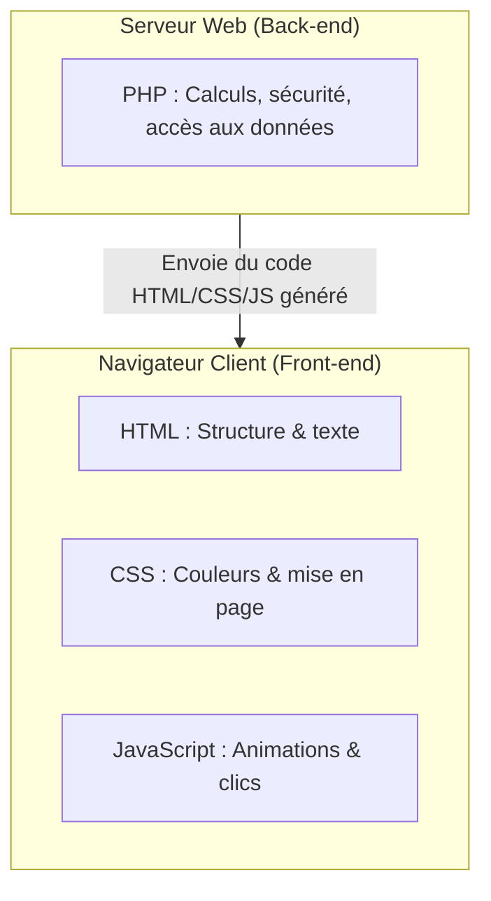

## 1. Objectif

Dans ce tutoriel, vous allez découvrir le rôle et la complémentarité des 4 langages incontournables qui composent une application Web moderne : **HTML**, **CSS**, **JavaScript** et **PHP**.

Vous allez apprendre à :
* comprendre la responsabilité unique de chaque langage ;
* distinguer les langages exécutés par le navigateur (Front-end) du langage exécuté par le serveur (Back-end) ;
* identifier comment ces 4 technologies collaborent pour afficher un article de blog complet.

## 2. Prérequis

* Avoir suivi le tutoriel [Comprendre le fonctionnement d'Internet et du Web](/tutos/comprendre-internet-web/).

---

## Partie 1 — Théorie

### 1.1. L'analogie de la maison

Pour mémoriser facilement le rôle de chaque langage, imaginez la construction d'une maison :

* **HTML (La structure) :** Ce sont les fondations, les murs, les portes et les fenêtres. Il donne du sens au contenu (titres, paragraphes, images).
* **CSS (L'esthétique) :** C'est la peinture, le carrelage, les rideaux et la décoration. Il habille la structure avec des couleurs, des polices et des marges.
* **JavaScript (L'interactivité) :** C'est l'électricité, la sonnette, l'ouverture automatique de la porte de garage. Il rend la page vivante et réagit aux actions de l'utilisateur.
* **PHP (Le moteur d'approvisionnement) :** C'est l'atelier ou le magasinier en coulisses. Il va chercher les matériaux dans la réserve (la base de données) et prépare le colis avant de l'expédier.

### 1.2. Front-end vs Back-end : Où s'exécute chaque langage ?



| Langage | Rôle principal | Lieu d'exécution | Exemple concret |
| :--- | :--- | :--- | :--- |
| **HTML** | Structurer le contenu sémantiquement | Navigateur (Client) | `<h1>Titre de mon article</h1>` |
| **CSS** | Définir le style visuel et le design | Navigateur (Client) | `h1 { color: #2563eb; }` |
| **JavaScript** | Gérer les événements et l'interactivité | Navigateur (Client) | Clic sur un bouton « Like » |
| **PHP** | Générer les pages et interroger la BDD | Serveur (Back-end) | Récupérer les 5 derniers articles |

---

## Partie 2 — Pratique

### 2.1. Exercice d'application : Identifier les langages sur une carte d'article

Dans cet exercice, vous allez analyser un composant visuel de l'application Blog (une carte d'article) et associer chaque élément au langage qui le prend en charge.

#### Étape 1 : Observer les composants de la carte
Une carte d'article de blog comporte :
1. Un titre `Mon premier voyage`, une image et une date de publication.
2. Un cadre avec une bordure arrondie, une ombre douce et un fond blanc.
3. Un bouton « Lire la suite » qui change de couleur au survol et affiche un message.
4. Une liste d'articles mise à jour dynamiquement selon l'auteur connecté.

#### Étape 2 : Répartir les responsabilités
Associez chaque élément au langage responsable :
* Le titre et l'image → **HTML**
* L'arrondi, les couleurs et les ombres → **CSS**
* L'animation interactive au clic → **JavaScript**
* La sélection des articles en base de données → **PHP**

### 2.2. Livrable attendu

1. Ajoutez **une slide** à votre présentation Google Slides de veille.
2. Titre de la slide : **« Les 4 langages fondamentaux du Web »**.
3. Présentez sur votre slide un tableau clair ou une infographie résumant le rôle des 4 langages et leur lieu d'exécution.
4. Dans votre dépôt de travail, créez le fichier de synthèse :

```text
veille/culture-web/langages-fondamentaux/synthese.md
```

**Contenu de votre fichier `synthese.md` :**
```markdown
# Livrable : Les 4 langages du Web

- **Auteur :** [Votre Prénom et Nom]
- **Session :** S1
- **Lien de la présentation :** [Coller votre lien Google Slides]

## Rôles résumés
- **HTML :** Structure le contenu.
- **CSS :** Met en forme et stylise.
- **JavaScript :** Dynamise l'interface côté client.
- **PHP :** Traite la logique et génère le contenu côté serveur.
```

Commitez et poussez votre fichier sur votre dépôt GitHub.

### Critères de réussite

* Vous savez nommer les 4 langages et expliquer le rôle de chacun avec une phrase simple.
* Vous savez différencier un langage Front-end (exécuté par le navigateur) d'un langage Back-end (exécuté par le serveur).
* Le fichier `synthese.md` est commité dans votre dépôt d'autoformation.

---

## Bilan

* Une page Web résulte de la collaboration ordonnée de plusieurs technologies complémentaires.
* **HTML**, **CSS** et **JavaScript** forment le trio du Front-end, exécuté directement sur votre machine.
* **PHP** opère en amont sur le serveur pour préparer les données avant leur expédition.

## Glossaire

* **HTML (HyperText Markup Language)** : Langage de balisage servant à structurer le contenu d'une page Web.
* **CSS (Cascading Style Sheets)** : Langage de feuilles de style utilisé pour mettre en forme les pages Web.
* **JavaScript** : Langage de programmation de scripts s'exécutant dans le navigateur pour animer les pages.
* **PHP (Hypertext Preprocessor)** : Langage de script exécuté côté serveur pour concevoir des pages Web dynamiques.
* **Front-end** : Partie visible d'une application s'exécutant sur le terminal de l'utilisateur.
* **Back-end** : Partie cachée d'une application s'exécutant sur le serveur distant.