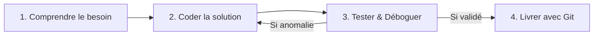
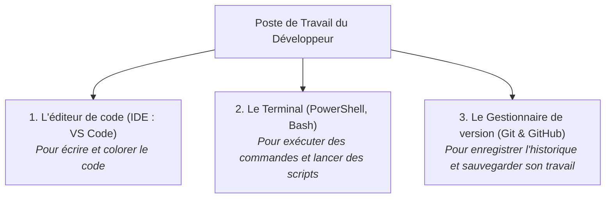

## 1. Objectif

Dans ce tutoriel, vous allez découvrir les activités quotidiennes d'un développeur Web et vous familiariser avec sa boîte à outils professionnelle : **l'éditeur de code (IDE)**, **le terminal** et **le gestionnaire de versions (Git)**.

Vous allez apprendre à :
* identifier les 3 missions clés d'un développeur (concevoir, coder, tester) ;
* distinguer les rôles de VS Code, du terminal et de Git/GitHub ;
* adopter la posture méthodique d'un développeur en niveau N1.

## 2. Prérequis

* Avoir suivi le tutoriel [Identifier les 4 langages fondamentaux du Web](/tutos/langages-fondamentaux-web/).

---

## Partie 1 — Théorie

### 1.1. Que fait un développeur au quotidien ?

Contrairement à l'idée reçue, un développeur ne passe pas tout son temps à taper du code à toute vitesse :
1. **Comprendre & Concevoir (40% du temps) :** Lire le besoin du client, observer les maquettes, découper le problème en sous-étapes logiques.
2. **Écrire le code (30% du temps) :** Rédiger des instructions claires, propres et commentées en respectant les standards du langage.
3. **Tester & Déboguer (30% du temps) :** Exécuter le programme, traquer les erreurs (bugs), vérifier que le résultat correspond exactement à l'attente.



### 1.2. La boîte à outils indispensable

Un développeur moderne s'appuie au quotidien sur trois outils complémentaires :



| Outil | Nom courant | Rôle essentiel |
| :--- | :--- | :--- |
| **Éditeur de code** | Visual Studio Code | Fournit la coloration syntaxique, l'autocomplétion et la détection d'erreurs. |
| **Terminal / Console** | PowerShell, Bash | Permet de dialoguer avec le système et d'exécuter des programmes (ex: `node script.js`). |
| **Gestionnaire de versions** | Git / GitHub | Agit comme une « machine à remonter le temps » pour sécuriser et partager son code. |

---

## Partie 2 — Pratique

### 2.1. Exercice d'application : Cartographier son environnement de travail

Dans cet exercice, vous allez rédiger une fiche de synthèse personnelle sur votre environnement de développement N1.

#### Étape 1 : Vérifier la présence de vos outils
1. Ouvrez **Visual Studio Code** sur votre machine.
2. Ouvrez le terminal intégré (`Ctrl + ù` ou `Terminal > Nouveau Terminal`).
3. Tapez `git --version` pour vérifier que Git est opérationnel.
4. Tapez `node --version` pour vérifier que le moteur JavaScript Node.js est accessible.

#### Étape 2 : Synthétiser vos découvertes
Rédigez 3 points clés décrivant comment vous utiliserez ces outils pour construire le projet Blog :
* Mon éditeur pour taper mes fichiers HTML, CSS et JS.
* Mon terminal pour tester mes scripts sans passer par un serveur lourd.
* Mon dépôt GitHub pour archiver chaque étape validée.

### 2.2. Livrable attendu

1. Ajoutez **une slide** à votre présentation Google Slides de veille.
2. Titre de la slide : **« Le métier et les outils du développeur N1 »**.
3. Présentez sur votre slide les 3 outils majeurs (IDE, Terminal, Git) et les qualités essentielles d'un développeur (rigueur, curiosité, persévérance).
4. Dans votre dépôt d'autoformation, créez le fichier de synthèse :

```text
veille/culture-web/metier-developpeur/outils.md
```

**Contenu de votre fichier `outils.md` :**
```markdown
# Livrable : Métier et outils du développeur

- **Auteur :** [Votre Prénom et Nom]
- **Session :** S1
- **Lien de la présentation :** [Coller votre lien Google Slides]

## Ma boîte à outils N1
- **IDE :** Visual Studio Code
- **Terminal :** PowerShell / Bash
- **Gestion de version :** Git et GitHub
- **Compétence clé développée :** Tester méthodiquement son code avant de le valider
```

Commitez et poussez votre fichier sur votre dépôt GitHub.

### Critères de réussite

* Vous savez nommer et expliquer l'utilité des 3 outils principaux du développeur.
* Vous avez vérifié la présence de Git et Node.js dans votre terminal.
* Le fichier `outils.md` est commité dans votre dépôt d'autoformation.

---

## Bilan

* Le métier de développeur repose autant sur la réflexion et le test que sur l'écriture du code.
* L'IDE, le terminal et Git constituent le socle technique indispensable à tout projet informatique.
* En maîtrisant ces outils dès le niveau N1, vous gagnez en efficacité et en autonomie.

## Glossaire

* **IDE (Integrated Development Environment)** : Logiciel combinant un éditeur de texte et des outils d'assistance au codage.
* **Terminal** : Interface textuelle permettant d'envoyer directement des commandes au système d'exploitation.
* **Git** : Système de contrôle de versions décentralisé permettant d'enregistrer l'historique des modifications d'un projet.
* **Bug** : Erreur ou anomalie de conception dans un programme provoquant un comportement inattendu.
* **Débogage** : Action méthodique visant à identifier, isoler et corriger un bug.